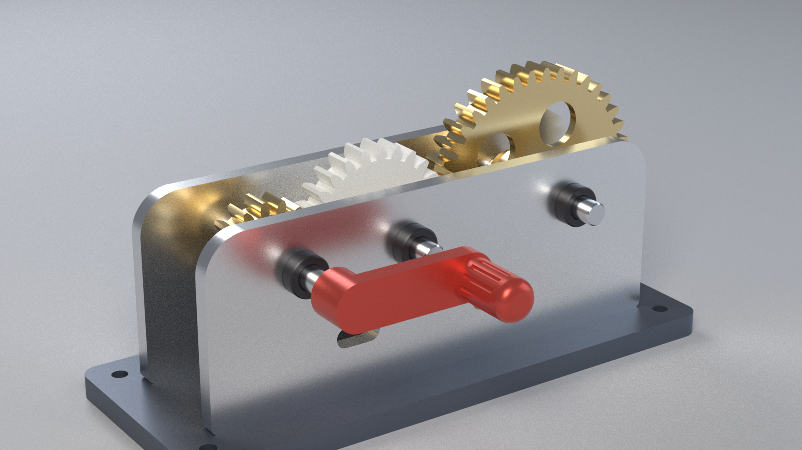
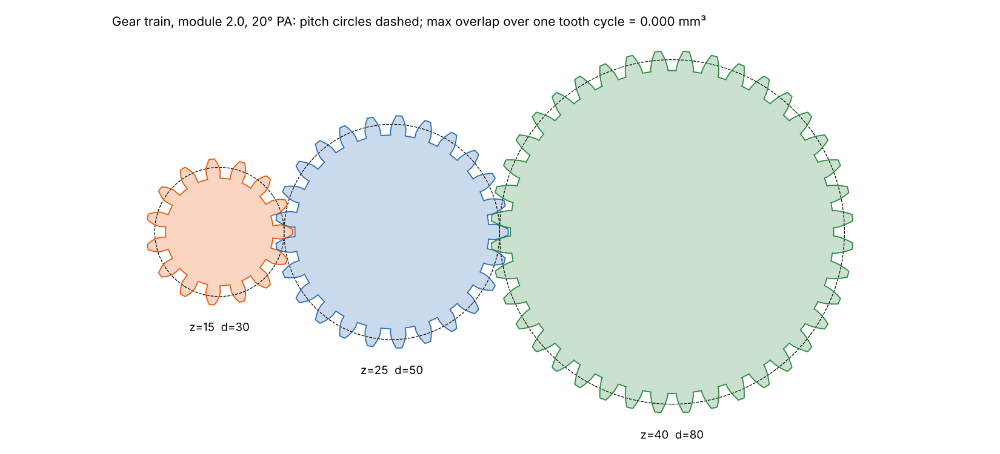

# Week 2: CAD design & assembly, a hand-cranked spur gear train

A complete parametric mechanical assembly, made in **CadQuery** (OpenCASCADE, the kernel behind FreeCAD). It is a
3-gear spur train driven by a hand crank: input pinion z15 → idler z25 → output z40, module 2, 20° pressure angle.
The overall ratio is 2.67 : 1 reduction, and the output turns the same way as the input.



| Task | Deliverable |
|---|---|
| Parametric sketch of a mechanical part with precise dimensions | Side plate (`side_plate()` in [`src/parts.py`](src/parts.py)). Its bores are computed from the gear centre distances a = m(z₁+z₂)/2. Drawing: [`drawings/01-side-plate.svg`](drawings/01-side-plate.svg) |
| Multi-part assembly (gear system) | 16 part instances of 9 different parts, mated by axis and plane relations with coupled revolute joints ([`src/assembly.py`](src/assembly.py)). STEP: [`cad/gear_train_assembly.step`](cad/gear_train_assembly.step) |
| Realistic materials | Physically based renders (Mitsuba 3 path tracer) in brass, brushed and anodised aluminium, steel, black-oxide steel, white acetal and red anodised aluminium; [`renders/`](renders/) |
| Technical drawing with orthographic views and dimensions | A3 sheets in first-angle projection, with hidden-line removal, dimensions, centre lines and title blocks: [`drawings/gear-train-drawings.pdf`](drawings/gear-train-drawings.pdf) (3 sheets) |
| **Mini project:** gear train with 3+ parts, constraints and joints, exploded view, dimensioned drawings, final render | All of the above, plus the exploded render [`renders/exploded.png`](renders/exploded.png), an exploded isometric with BOM and balloons on sheet 3, and a close-up of the mesh [`renders/closeup.png`](renders/closeup.png) |

## The design
| | |
|---|---|
| Gears | m = 2, α = 20°. z = 15 / 25 / 40 gives pitch diameters 30 / 50 / 80 mm and tip diameters 34 / 54 / 84 mm. Face width 10 mm, backlash 0.1 mm. The z40 gear has a 3 mm web with 5 lightening holes |
| Centre distances | 40 mm and 65 mm (standard gears, no profile shift) |
| Contact ratio | 1.55 (z15–z25) and 1.66 (z25–z40), above the usual 1.2 minimum for smooth running |
| Shafts | Ø8 × 74 steel; the input shaft is Ø8 × 86, so the crank clears the idler shaft. Bores give 0.1 mm radial running clearance |
| Frame | 2 side plates (6 mm Al 6061) on a 200 × 80 × 8 anodised base plate with 4 mounting holes. Collars on both sides of each plate locate the shafts axially |
| Envelope / mass | 200 × 120 × 96 mm; about 1.14 kg (BOM masses computed from CAD volume × density) |

**The involute teeth are generated from first principles,** not from a library: base circle, involute flanks,
addendum m and dedendum 1.25 m.

**Verification** ([`src/mesh_check.py`](src/mesh_check.py); results in
[`results/mesh-check.json`](results/mesh-check.json)):
* **Tooth phasing:** each gear is rotated so a tooth space faces its neighbour's tooth. The idler phase is analytic;
  the output phase is searched.
* **No overlap through a full cycle:** the meshing pairs are stepped through a whole tooth cycle, each gear turned by
  its ratio, and the OCC boolean intersection volume is computed at every step. The worst overlap is **0.000 mm³**.
* **No clashes:** every pair of parts in the assembly is also checked for interference, and none overlaps.



## Constraints and joints
CadQuery has no graphical joint editor, so the relationships are written as a small mate solver in
`placements()`. Here is what each Fusion-360-style joint corresponds to:

| Relation | Implemented as |
|---|---|
| Plate bottom face on base top face; inner faces at ±gap/2 | rigid joint, plane mate |
| Shaft axis ≡ bore axes of both plates | axis mate (shared x, z) |
| Gear bore axis ≡ shaft axis, gear mid-plane on the centre plane | axis + plane mate |
| Collars against the plates' outer faces | plane mate |
| Crank hub on the input shaft | rigid to shaft 1 |
| Shafts | revolute joints, **coupled**: θ_idler = −(15/25)·θ, θ_out = +(15/40)·θ, plus each gear's tooth-phase offset |

`build(theta, explode)` re-solves every placement for any crank angle and explode factor. The exploded render and
the exploded isometric on sheet 3 are the same assembly at explode = 1. Next week's animation will drive θ.

## Drawings (`src/drawing.py`)
Views come from OpenCASCADE hidden-line removal: visible edges 0.5 mm, hidden edges dashed. The drawings follow
ISO practice: chain-line centre lines, gear data table, and ISO 2203 conventional gear representation in side and
assembly views. Each sheet has a title block and the first-angle symbol.

1. **Side plate (1:1):**
   * front, top and left views;
   * overall 171 × 64 × 6;
   * bore centres 40 / 65;
   * axis height 46;
   * 3× Ø8.2 bores;
   * R14 corners;
   * slots at 20 mm height.
2. **Output gear z40 (1.4:1):**
   * face view with real teeth;
   * conventional side view with face width, total length and hub diameter;
   * bore and keyway;
   * lightening holes;
   * gear data table.
3. **Assembly (1:2):** front and top views with overall and centre-distance dimensions, the exploded isometric with
   numbered balloons, and the BOM (item, part, quantity, material, mass).

## Renders (`src/render.py`)
All renders are 1920×1080 at 384 samples per pixel, using a path tracer, principled BSDF materials, and three-point
area lighting (key, fill and rim).
* `hero.png`: three-quarter view
* `exploded.png`: exploded assembly
* `closeup.png`: front plate hidden, showing the teeth in mesh

## Files
* `cad/gear_train_assembly.step`: full assembly, coloured by material
* `cad/side_plate.step` and `cad/gear_out.step`: single parts
* `cad/stl/*.stl`: every part, in its own coordinates, ready for 3D printing or CAM

## Honest notes
* **Software:** the brief names Blender and Fusion 360. This work uses CadQuery, which is free, scriptable and on the
  same OCC kernel as FreeCAD; its STEP files open directly in Fusion 360. Rendering uses Mitsuba 3, a free research
  path tracer, instead of Blender Cycles.
* **Surface textures:** finishes are made with physically based roughness and metalness values, not image textures.
  The only texture modelled as geometry is the crank's fluted grip.
* **Simplifications:** the shafts run directly in the plate bores (bronze bushings would be the production choice),
  and the keys and set screws aren't modelled.

## Reproduce
```bash
pip install cadquery mitsuba
cd 3d-cad-design/week-2
python src/mesh_check.py && python src/assembly.py
python src/drawing.py && python src/render.py      # renders take ~4 min each on 2 CPUs
```
Change any value in `PARAMS` (module, tooth counts, plate size…), then rerun to regenerate the parts, the assembly,
the checks and the drawings.
