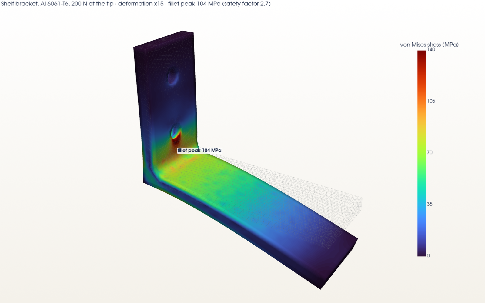
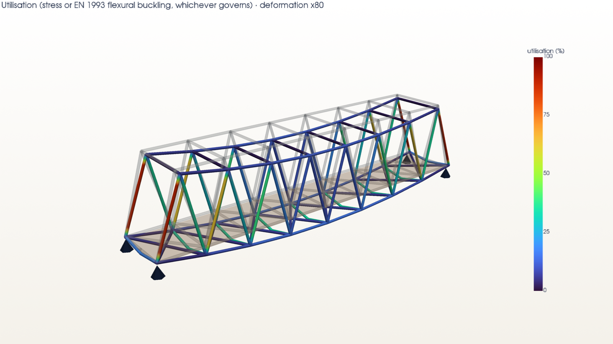

# Week 3: Simulation & animation

This week covers finite-element stress analysis, with a mesh-convergence study and validation against beam theory,
a mechanism animation, an HDRI-lit product shot, and a mini project: a full FEA study of a 12 m steel footbridge with
heat maps, a deformation animation and a written report.

All tools are free: CadQuery, gmsh, scikit-fem (quadratic tetrahedra), a 3D frame finite-element model written for
this project, PyVista (VTK) and Mitsuba 3.

| Task | Deliverable |
|---|---|
| Basic stress analysis on a bracket or beam | Shelf bracket in Al 6061-T6: [`renders/bracket-stress.png`](renders/bracket-stress.png), [`results/bracket-study.json`](results/bracket-study.json) |
| FEA mesh and convergence | Bracket at 5 mesh densities (21 k to 160 k degrees of freedom), plus a validation cantilever at 5 densities against beam theory: [`results/bracket-convergence-and-fillets.png`](results/bracket-convergence-and-fillets.png), [`results/cantilever-convergence.png`](results/cantilever-convergence.png) |
| Animate a mechanical assembly | Week 2's gear train assembling from exploded, then turning through one crank revolution with the coupled joints: [`anim/gear-train.mp4`](anim/gear-train.mp4) / [`.gif`](anim/gear-train.gif) |
| Photorealistic product shot with HDRI lighting | [`renders/product-shot-hdri.png`](renders/product-shot-hdri.png), lit only by [`renders/studio-hdri.exr`](renders/studio-hdri.exr) ([preview](renders/studio-hdri-preview.png)) |
| **Mini project:** bridge or cantilever (loads, FEA, stress heat map, deformation animation, report) | 12 m Warren-truss footbridge: [`report.md`](report.md), heat maps [`renders/bridge-axial-stress.png`](renders/bridge-axial-stress.png) and [`renders/bridge-utilisation.png`](renders/bridge-utilisation.png), animation [`anim/bridge-deformation.mp4`](anim/bridge-deformation.mp4), numbers in [`results/bridge.json`](results/bridge.json) |



## 1. Can the solver be trusted? Cantilever validation
I checked the solid FEA pipeline against textbook beam theory first (`src/fea.py`, `src/validate_cantilever.py`):
CadQuery solid → gmsh tetrahedral mesh → scikit-fem with **quadratic** tetrahedra. Linear tetrahedra "lock" in
bending and come out far too stiff.

The test case is a 200 × 20 × 10 mm aluminium cantilever with 100 N at the tip:

| Mesh (degrees of freedom) | Tip deflection | vs Timoshenko 0.5842 mm | Stress at mid-span | vs Mc/I = 15.00 MPa |
|---|---|---|---|---|
| 3,741 | 0.5800 mm | −0.73 % | 15.07 MPa | +0.48 % |
| 23,220 | 0.5809 mm | −0.57 % | 15.00 MPa | −0.02 % |
| 99,717 | 0.5811 mm | −0.53 % | 15.00 MPa | −0.03 % |

**Stress matches to 0.03 %.** The deflection is within 0.6 %. The FEA is slightly stiffer than beam theory because a
fully fixed end face also prevents the cross-section from warping, which beam theory allows.

## 2. Bracket stress analysis and convergence (`src/bracket_study.py`)
**Setup:**
* **Bracket:** 30 mm wide and 6 mm thick, in Al 6061-T6 (yield 276 MPa), with a 4 mm inner fillet.
* **Supports:** the vertical flange is bolted to a wall, with the 2× M6 bolt bores fixed.
* **Load:** 200 N downward on the last 10 mm of the 86 mm arm.

| Mesh (degrees of freedom) | 20.8 k | 31.8 k | 47.2 k | 82.2 k | 159.6 k |
|---|---|---|---|---|---|
| Peak stress on the fillet (MPa) | 104.0 | 97.0 | 96.5 | 103.8 | 107.1 |
| Tip deflection (mm) | 1.271 | 1.277 | 1.278 | 1.282 | 1.284 |
| Bolt-bore peak (MPa) | 181 | 185 | 183 | 183 | **191, still rising** |

How to read it:
* **Tip deflection** is converged: it changed by 0.2 % over the last doubling of the mesh.
* **The fillet peak** settles at **about 100–107 MPa**. That is 1.2–1.3× the nominal Mc/I of 83 MPa, as expected
  for a stress concentration at a 4 mm fillet. It jumps by ±5 % from mesh to mesh because it's read from a single
  node on a curved surface; the spatially averaged value moves much less.
  * **Safety factor against yield: about 2.6.**
* **The bolt-bore peak keeps rising** as the mesh is refined. That is the classic signature of a **singularity**: a
  perfectly rigid support edge makes the stress there infinite in theory. It's an artefact of the boundary
  condition, not a real stress, and is reported separately rather than used for design. Modelling bolt contact or
  pre-load would remove it.

**Fillet design study** (all at the 82 k mesh):

| Inner fillet | Peak stress | Safety factor | Tip deflection |
|---|---|---|---|
| R1 | 186 MPa | 1.5 | 1.38 mm |
| **R4** | **104 MPa** | **2.7** | 1.28 mm |
| R8 | 131 MPa | 2.1 | 1.13 mm |

R1 is a near-sharp corner and concentrates stress, as expected. R8 is stiffer but *worse* for stress: its tangent
point climbs to 14 mm, next to the lower bolt hole at 20 mm, and the two stress concentrations interact. **R4 is
the best of the three.** Learning that is the point of a simulation-driven design loop.

## 3. Mechanism animation (`src/animate_gears.py`)
It uses week 2's parametric parts and mate solver unchanged; every frame re-solves the placements:
* **0 to 2.5 s:** the explode factor eases from 1 to 0, so the parts slide into place along their mates.
* **3 to 9 s:** the crank turns 360°. The idler turns −216° (ratio −15/25) and the output turns +135° (ratio
  +15/40).

The angles shown on screen are computed live from the joint relations, and the teeth stay in mesh throughout. That
was verified in week 2 with zero intersection volume across a full tooth cycle.

## 4. HDRI product shot (`src/hdri_shot.py`)
The assembly is lit **only by an equirectangular HDR environment map**: no area lights, a glossy dark floor, 512
samples per pixel. This environment has no internet access, so I couldn't download a Poly Haven HDRI. Instead the
script generates a studio HDRI and saves it as `studio-hdri.exr`, so any downloaded HDRI can be swapped in. It
contains:
* a large warm key softbox (radiance 16, a few hundred times the background);
* a cool fill;
* a bright rim strip behind;
* a soft overhead.

## 5. Mini project: the footbridge (`src/bridge.py`, `src/bridge_viz.py`, [`report.md`](report.md))
**The structure:**
* **Bridge:** a 12 m through-truss in S355 steel, 2.5 m deep and 2.0 m wide, with 8 Warren panels. It has floor
  beams, top struts and plan bracing.
* **Model:** 104 frame members and 43 nodes, using 12-degree-of-freedom 3D beam elements written from first
  principles.
* **Supports:** one fixed bearing, two guided and one free-sliding.
* **Loads:**
  * self-weight;
  * 0.6 kN/m² timber deck;
  * 5 kN/m² crowd load;
  * the deck spans between floor beams, so the floor beams bend under it.
* **Combinations:** ULS 1.35G + 1.5Q for strength; SLS Q only for deflection.

| Check | Result |
|---|---|
| Equilibrium | reactions 216.0 kN = applied 216.0 kN ✓ |
| Hand statics (M/h at mid-span) | 64.8 kN vs FEA 60.4 kN (−6.8 %: rigid joints and plan bracing share the load, as explained in the report) ✓ |
| Mid-span deflection, SLS | **4.3 mm** vs the L/400 limit of 30 mm ✓ |
| Highest utilisation | **0.89**: end diagonals SHS 50×50×3, governed by EN 1993-1-1 flexural buckling |
| Design iteration | The first sizing (chords SHS 120, diagonals SHS 80) reached only 0.17 utilisation. Resizing cut steel weight from 26.6 kN to 12.2 kN (−54 %) |



## Honest notes
* **Software:** the brief's tools are Fusion 360 / ANSYS / Blender. This used free, scriptable equivalents with the
  same methods (tetrahedral FEA with quadratic elements, frame FEA, path-traced rendering).
* **Results are verified,** against beam theory, statics and equilibrium, but **not certified.** A real bridge also
  needs wind, dynamic (pedestrian vibration) and connection design, plus combined bending-and-buckling interaction
  checks. These are listed in the report.

## Reproduce
```bash
pip install cadquery gmsh scikit-fem pyamg pyvista mitsuba
cd 3d-cad-design/week-3
python src/validate_cantilever.py && python src/bracket_study.py      # ~15 min
python src/bridge.py && python src/bridge_viz.py
python src/animate_gears.py && python src/hdri_shot.py
```
