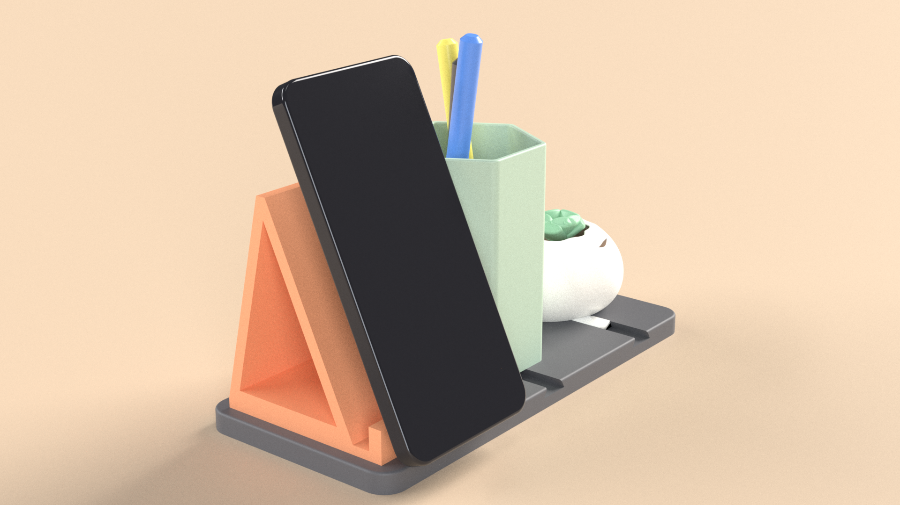

# Week 4: Capstone product design, "Stackr" modular desk organiser

This is a complete product taken from concept to print-ready files. **Stackr** is a 3D-printable PLA base with three
dovetail rails and slide-in modules:
* a phone stand;
* a hex pen cup;
* an organic pebble planter.

Any module fits any rail, so the desk layout can be rearranged without tools.



| Capstone requirement | Deliverable |
|---|---|
| Concept sketch | [`concept/concept-sketches.png`](concept/concept-sketches.png): three directions, an evaluation matrix and the phone-stand profile iteration |
| Parametric CAD | [`src/product.py`](src/product.py). One `PARAMS` table drives every dimension, including the print clearance built into the dovetails |
| Organic modelling | [`src/organic.py`](src/organic.py): a signed-distance-field sculpt (blended ellipsoids plus ripples), meshed with marching cubes and boolean-joined to the CAD dovetail key |
| Assembly with mates | [`src/assemble.py`](src/assemble.py) and [`cad/stackr_assembly.step`](cad/stackr_assembly.step). Mates: key flanks ≡ groove flanks, module floor ≡ base top. **Clash volume is 0 mm³ for all 6 part pairs** ([`results/assembly.json`](results/assembly.json)) |
| Simulation | [`src/sim.py`](src/sim.py): structural FEA plus a steady-state thermal model of the phone stand ([`results/sim.json`](results/sim.json), [`renders/stand-stress.png`](renders/stand-stress.png), [`renders/stand-thermal.png`](renders/stand-thermal.png)) |
| 3D-print preparation, STL | [`cad/stl/`](cad/stl/) (watertight) and [`src/print_prep.py`](src/print_prep.py): wall thickness, overhangs, orientation and a slicing estimate ([`results/print-report.json`](results/print-report.json), [`results/print-layer-preview.png`](results/print-layer-preview.png)) |
| Technical drawings | [`drawings/stackr-drawings.pdf`](drawings/stackr-drawings.pdf), 3 A3 sheets in first-angle projection: phone stand, base with a 5:1 dovetail detail, and the assembly with BOM |
| Photoreal renders | [`renders/hero.png`](renders/hero.png) (with props) and [`renders/exploded.png`](renders/exploded.png): Mitsuba 3 path tracing, lit only by week 3's studio HDRI |
| Animation | [`anim/stackr-assembly.mp4`](anim/stackr-assembly.mp4) / [`.gif`](anim/stackr-assembly.gif): modules drop and slide in, a turntable orbit, then the pen cup and planter swap rails |
| Portfolio | [`portfolio/index.html`](portfolio/index.html): one static page covering all four weeks of the course, with its own downsized images, so the folder can be hosted as-is (for example on GitHub Pages, which is free) |

## 1. Concept (`src/concept.py`)
**The brief I set:** one printable kit that holds a phone, pens and a small plant. It should be rearrangeable, fit a
21 cm shelf, and use no more than 250 g of PLA.

| Criterion (1–3) | A · monolithic block | B · pegboard + hooks | **C · rail + modules** |
|---|---|---|---|
| Printability | 2 (one 9 h print, a failure means starting over) | 3 | 2 (supports under the module floors) |
| Rearrangeable | 1 | 3 | 3 |
| Stable under a phone tap | 3 | 1 (hooks wobble) | 3 |
| Filament ≤ 250 g | 2 | 3 | 3 |
| No tools, no wall fixing | 3 | 1 | 3 |
| **Total** | 11 | 11 | **14** |

## 2. Design
| | |
|---|---|
| Base | 210 × 96 × 9 mm with R10 corners and three dovetail grooves at 68 mm pitch, running front to back. Recesses for stick-on rubber feet |
| Dovetail | 10 mm wide at the top, 4 mm deep, 60° flanks. The key on each module is the groove profile shrunk by **0.25 mm per flank** (plus a 0.25 mm vertical gap), which suits a 0.4 mm nozzle. Because the key widens downward, a module can't lift out; it can only slide |
| Phone stand | 62 wide × 80 deep × 92 tall, with a 65° back support, a 14 mm lip and a cable slot. **v2** is an open A-frame at 98.5 cm³, down from 121.6 cm³ for the v1 solid cheeks (**−19 %**). The simulation showed the stand was far stronger than it needed to be (below) |
| Pen cup | Hexagonal, 60 mm across flats, 96 mm tall, 2.4 mm walls |
| Planter | An organic pebble modelled as a signed distance field, hollowed to a 2.4 mm wall, 24 cm³. The mesh is decimated to 60 k faces and is watertight |
| Envelope | 210 × 96 × 105 mm |

## 3. Simulation (`src/sim.py`; solver validated in week 3)
* **Material:** PLA, E = 3.5 GPa, ν = 0.36, tensile strength about 50 MPa, k = 0.13 W/m·K.
* **Mesh:** quadratic tetrahedra, 35 k elements and 183 k degrees of freedom.

| Load case | Result |
|---|---|
| Structural: phone weight (200 g) plus a **10 N finger tap** on the top of the back support | peak von Mises **0.28 MPa**, **safety factor about 176**, top deflection 0.003 mm |
| v1 (solid cheeks) under the same loads | 0.14 MPa, 0.002 mm. Both versions are extremely strong, so v2 removes material: −19 % filament and print time for a stand that is still about 176× stronger than it needs to be |
| Thermal: a 38 °C phone (charging) against the support; still air (h = 10 W/m²K) at 25 °C | 0.72 W flows through the stand; the base stays at 25.3 °C. PLA softens around 55–60 °C, so 38 °C is safe. PLA is an insulator, so the stand does almost nothing to cool the phone. That's a useful honest finding: a phone that runs hot needs an open back, not a heat-sink claim |

In practice, layer adhesion and print defects govern a PLA part long before 0.28 MPa does, so the real design
drivers are print quality and the dovetail fit, not stress.

## 4. Print preparation (`src/print_prep.py`)
Settings: 0.2 mm layers, 0.45 mm lines, 2 perimeters, 15 % infill, 4 solid layers, 60 mm/s.

| Part | Orientation | Min. wall | Supports | Filament | Time |
|---|---|---|---|---|---|
| Base | flat, top up (30° groove flanks are self-supporting) | 1.4 mm | 3 cm² | 91.9 g | 4.8 h |
| Phone stand | upright; tree supports under the floor beside the key and under the apex | 4.0 mm | 44 cm² | 57.3 g | 3.0 h |
| Pen cup | upright; supports beside the key | 2.4 mm | 27 cm² | 50.6 g | 2.6 h |
| Planter | upright; supports beside the key | 1.4 mm | 19 cm² | 19.7 g | 1.0 h |
| **Kit** | | | | **219.5 g** (within the 250 g brief) | **11.4 h** |

* **Wall thickness:** measured by casting rays inward from surface samples. Less than 1.5 % of any part's surface is
  thinner than the 0.9 mm two-perimeter minimum.
* **Print a test piece first:** print a 10 mm slice of the base and one key, then tune `fit` by ±0.05 mm if needed.

## 5. Drawings (`src/drawings.py`)
They reuse week 2's hidden-line-removal drawing engine:
1. **Phone stand:** side, front and top views with the overall dimensions, the back angle and the lip height, plus print and FEA notes.
2. **Base:** top and front views, the rail pitch, and a **5:1 detail of the dovetail** with its clearance.
3. **Assembly:** views with the planter outline, and a BOM listing material, filament mass and print hours.

## 6. Renders and animation
* **Renders** (`src/render.py`): Mitsuba 3 path tracer, 1920×1080 at 384 samples per pixel, principled PLA materials
  (matte, roughness 0.45–0.6), lit only by `../week-3/renders/studio-hdri.exr`. The props (phone, pens, succulent) are
  simple CAD stand-ins for scale.
* **Animation** (`src/animate.py`): driven by the same `placements(slide)` mate function as the assembly. Each module
  arrives in turn, then the camera orbits, then the pen cup and planter swap rails. The swap has five phases (pull out,
  lift, traverse, lower, slide in), with the planter lifted 130 mm so it clears the 105 mm cup.

## Honest notes
* **Software:** the brief names Fusion 360, Blender and a slicer such as Cura. This uses free, scriptable equivalents:
  * CadQuery (STEP files open in Fusion 360);
  * an SDF sculpt in place of Blender sculpting;
  * a custom slicing estimate in place of Cura.

  Run the STLs through Cura or PrusaSlicer for exact G-code; expect their time and mass to differ by about ±15 %.
* **Not printed:** there's no printer here, so the 0.25 mm fit is a standard starting value, to be confirmed with the
  test piece above.
* **The props are stand-ins** and aren't part of the product.

## Reproduce
```bash
pip install cadquery gmsh scikit-fem pyamg pyvista mitsuba trimesh manifold3d scikit-image shapely fast-simplification
cd 3d-cad-design/week-4
python src/concept.py
python src/organic.py && python src/assemble.py && python src/print_prep.py
python src/sim.py && python src/drawings.py
python src/render.py && python src/animate.py && python src/portfolio.py
```
