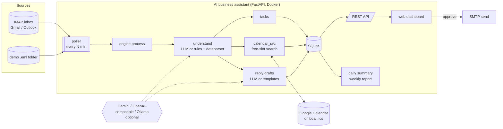
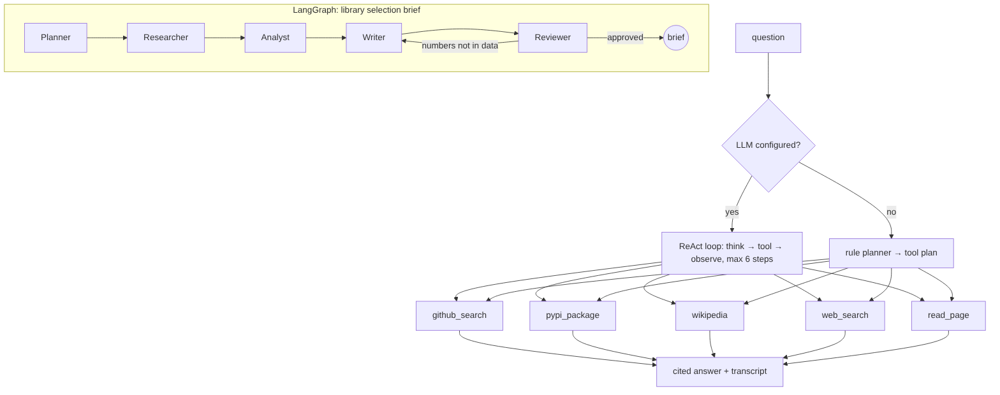
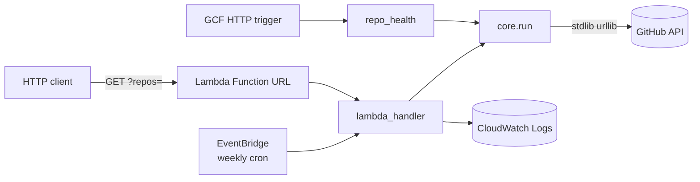
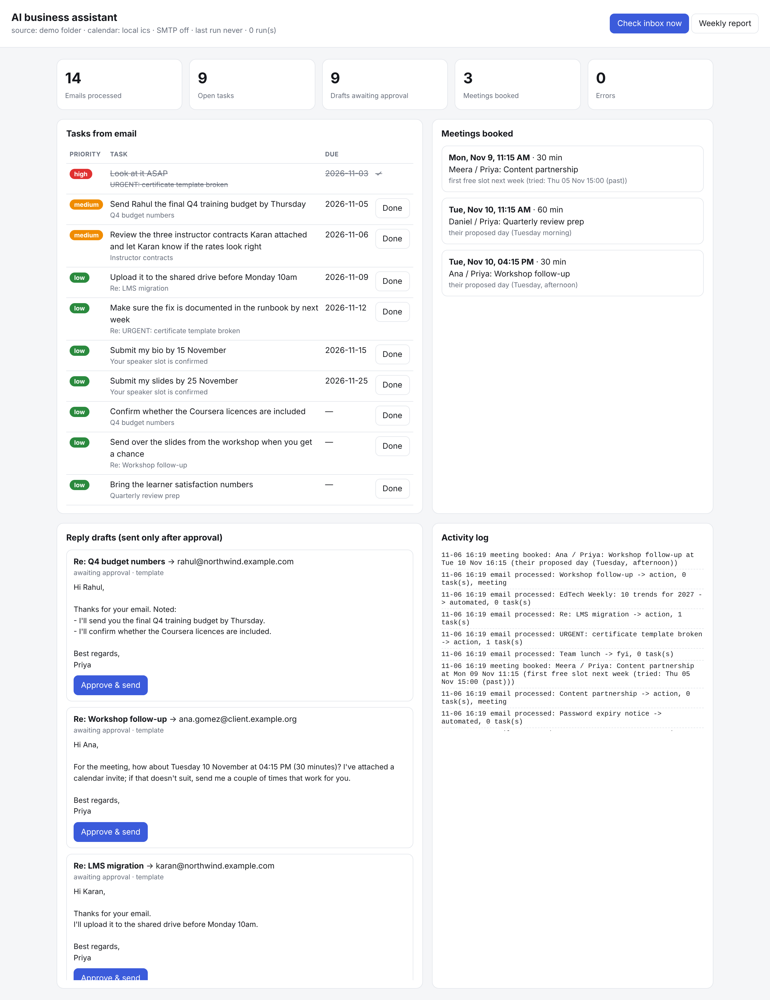

# Week 4: AI agents & deployment

| Task | Folder | Result |
|---|---|---|
| AI agent that searches the web and answers research questions | [`research-agent/`](research-agent/) | A tool-using agent: a ReAct loop with an LLM, or a rule planner without one. Five tools: GitHub, PyPI, Wikipedia, DuckDuckGo and page reader. 3 real research runs with cited transcripts in [`transcripts/`](research-agent/transcripts/) |
| Multi-agent workflow with LangChain/CrewAI for a specific task | [`multi-agent/`](multi-agent/) | **LangGraph** (LangChain's agent-orchestration library): Planner → Researcher → Analyst → Writer → Reviewer, with a review loop. It writes a **library selection brief** from live PyPI and GitHub data |
| Deploy a Python automation script as a cloud function (AWS Lambda or GCF) | [`cloud-function/`](cloud-function/) | A repo-health checker with **both** entry points (a Lambda handler with a Function URL and a weekly EventBridge schedule, and a GCF HTTP function). SAM template, a 2 KB deployment zip, and 4 passing tests against the live GitHub API |
| Documentation with architecture diagrams | this README + [`docs/`](docs/) | 3 Mermaid diagrams (source `.mmd`, rendered SVG and PNG), setup, configuration, API reference and limitations |
| **Major project:** AI business assistant (email action items, AI replies, calendar scheduling, task summaries, weekly reports, cloud-hosted, monitoring dashboard) | [`assistant/`](assistant/) | A FastAPI service with an IMAP poller, action-item extraction, meeting booking with free-slot search, reply drafts behind an approval step, daily and weekly reports, and a web dashboard. Docker + Render free tier. 7 passing tests |

## Architecture


## 1 · Research agent (`research-agent/`)


**How it works:**
* **With an LLM** (Gemini's free tier, any OpenAI-compatible API, or a local Ollama model): the model gets the tool
  list and replies in JSON, either `{"thought", "action", "input"}` or `{"final_answer", "sources"}`. It sees every
  observation and can make up to 6 tool calls.
* **Without an LLM:** a planner maps question patterns to a tool plan, and the answer is synthesised from a template
  with numbered citations.
* **Failures are visible:** when a tool fails, the agent sees the error and routes around it.

**Runs** (live data, 6 Nov 2026, offline planner):
* **"Which Python libraries are most popular for web scraping, and are they maintained?"**
  * GitHub search, then PyPI checks on the top repos.
  * Answer: Scrapling, crawl4ai and Scrapy lead by stars, and all 5 results were pushed to within 90 days.
  * **The agent caught a real trap:** PyPI names don't always belong to the GitHub project. It only attaches a PyPI
    version when the PyPI project links back to that repository; for `ragflow`, `LightRAG` and `you-get` it
    deliberately claims no version.
* **"Compare httpx vs requests vs aiohttp":** three PyPI lookups, giving latest versions, release dates and the
  number of releases.
* **"What is retrieval augmented generation?":** Wikipedia and DuckDuckGo are unreachable from this sandbox, so the
  agent fell back to GitHub and answered from the leading RAG projects. The failed calls are listed in the
  transcript.

## 2 · Multi-agent workflow (`multi-agent/graph.py`)
LangGraph `StateGraph` with a shared, append-only message log ([`graph.mmd`](multi-agent/graph.mmd)):

| Agent | Job |
|---|---|
| Planner | turns the need into 3 candidate packages and weighted criteria, and detects hard requirements (async) |
| Researcher | PyPI JSON plus GitHub data for each candidate |
| Analyst | a transparent score: maintenance 35 %, popularity 25 %, maturity 20 %, fit 20 %, with a 40 % penalty for failing a hard requirement |
| Writer | the brief, written by the LLM when configured or from a template |
| Reviewer | **fact-checks every number in the draft against the research data** and checks every candidate is covered; sends the draft back to the Writer if not (at most 2 revisions) |

**Results** ([`runs/`](multi-agent/runs/)):
* **"HTTP client for an async web scraper":** **aiohttp** (0.94) > httpx (0.59) > requests (0.43, no native async).
  The Reviewer verified 16 numbers.
* **"dataframe library for large CSV files":** pandas 0.98, polars 0.91, duckdb 0.84. duckdb's star count is low
  because its PyPI page links to the `duckdb-python` repo rather than the main one, and the brief reports exactly
  what PyPI links to.
* **Reviewer test:** a tampered draft with version 9.9.9 was **rejected** with "numbers not in the research data:
  ['9.9.9']".

## 3 · Cloud function (`cloud-function/`)


The function is a repo-health checker built only on the standard library, so the deployment zip is about 2 KB.

**Score (0–100):**
* push recency: 40;
* release recency: 20;
* issues per star: 20;
* licence present: 10;
* not archived: 10.

When only the search API is available, as in this sandbox, it uses that and rescales the score without the release
points, saying so in `data_source`.

**Deploy (both free tiers):**
* **AWS:** `sam build && sam deploy --guided` ([`template.yaml`](cloud-function/template.yaml)). This creates an arm64
  Lambda with 128 MB, a public Function URL and a Monday 04:00 UTC schedule, with logs in CloudWatch. Or upload
  [`repo-health-lambda.zip`](cloud-function/repo-health-lambda.zip) in the console with handler
  `lambda_function.lambda_handler`.
* **Google Cloud:**
  ```
  gcloud functions deploy repo-health --gen2 --runtime=python312 --entry-point=repo_health --trigger-http --source=.
  ```

**Tested locally** (`pytest test_function.py`, 4 passing), against the live GitHub API:
* HTTP GET;
* a bad body and missing parameters (400 errors);
* a repo that doesn't exist (reported, not raised);
* the GCF entry point.

Sample output: [`sample-output.json`](cloud-function/sample-output.json).

## 4 · Major project: AI business assistant (`assistant/`)
**What happens on every poll** (`engine.process`; idempotent by Message-ID, so it's safe to run every few minutes):
1. **Fetch:** unread mail over IMAP (Gmail or Outlook with a free App Password; read-only, nothing is marked or
   deleted), or the demo folder.
2. **Understand:**
   * sort the email into action, FYI, automated or conversation;
   * detect urgency;
   * pull out **action items** with deadlines resolved relative to when the email was sent ("by Thursday" →
     2026-11-05), including deadlines in the next sentence ("…? Ideally by end of day Friday.") and two deadlines
     in one sentence;
   * detect **meeting requests**: length, proposed days and times, part of the day, and "next week" shifting
     weekday names to next week.
3. **Tasks:**
   * rewritten as to-dos: "Can you send me the budget by Thursday?" → "Send Rahul the budget by Thursday";
   * priority comes from urgency and how close the deadline is;
   * **a follow-up saying "it's fixed" auto-closes that thread's earlier tasks.**
4. **Scheduling:**
   * the free-slot search respects working hours, a 15-minute buffer and the requested day or time;
   * it falls back when a proposed time has already passed;
   * it books the slot on Google Calendar, or in a local `.ics` file plus an invite.
5. **Reply drafts:** written by the LLM or from templates, acknowledging each item and proposing the meeting slot.
   **Nothing is sent until a person clicks Approve.**
6. **Logging and reports:** an activity log, a daily task summary, and a weekly report (overdue, due next week,
   meetings, estimated time saved).

**Demo run on a fictional 14-email inbox** ("Northwind Learning", a made-up company; results in
[`data/demo/run.md`](assistant/data/demo/run.md) and
[`weekly-report.md`](assistant/data/demo/weekly-report.md)):

| | |
|---|---|
| Emails | 14: 10 action, 2 automated, 2 FYI (newsletters, the password notice, the team lunch and the expense policy all correctly needed no task) |
| Tasks | 10 extracted with correct deadlines; 1 auto-closed by the "it's fixed" follow-up |
| Meetings | 3 booked without conflicts. Ana → her Tuesday afternoon; Daniel → Tuesday 11:15, the first morning slot after a 10–11 meeting plus buffer; Meera → her "Thursday 3pm" had already passed, so the first free slot next week |
| Drafts | 9 awaiting approval |
| Errors | 0 |



**API:**

| Method | Path | Purpose |
|---|---|---|
| GET | `/` | dashboard (auto-refreshes every 30 s) |
| GET | `/api/status` | health, configured connectors, counters |
| POST | `/api/run` | process the inbox now |
| GET | `/api/tasks` | list tasks |
| POST | `/api/tasks/{id}/done` | mark a task done |
| GET | `/api/drafts` | list reply drafts |
| POST | `/api/drafts/{id}/approve` | send the draft (SMTP), or mark it approved if no SMTP is set |
| GET | `/api/meetings` | booked meetings |
| GET | `/api/logs` | activity log |
| GET | `/report/daily` | daily task summary |
| GET | `/report/weekly` | weekly report |

**Configuration** (environment variables; all optional, and with none set it runs on the demo data):

| Variable | Purpose |
|---|---|
| `IMAP_HOST`, `IMAP_USER`, `IMAP_PASS` | real inbox (Gmail: `imap.gmail.com` + an App Password) |
| `SMTP_HOST`, `SMTP_PORT`, `SMTP_USER`, `SMTP_PASS` | sending approved drafts |
| `GOOGLE_CALENDAR_ID`, `GOOGLE_SERVICE_ACCOUNT_JSON` | Google Calendar instead of the local `.ics` |
| `GEMINI_API_KEY` or `OPENAI_API_KEY` (+ `OPENAI_BASE_URL`) | LLM understanding and drafting |
| `POLL_MINUTES` | polling interval (default 10; 0 disables polling) |
| `OWNER_NAME` | name used in drafts |

**Deploy free:** [`render.yaml`](assistant/render.yaml) is a Render blueprint (Docker, free plan, health check on
`/api/status`). [`Dockerfile`](assistant/Dockerfile) works the same on Fly.io, Railway or Google Cloud Run.

> On Render's free plan the service sleeps after 15 minutes without traffic, so background polling pauses too. Use
> a free uptime pinger (for example UptimeRobot) or Cloud Run with Cloud Scheduler.

## Honest notes
* **No LLM was available here** (no key, and AI APIs are blocked in this sandbox), so every result above comes from
  the rule-based paths. They're labelled `engine: rules`, `template` or `offline:planner`. With a free Gemini key in
  `.env`, the same code uses the LLM paths, whose prompts are in the source.
* **Not deployed:** deploying to AWS, GCP or Render needs your account. Everything is packaged (SAM template, zip,
  gcloud command, Dockerfile, Render blueprint) and tested locally.
* **Fictional data:** the inbox and calendar are made up. The research agent, the multi-agent brief and the cloud
  function use live public data from GitHub and PyPI.

## Run
```bash
pip install requests beautifulsoup4 trafilatura scikit-learn networkx langgraph fastapi uvicorn dateparser icalendar pytest
cd ai-automation/week-4
(cd research-agent && python agent.py "Compare httpx vs requests vs aiohttp")
(cd multi-agent && python graph.py "HTTP client for an async web scraper")
(cd cloud-function && pytest -q test_function.py)
(cd assistant && python demo.py && pytest -q tests && POLL_MINUTES=0 uvicorn app.main:app)   # dashboard at :8000
```
