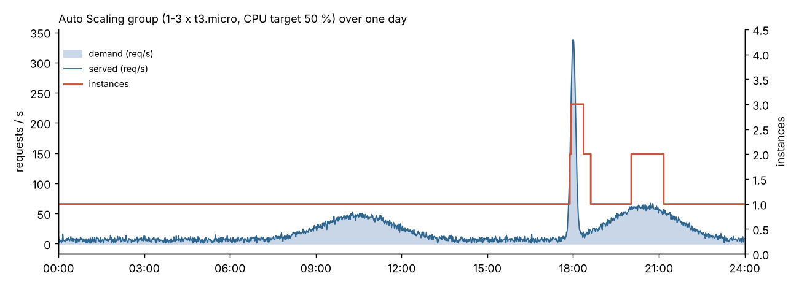

# Cloud Computing with AWS — Week 3: high availability, scaling, CDN and CI/CD

Week 2 built a network, a serverless API and a secure bucket. This week makes a web tier that **survives an AZ
failure and scales with demand**, puts a static site on a **global CDN**, and adds **deployments from GitHub with
no stored AWS keys**. As before, everything is infrastructure as code, tested against an AWS emulator: ₹0, no login needed.

| Part | Files | Verified by |
|---|---|---|
| Load-balanced, auto-scaling web tier (ALB + ASG across 2 AZs) | [infra/web-tier.yaml](infra/web-tier.yaml) | deployed with week 2's VPC into emulated CloudFormation, then inspected |
| How the scaling behaves over a real day | [scripts/scaling_sim.py](scripts/scaling_sim.py) | [results/scaling.md](results/scaling.md) |
| Static site: private S3 + CloudFront (OAC, HTTPS, security headers) | [infra/static-site.yaml](infra/static-site.yaml), [site/](site/) | template tests |
| CI/CD with GitHub OIDC (no access keys) | [infra/github-oidc.yaml](infra/github-oidc.yaml), [workflow](../../.github/workflows/aws-deploy-site.yml) | trust-policy test |

`pytest -q tests` → **7 passed**; all templates pass `cfn-lint`.

## 1. Highly available web tier
```
            Internet
               │ :80
     ┌─────────▼──────────┐   Application Load Balancer in both public subnets (AZ a + AZ b)
     │        ALB         │   health check GET /health every 15 s, 2 failures = unhealthy
     └────┬──────────┬────┘
   AZ a   │          │   AZ b       Auto Scaling group: min 1, max 3 t3.micro, target 50 % average CPU
   ┌──────▼───┐  ┌───▼──────┐       ELB health checks: an instance whose app stops answering is replaced,
   │ instance │  │ instance │       not just one whose VM died
   └──────────┘  └──────────┘       rolling updates: bumping AppVersion replaces one instance at a time
```
* **Security**:
  * instances accept traffic only from the load balancer's security group, so they are unreachable directly;
  * no SSH (SSM Session Manager);
  * IMDSv2 only, encrypted gp3 disks;
  * the ALB drops invalid headers.
* **Alarm** when the load balancer has no healthy targets.
* The test deploys week 2's network and this stack into emulated CloudFormation, then checks:
  * the group spans 2 AZs, with min 1 / max 3, and uses ELB health checks and the target group;
  * the load balancer is internet-facing in 2 AZs, with the health check on `/health`;
  * the app security group has no internet rules;
  * target tracking at 50 %. The emulator can't create scaling policies, so this is checked in the template.

## 2. Scaling over a day ([results](results/scaling.md))
A minute-by-minute model of target tracking (3-minute warm-up, 15-minute scale-in wait) on a college site's day.
The day has morning and evening peaks plus a sudden **results-announcement rush at 18:00** (338 req/s, while one
t3.micro handles about 120).



| Setup | Instance-hours/day | Minutes over 80 % CPU | Requests dropped |
|---|---:|---:|---:|
| Fixed 1 instance | 24 | 17 | 6.6 % |
| Fixed 3 instances | 72 | 6 | 0 |
| **Auto Scaling 1-3** | **26** | 8 (all in the rush, while new instances boot) | 0 |
| Auto Scaling 1-4 + scheduled min 3 at 17:45 | 29 | **0** | 0 |

Auto Scaling uses 63 % fewer instance-hours than a fixed fleet of 3 and handles normal peaks. The one weak spot
is a sudden rush, because new instances need minutes to boot. For a known event (results day, fest registration),
a **scheduled action** fixes it for about 2 extra instance-hours.

## 3. Static site on S3 + CloudFront
* The bucket stays **private**. A bucket policy lets only *this* distribution read it (Origin Access Control,
  `AWS:SourceArn` condition), so the site can't be read around the CDN.
* Viewers are redirected to HTTPS, served over HTTP/2 and HTTP/3 with compression, from edge locations including India (PriceClass_200).
* A response headers policy adds HSTS, CSP, X-Frame-Options DENY, nosniff and a strict referrer policy. There is a custom 404 page.
* CloudFront's always-free tier (1 TB and 10 M requests per month) means a student site costs nothing.

## 4. CI/CD without access keys
`infra/github-oidc.yaml` registers GitHub as an OIDC identity provider and creates a deploy role.
* Its trust policy accepts **only** tokens for `repo:priyanshusharan-cmd/skillnexis-coursework:ref:refs/heads/main`
  with audience `sts.amazonaws.com`. Forks, pull requests and other branches can't assume it.
* Its permissions cover only uploading to `week3-site-*` buckets, invalidating CloudFront and reading
  `week3-*` stacks, with no wildcards on actions (tested).

The [deploy workflow](../../.github/workflows/aws-deploy-site.yml):
* gets a one-hour session via `aws-actions/configure-aws-credentials`, then runs `s3 sync` and a CloudFront invalidation;
* runs only when the `AWS_DEPLOY_ROLE` repository variable is set, so without an AWS account it is skipped rather than failing.

## Deploy for real (optional, free tier)
```bash
aws cloudformation deploy --template-file infra/github-oidc.yaml --stack-name week3-oidc --capabilities CAPABILITY_IAM
aws cloudformation deploy --template-file infra/static-site.yaml --stack-name week3-site
gh variable set AWS_DEPLOY_ROLE --body "<RoleArn output>"       # then any change in site/ deploys itself
aws cloudformation deploy --template-file infra/web-tier.yaml --stack-name week3-web --capabilities CAPABILITY_IAM \
  --parameter-overrides VpcId=<week2 VpcId> PublicSubnets=<public-a>,<public-b>
```
Cost note: the ALB is **not** in the always-free tier. New accounts get 750 h/month for 12 months; after that it is
about $16/month, so delete `week3-web` after the lab.

## Limitations
* Emulator-verified, not live: there are no real load-balancer health checks or scaling events. The scaling
  behaviour comes from a model whose per-instance capacity (120 req/s) is an assumption to replace with a load-test figure.
