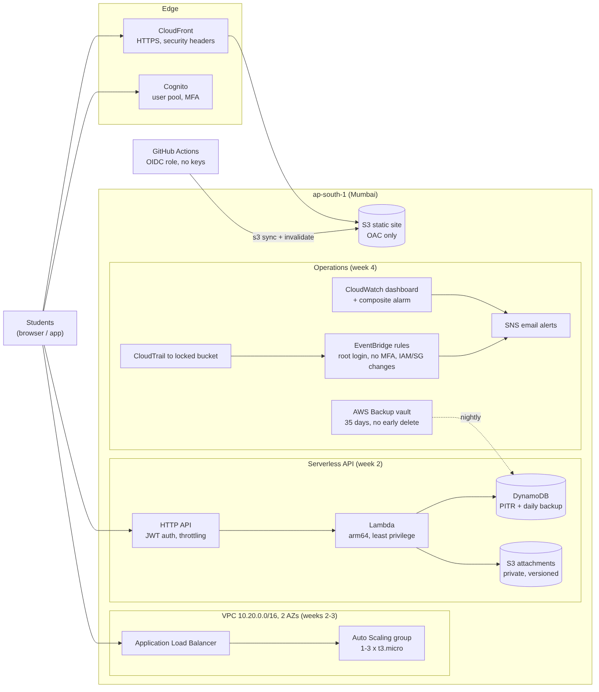

# Cloud Computing with AWS — Week 4 capstone: production-ready study-links platform

The capstone pulls weeks 2–3 together into one system and adds what makes it **operable in production**:
* monitoring and alerting;
* an audit trail with security alerts;
* backups with a **tested restore**;
* a Well-Architected review.

All infrastructure as code, verified with an AWS emulator: ₹0, no AWS login.



| Week | What it adds | Folder |
|---|---|---|
| 2 | VPC + EC2, serverless API (HTTP API, Lambda, DynamoDB, S3, Cognito), IAM, S3 lab, budget | [week-2](../week-2/) |
| 3 | ALB + Auto Scaling across 2 AZs, CloudFront static site, GitHub OIDC deploys, scaling model | [week-3](../week-3/) |
| **4** | **Observability, security baseline, backup + DR drill, Well-Architected review** | here |

`pytest -q tests` → **13 passed**; the 3 new templates pass `cfn-lint`. CI runs weeks 2, 3 and 4 on every push.

## 1. Observability ([infra/observability.yaml](infra/observability.yaml))
* **Dashboard**:
  * API requests, 4xx and 5xx;
  * Lambda p50/p99 duration, errors and throttles;
  * DynamoDB capacity and throttles;
  * a Logs Insights widget with the latest errors.
* **Alarms** on what users feel:
  * 5xx **rate** above 5 % (metric math, ignored below 20 requests so 1 error in 3 doesn't page);
  * p99 latency above 2 s for 15 minutes;
  * any DynamoDB throttling.
* **Composite alarm** "service unhealthy": one notification per incident instead of three (tested to include every alarm).

## 2. Security baseline ([infra/security-baseline.yaml](infra/security-baseline.yaml))
* **CloudTrail**:
  * multi-region, global services included;
  * **log file validation**, so edited logs are detectable;
  * delivered to an encrypted, versioned, TLS-only bucket kept on stack deletion; Glacier after 90 days, expiry at 2 years.
* **EventBridge → email** on:
  * any **root** sign-in;
  * a console sign-in **without MFA**;
  * IAM policy or access-key changes and security groups being opened.
  * The patterns are tested against sample CloudTrail events, both the ones that should fire and look-alikes that shouldn't.
* Free: the first management-event trail, EventBridge rules and SNS email are no-cost.

## 3. Backup and disaster recovery ([infra/backup.yaml](infra/backup.yaml), [docs/dr.md](docs/dr.md))
* Daily AWS Backup at 02:00 IST of anything tagged `backup=daily`, kept 35 days. The vault policy **denies
  deleting recovery points early**, even for admins.
* Together with DynamoDB point-in-time recovery: RPO of seconds for bad deploys, ≤ 24 h for problems found late, RTO 30 minutes.
* **Drill** ([scripts/dr_drill.py](scripts/dr_drill.py), [results](results/dr_drill.md)):
  1. seed 1,000 items;
  2. back up;
  3. delete the table (the "incident");
  4. restore to a new table;
  5. compare every item → **1,000 / 1,000 identical, PASSED**.

## 4. Well-Architected review ([docs/well-architected.md](docs/well-architected.md))
Covers all six pillars. For each: what is implemented, where the evidence is, and the risks still open.

Highlights:
* every component multi-AZ;
* no long-lived keys anywhere;
* encryption at rest and TLS everywhere;
* 63 % fewer instance-hours with Auto Scaling;
* a free-tier-first design with no NAT gateway.

Top three next steps:
1. A domain with an ACM certificate, for HTTPS on the ALB.
2. Lambda canary deploys with automatic rollback.
3. A load test to replace the assumed per-instance capacity.

## Deploy order (optional, real free-tier account)
```bash
cd ../week-2 && aws cloudformation deploy --template-file infra/budget.yaml --stack-name week2-budget --parameter-overrides Email=you@example.com
cd ../week-4 && aws cloudformation deploy --template-file infra/security-baseline.yaml --stack-name week4-security --parameter-overrides AlertEmail=you@example.com
# week 2 api, week 3 site/web tier (see their READMEs), then:
aws cloudformation deploy --template-file infra/backup.yaml --stack-name week4-backup --capabilities CAPABILITY_IAM
aws cloudformation deploy --template-file infra/observability.yaml --stack-name week4-obs --parameter-overrides \
  ApiFunctionName=<fn> ApiId=<api id> TableName=<table> AlertTopicArn=<week4-security AlertTopicArn>
```

## Limitations
* Emulator-verified: real alarm firing, CloudTrail delivery and AWS Backup jobs need a live account.
  * EventBridge matching uses moto's implementation of AWS's pattern rules.
  * The restore drill uses DynamoDB on-demand backups, the same mechanism AWS Backup uses for DynamoDB.
