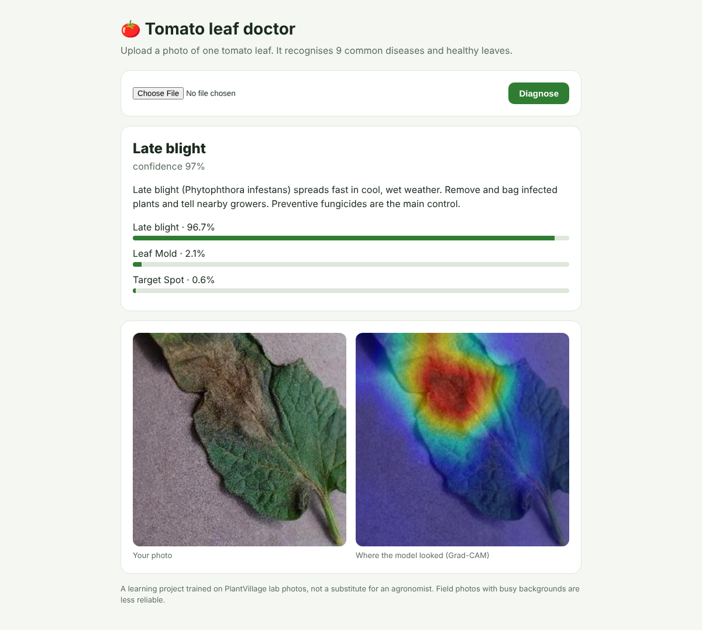
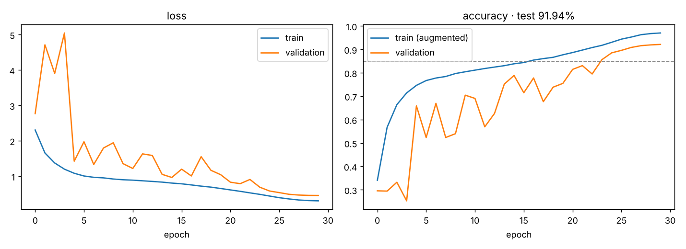
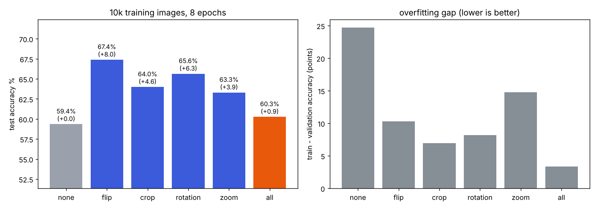
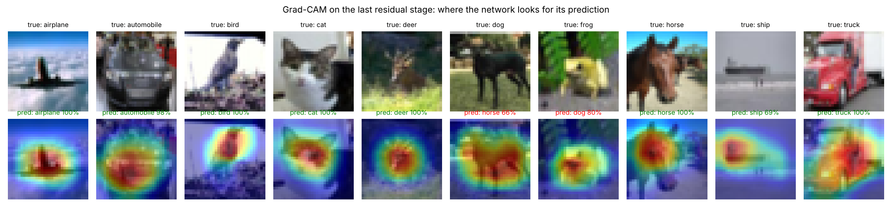

# Week 2: Convolutional neural networks & computer vision

| Task | File | Result |
|---|---|---|
| CNN from scratch on CIFAR-10 | [`src/cifar_cnn.py`](src/cifar_cnn.py) | A compact residual CNN (0.70 M parameters), trained from random weights on a CPU: **91.94 % test accuracy** (10,000 test images, used once) |
| Transfer learning with a pretrained model (ResNet50) on a custom dataset | [`src/transfer_resnet50.py`](src/transfer_resnet50.py), [`src/baseline_scratch.py`](src/baseline_scratch.py) | 5 tomato-leaf classes, 280 training images per class. **Frozen ResNet50 94.0 % → fine-tuned conv5 96.3 %**, against **88.7 %** for a CNN trained from scratch on the same images |
| Data augmentation study | [`src/augmentation_study.py`](src/augmentation_study.py) | A controlled experiment (10,000-image subset, the same network, seed and schedule; only the augmentation changes): **every single augmentation beat none** (horizontal flip best: **59.4 % → 67.4 %**), and all four together *underfit* in a short 8-epoch budget |
| Visualise filters, feature maps and Grad-CAM | [`src/gradcam.py`](src/gradcam.py) | First-layer filters, feature maps of every stage, and Grad-CAM heat maps for one test image per class |
| **Mini project:** plant disease detection web app | [`src/train_plant.py`](src/train_plant.py), [`plant-app/`](plant-app/) | MobileNetV2, 10 tomato classes (9 diseases + healthy): **91.4 % test accuracy**, well-calibrated confidence (ECE 0.011). A Flask app with Grad-CAM, care advice, an "I'm not sure" threshold and a JSON API. Dockerfile included |



## Data (all public, fetched with [`get_data.sh`](get_data.sh))
* **CIFAR-10** (Krizhevsky 2009): the binary distribution, each file checked against the SHA-256 values in
  [`data/cifar10_sha256.txt`](data/cifar10_sha256.txt), and read as raw bytes (no pickle).
* **PlantVillage** (Hughes & Salathé 2015, `github.com/spMohanty/PlantVillage-Dataset`): 3,971 tomato-leaf photos,
  up to 400 per class from all 10 tomato classes ([`data/plantvillage_files.txt`](data/plantvillage_files.txt)).
  * One fixed stratified 70/15/15 split ([`data/plant_split.json`](data/plant_split.json)) is shared by every
    script: 2,781 train, 596 validation, 596 test.
  * Tasks 2 and 3 use a 5-class subset of the same split.
* **Weights:** the official Keras ImageNet files for ResNet50 and MobileNetV2 (GitHub releases).
  [`src/resnet_weights.py`](src/resnet_weights.py) maps the old ResNet50 file's layer names onto today's
  `keras.applications.ResNet50`; every layer must match.

## 1 · CNN from scratch: 91.94 %
* **Architecture:** a stem conv → 3 stages of 2 residual blocks (32/64/128 channels) → global average pooling →
  dropout → 10 classes.
* **Training:**
  * random crop (pad 4) + horizontal flip, label smoothing 0.1, weight decay 5e-4;
  * SGD with Nesterov momentum and a one-cycle learning-rate schedule;
  * 30 epochs; 45,000 train / 5,000 validation;
  * resumable from checkpoints (the full run took 103 minutes on 2 CPU cores).

| | |
|---|---|
| Test accuracy | **91.94 %** (best validation 92.14 %) |
| Best / worst class | automobile 97.4 % / cat 83.5 % (cat ↔ dog is the classic confusion) |



## 2 · Transfer learning: ResNet50 on tomato leaves
* **Data:** 5 classes (healthy, early blight, late blight, leaf mold, bacterial spot); 1,400 train / 300 validation /
  300 test.
* **A. Feature extraction:** frozen ResNet50 → pooled features → softmax head.
* **B. Fine-tuning:** conv5 (15 M parameters) unfrozen at a low learning rate.
  * To make this possible on a CPU, the frozen conv1–conv4 outputs are computed **once** and cached as float16, and
    conv5 is rebuilt on top of them.
  * That's mathematically the same as fine-tuning conv5 in the full network, but many times faster.
* **Baseline:** a small CNN trained from scratch on the same images, with augmentation and early stopping.

| Model | Test accuracy | Training time |
|---|---|---|
| CNN from scratch (0.24 M parameters) | 88.7 % | 25 min, 33 epochs |
| ResNet50, frozen (A) | 94.0 % | 4 min |
| ResNet50, conv5 fine-tuned (B) | **96.3 %** | 5 min |

**Pretraining buys 7.7 points in a fifth of the time.** Full per-class report: [`results/transfer.json`](results/transfer.json);
confusion matrix: [`results/transfer_confusion.png`](results/transfer_confusion.png).

## 3 · Data augmentation study
A **controlled experiment** on a 10,000-image CIFAR-10 training subset (augmentation matters most when data is
limited). Everything is the same between runs except the augmentation:
* the same network (width 32) and random seed;
* the same one-cycle schedule, 8 epochs;
* validation and test images are never augmented.

| Augmentation | Test accuracy | vs none | Train − validation gap |
|---|---|---|---|
| none | 59.4 % | | 24.7 points (heavy over-fitting) |
| horizontal flip | **67.4 %** | **+8.0** | 10.3 |
| rotation ±15° | 65.6 % | +6.3 | 8.2 |
| random crop (pad 4) | 64.0 % | +4.6 | 6.9 |
| zoom 0.9–1.1 | 63.3 % | +4.0 | 14.8 |
| all four together | 60.3 % | +0.9 | **3.3** |



**What it shows:**
* **Augmentation is regularisation.** Each kind cut the train–validation gap, from 25 points down to 3–15, and
  improved test accuracy.
* **Horizontal flip is the best single augmentation** for CIFAR-10: a flipped car is still a car, and the flip adds
  no artefacts.
* **"All four" closes the gap almost completely but underfits** (train accuracy only 63 %). Stacking strong
  augmentations makes the task harder, and 8 epochs aren't enough to learn it. With the full 30-epoch run in task 1,
  crop + flip together are what reached 91.9 %. So the right amount of augmentation depends on the training budget,
  not only on the data.

Examples of each augmentation: [`results/augmentation_examples.png`](results/augmentation_examples.png).
Raw numbers and validation curves: [`results/augmentation.json`](results/augmentation.json).

## 4 · What the CNN learned
[`src/gradcam.py`](src/gradcam.py) produces three figures from the CIFAR-10 network:
* [`filters.png`](results/filters.png): the 32 first-layer 3×3 filters:
  * a few strong colour detectors (green, blue) and centre-surround ones;
  * faint light-to-dark edges;
  * many low-contrast filters, which is typical with weight decay and a tiny 3×3 stem;
* [`feature_maps.png`](results/feature_maps.png): one image passing through every stage, from edges to coarse,
  class-specific blobs;
* **Grad-CAM** (Selvaraju et al. 2017): the gradient of the class score with respect to the last stage's feature
  maps weights those maps, showing where the evidence is.



The heat maps sit on the object (the plane's body, the cat's face, the truck's cab), not the background. The two
mistakes in the figure are informative: the dog predicted as a horse lights up the long, four-legged body, and the
frog predicted as a dog has its evidence on the frog's rounded shape.

## 5 · Mini project: plant disease detector (`plant-app/`)
**Model** ([`src/train_plant.py`](src/train_plant.py)): MobileNetV2 at 224×224 (2.3 M parameters, small enough
for a CPU web app), 10 tomato classes.
1. **Stage A:** frozen backbone, train the head on cached features → 89.6 % test (88.3 % validation).
2. **Stage B:** fine-tune the top 40 layers with augmentation (flips, rotation, zoom, brightness) at learning rate
   3e-5 → 92.5 % validation.
3. **The stage to deploy was chosen on validation accuracy, not test:** stage B. Its test accuracy is **91.4 %**.

| Metric (596 test images) | Value |
|---|---|
| Accuracy | **91.4 %** |
| Expected calibration error | **0.011** (when it says 90 %, it is right about 90 % of the time) |
| Confidence ≥ 0.6 | 93 % of images, at **94.6 %** accuracy. Below 0.6 the app says "Not sure" instead of guessing |
| Weakest classes (recall) | late blight 75 %, early blight 82 %: they're confused with each other and with target spot |

Confusion matrix: [`results/plant_confusion.png`](results/plant_confusion.png). Per-class precision and recall:
[`results/plant.json`](results/plant.json).

> **An earlier run is worth reporting.** At 160 px with learning rate 1e-4, fine-tuning made the model *worse*
> (82 % against 88 % frozen), because the learning rate was too high for the small dataset. Lowering the learning
> rate, going to 224 px and selecting on validation fixed it, and the script now always keeps whichever stage
> validates better.

**App** ([`plant-app/app.py`](plant-app/app.py), Flask):
* upload a leaf photo → disease, confidence, top 3, and a **Grad-CAM heat map** of where the model looked;
* care advice per disease ([`model/advice.json`](plant-app/model/advice.json));
* `POST /api/predict` returns JSON;
* errors are handled: no file (400), not an image (415), over 8 MB (413).

**Tested** with Flask's test client on test images from every class: 8 of 10 correct, and the other 2 below the
threshold answered "Not sure". Non-image and empty requests return the right errors.

**Run it:**
```bash
cd plant-app && pip install -r requirements.txt && python app.py          # http://localhost:5000
docker build -t plant-app . && docker run -p 5000:5000 plant-app         # or with Docker (gunicorn)
```
Free hosting: Render or Hugging Face Spaces (Docker), both of which need your account. The model is 23 MB.

**Limitation:** PlantVillage photos are lab shots (one leaf, plain background). Field photos with soil, several
leaves and harsh light are harder than the test accuracy suggests, which is why the app explains how to retake an
uncertain photo.

## Run
```bash
pip install tensorflow-cpu keras h5py pillow scikit-learn matplotlib flask
./get_data.sh            # prints the export line for the data paths
python src/cifar_cnn.py 30 && python src/gradcam.py
python src/transfer_resnet50.py && python src/baseline_scratch.py
AUG_EPOCHS=8 python src/augmentation_study.py
python src/train_plant.py && (cd plant-app && python app.py)
```
Large files that are not committed: the training checkpoint and the 172 MB fine-tuned ResNet50. Rerun the scripts to
recreate them.
