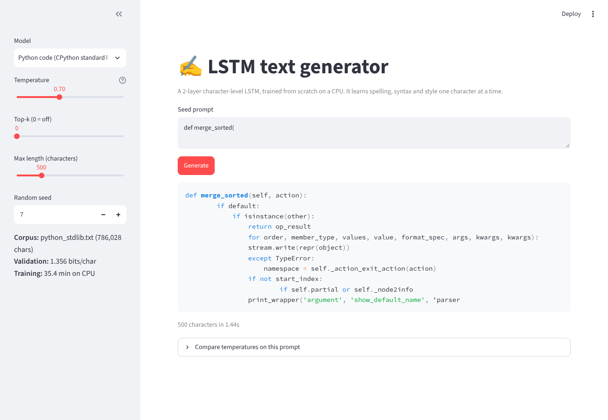
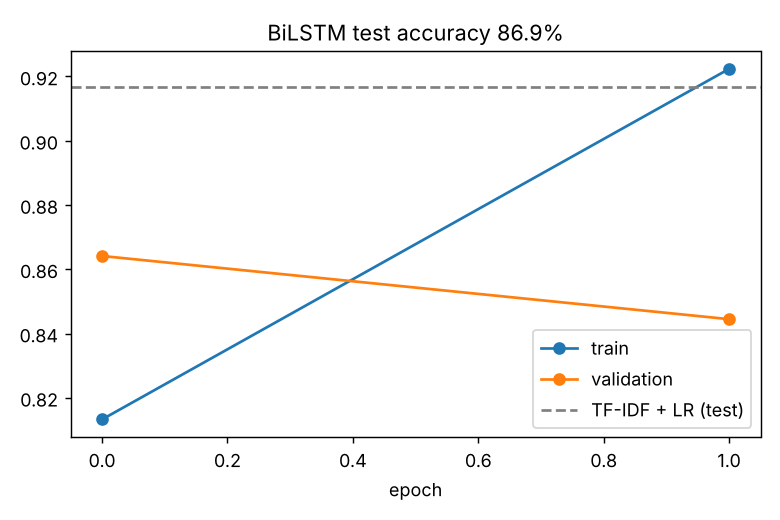
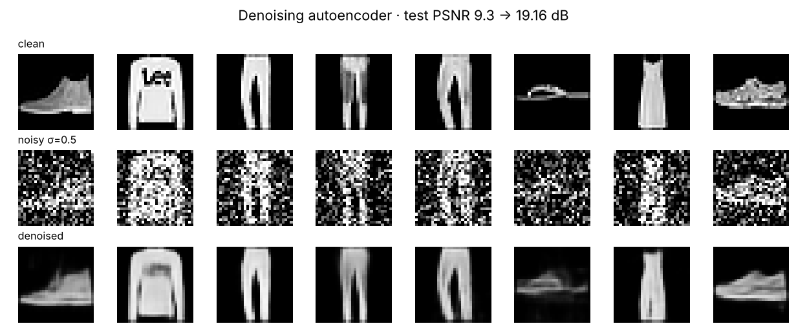
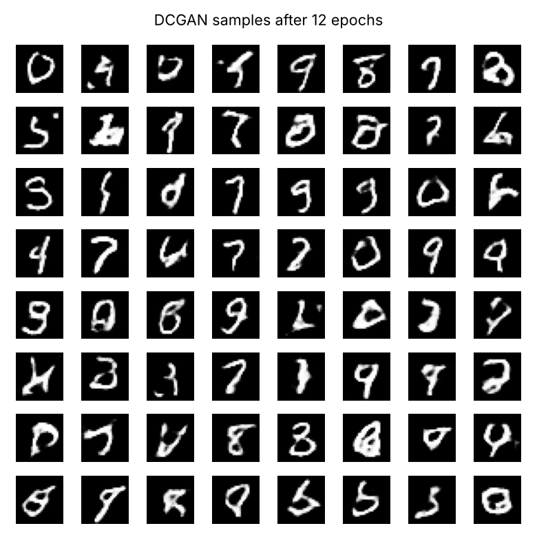

# Week 3: Sequence models & generative models

| Task | File | Result |
|---|---|---|
| LSTM sentiment analysis | [`src/sentiment_lstm.py`](src/sentiment_lstm.py) | Bidirectional LSTM on 49,582 IMDB reviews (duplicates removed before splitting): **86.9 % test accuracy, AUC 0.947**. An honest baseline, TF-IDF + logistic regression, does **better: 91.7 %** |
| Text generation with an LSTM | [`src/charlstm.py`](src/charlstm.py) | A character-level 2-layer LSTM trained on Shakespeare (1.1 M characters): **2.19 bits/char** on held-out text, and it writes plausible play dialogue |
| Denoising autoencoder | [`src/denoising_ae.py`](src/denoising_ae.py) | A convolutional autoencoder on Fashion-MNIST. At the training noise level (σ = 0.5), test PSNR goes **9.3 → 19.2 dB (+9.9 dB)**, and it still helps at noise levels it never saw |
| GAN that generates images | [`src/gan_mnist.py`](src/gan_mnist.py) | A DCGAN on MNIST, judged by a separate classifier (98.7 % test accuracy) instead of by eye: 10,000 generated digits cover **all 10 classes almost evenly (3.28 of a maximum 3.32 bits)**; **52 %** are recognised with more than 90 % confidence |
| **Mini project:** creative text generator app | [`app/streamlit_app.py`](app/streamlit_app.py) | A Streamlit app with two character-LSTMs, **Python code** (trained on the CPython standard library) and Shakespeare, plus temperature, top-k, seed and a side-by-side temperature comparison. Python model: **1.36 bits/char** |



## Data (all public)
* **IMDB** movie reviews (Maas et al. 2011): the 50,000-review CSV. 418 duplicate reviews are removed **before**
  splitting, otherwise copies would leak between train and test. Split: 35,698 train / 3,967 validation /
  9,917 test.
* **Tiny Shakespeare** (public domain) and **Python source** from the CPython standard library (`Lib/`, PSF
  licence), both in [`data/`](data/).
* **MNIST** and **Fashion-MNIST** in the original IDX files from GitHub ([`src/mnist_data.py`](src/mnist_data.py)).

## 1 · Sentiment analysis
**Model:**
* `TextVectorization` (20 k words, 300 tokens) → embedding 128 → **bidirectional LSTM 64** → dropout 0.4 →
  sigmoid;
* 2.66 M parameters; early stopping on validation accuracy.

| Model (9,917 test reviews) | Accuracy |
|---|---|
| BiLSTM | 86.9 % (AUC 0.947) |
| TF-IDF (1–2 grams) + logistic regression | **91.7 %** |



**Honest reading:**
* The LSTM peaks after **one epoch** (86.4 % validation), then over-fits: train accuracy 92 %, validation 84 %.
  Early stopping restores the best weights.
* On IMDB, a well-tuned linear model on n-grams is famously hard to beat without pretrained embeddings or a
  transformer. Long reviews (300 tokens and more) are also hard for an LSTM trained from scratch on 36 k examples.

**Demo sentences** ([`results/sentiment.json`](results/sentiment.json)):
* "An absolute masterpiece…" → **0.88 positive**;
* "I wanted to love it, but the plot was a mess…" → 0.42;
* "The movie was not good." → 0.55. **Negation is a known weak spot.**

## 2 · Text generation (Shakespeare)
**Model:** a character-level LSTM (embedding 64, 2 × 384 hidden units, dropout 0.2) trained on 128-character
windows with AdamW and a one-cycle schedule, 2,000 steps (34 minutes on 1 CPU core). The last 5 % of the text is
held out.

| | |
|---|---|
| Held-out loss | 1.515 nats = **2.19 bits per character** (uniform over 65 characters would be 6.0) |

Sample at temperature 0.5, unedited:
```
CAPULET:
Marry, and so that I may call him with a virtue,
And he must not stay to stand her hence:
The day of your desert to the world with sorrow
```
It has learned speaker names, line breaks, verse rhythm and an archaic vocabulary from characters alone. The meaning
is still dream logic. Higher temperatures invent words ("Burshiness", "NORTHUMBERLENBURY"); all three temperatures
are in [`results/charlstm_shakespeare.log`](results/charlstm_shakespeare.log).

## 3 · Denoising autoencoder
**Model:**
* encoder 28→14→7 (32/64 channels), decoder with transposed convolutions; 97 k parameters;
* trained to output the **clean** image from a noisy one (Gaussian σ = 0.5, resampled every batch), with MSE loss;
* 8 epochs in 5 minutes.

| Test images (10,000) | Noisy PSNR | Denoised PSNR | Gain |
|---|---|---|---|
| σ = 0.3 (unseen level) | 12.8 dB | 20.3 dB | +7.5 dB |
| **σ = 0.5 (training level)** | 9.3 dB | **19.2 dB** | **+9.9 dB** |
| σ = 0.7 (unseen level) | 7.6 dB | 16.6 dB | +9.0 dB |



Shapes are recovered almost perfectly, but fine texture (the logo on the sweater, the sole of the sneaker) is
smoothed away. That's the classic trade-off of MSE training: averaging is the safest guess.

## 4 · GAN
**Model** ([`src/gan_mnist.py`](src/gan_mnist.py)):
* **generator:** z (64) → 7×7×128 → transposed convolutions with batch norm → 28×28 tanh;
* **discriminator:** strided convolutions, LeakyReLU, dropout;
* training: non-saturating loss, Adam (2e-4, β₁ 0.5), one-sided label smoothing (0.9), 12 epochs, 32 minutes on
  1 CPU core.

**Measured instead of eyeballed.** A separate CNN classifier, trained on real MNIST (98.7 % test accuracy), labels
10,000 generated digits ([`results/gan.json`](results/gan.json)):

| | Generated | Real test digits |
|---|---|---|
| Mean classifier confidence | 0.83 | 0.98 |
| Recognised with confidence > 0.9 | 52 % | |
| Class spread (entropy of the label histogram) | **3.28 bits** (maximum 3.32) | |
| Smallest / largest class share | 6.4 % (digit 4) / 13.5 % (digit 3) | 10 % each |



**Reading it:**
* **No mode collapse:** every digit is generated, close to evenly. The losses stayed balanced the whole time
  (D ≈ 1.25, G ≈ 1.05), with no sign of one network overpowering the other.
* **Quality is mixed:** about half the samples are clean digits (0, 7, 9, 3); the rest are wobbly or ambiguous
  strokes that the judge is unsure about.
* Progress over training, the same 16 noise vectors at every epoch: [`results/gan_progress.png`](results/gan_progress.png).

## 5 · Mini project: LSTM text generator app
**Second model:** the same character-LSTM trained on **786 KB of real Python** (CPython `Lib/`), 2,000 steps:
**1.36 bits/char** on held-out code (code is more predictable than verse). Sample at temperature 0.6, seed 7,
unedited:
```python
def merge_sorted(self, action):
        if default:
            if isinstance(other):
                return op_result
                    or x in range(*args, **kwargs):
                    result = expand_targets
```
It has learned Python's *surface*: indentation after `:`, `self`, `isinstance`, `*args, **kwargs`, `return`, and
private `_names`. It hasn't learned semantics or even consistent indentation, so the output rarely parses. That's
the honest ceiling of a 1.9 M-parameter character model trained for 35 minutes, and why code assistants use large
transformers.

**App** ([`app/streamlit_app.py`](app/streamlit_app.py)):
* pick the model, type a seed prompt (default `def merge_sorted(` or `ROMEO:`), and set temperature, top-k, length
  and seed;
* the output is shown with syntax highlighting;
* an expander compares temperatures 0.3 / 0.8 / 1.3 on the same prompt;
* the sidebar shows the corpus size, validation bits/char and training time.

```bash
streamlit run app/streamlit_app.py      # http://localhost:8501
```

## Run
```bash
pip install tensorflow-cpu keras torch pandas scikit-learn matplotlib streamlit
cd deep-learning/week-3
python src/sentiment_lstm.py                         # needs the IMDB CSV: IMDB_CSV=/path/imdb.csv
python src/charlstm.py data/shakespeare.txt results/charlstm_shakespeare.pt 2000
python src/charlstm.py data/python_stdlib.txt results/charlstm_python.pt 2000
python src/denoising_ae.py && python src/gan_mnist.py   # MNIST files download automatically
streamlit run app/streamlit_app.py
```
