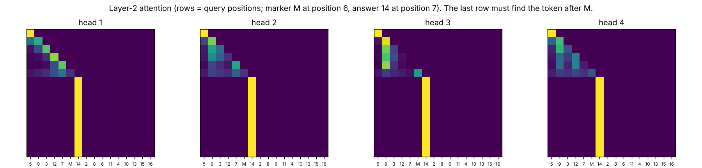
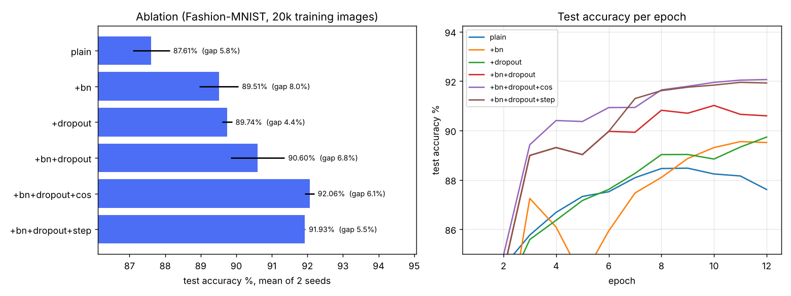
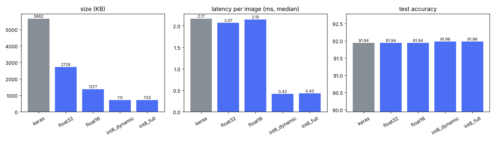
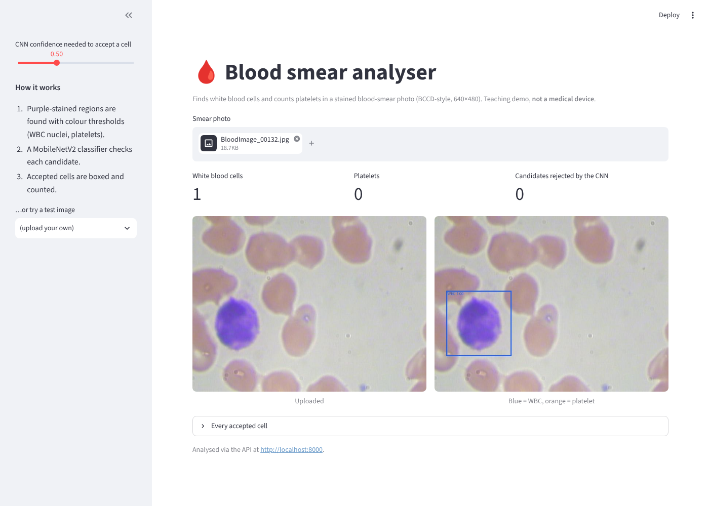

# Week 4: Transformers, optimisation & deployment

| Task | Folder / file | Result |
|---|---|---|
| Self-attention from scratch | [`src/self_attention.py`](src/self_attention.py) | Scaled dot-product and multi-head attention with only matmul, softmax and reshapes. It **matches `torch.nn.MultiheadAttention` to 1e-7**, the causal mask leaks **exactly 0**, and a tiny 2-layer transformer solves a lookup task **100 %** (83.8 % without attention) |
| Ablation: batch norm, dropout, learning-rate schedules | [`src/ablation.py`](src/ablation.py) | A controlled ablation on Fashion-MNIST (2 seeds per row): plain **87.6 %** → +BN 89.5 % / +dropout 89.7 % → both 90.6 % → **+ cosine LR schedule 92.1 %**. The schedule is the single biggest step |
| Optimise for deployment (TFLite / quantisation) | [`src/tflite_benchmark.py`](src/tflite_benchmark.py) | The week-2 CIFAR-10 CNN in int8: **7.8× smaller (5.5 MB → 0.71 MB) and 5× faster (2.2 → 0.43 ms/image)**, with **no accuracy loss** (91.98 % vs 91.94 %) |
| Deploy as a REST API with error handling | [`api/`](api/) | FastAPI serving the int8 model: single and batch prediction, JSON errors (400/413/415/422/429/500/503) with request IDs, structured logs, rate limiting, a Dockerfile, and **15 passing tests** |
| **Capstone:** end-to-end deep-learning application | [`capstone/`](capstone/) | **Blood-smear analyser** (BCCD, medical imaging): stain segmentation plus a MobileNetV2 cell classifier (**macro-F1 0.988**). WBC localisation **recall 1.00, precision 0.95**; platelet count MAE **0.56** (baseline 0.88). FastAPI + Streamlit + Docker Compose and a [full report](capstone/REPORT.md) |

## 1 · Self-attention from scratch
[`src/self_attention.py`](src/self_attention.py) implements `softmax(QKᵀ/√d_k + mask)·V`, multi-head splitting and
merging, and causal and padding masks. It's verified three ways ([`results/self_attention.json`](results/self_attention.json)):

| Check | Result |
|---|---|
| Same weights as `torch.nn.MultiheadAttention`: plain / causal / padding mask | max difference 1.0e-7 / 8.9e-8 / 1.2e-7 |
| Causal mask: change token t+1 and see what moves | outputs at positions ≤ t change by **0.0**; later positions change (up to 4.1) |
| Learning: find the token right after a marker, anywhere in a 16-token sequence (chance 6.25 %) | **100 %** with attention; **83.8 %** when attention is replaced by running averages |



**The map shows the mechanism:** every query position after the marker attends almost entirely to the answer
token (column "14", right after "M") in all four heads of layer 2. That's exactly the lookup the task needs.

## 2 · Ablation: batch norm, dropout, learning-rate schedules
**Setup** ([`src/ablation.py`](src/ablation.py)): one small CNN (2 conv blocks + dense 256) on a 20,000-image
Fashion-MNIST subset, so that over-fitting shows up.
* Fixed across rows: SGD with Nesterov momentum, batch 128, 12 epochs, and 2 seeds per row; the full 10,000-image
  test set.
* Exactly one ingredient changes from row to row.
* The plain row's seed-0 run came from the first, sequential run; the rest were run as two parallel seed workers
  with identical code. Raw numbers: [`results/ablation.json`](results/ablation.json).

| Configuration | Test accuracy (mean ± half-range) | Train − test gap |
|---|---|---|
| plain (no BN, no dropout, constant LR 0.02) | 87.6 % ± 0.5 | 5.8 points |
| + batch norm (LR 0.05) | 89.5 % ± 0.6 | 8.0 |
| + dropout (0.1 conv / 0.3 dense) | 89.7 % ± 0.1 | **4.4** |
| + batch norm + dropout | 90.6 % ± 0.8 | 6.8 |
| + BN + dropout + **cosine** LR decay | **92.1 % ± 0.1** | 6.1 |
| + BN + dropout + **step** decay (÷10 at 50 % and 75 %) | 91.9 % ± 0.0 | 5.5 |



**What each ingredient does:**
* **Batch norm** speeds up training and tolerates a 2.5× larger learning rate (+1.9 points). It doesn't regularise
  much here: the gap grows to 8 points, and the test curve wobbles mid-training at the high constant learning rate
  (the dip around epoch 5).
* **Dropout** is the regulariser: it gives the **smallest train-test gap (4.4)** and the most stable seeds
  (±0.1).
* **Combined**, they add up (90.6 %), but a constant learning rate leaves the model bouncing around the minimum
  (see the curves).
* **A learning-rate schedule is the biggest single gain (+1.5 points)**, and it removes the seed-to-seed variance.
  Annealing lets SGD settle into the minimum. Cosine and step decay end up equal within noise (92.1 % vs 91.9 %);
  cosine gets there more smoothly.
* **Caveat:** 2 seeds per row is enough to see differences of 1 point or more, not the 0.1-point difference between
  cosine and step.

## 3 · TFLite optimisation
The week-2 CIFAR-10 network (0.7 M parameters, 91.94 %) is converted four ways and measured on all 10,000 test
images ([`results/tflite.json`](results/tflite.json)). Latency is single-image, 1 thread, median of 300 runs on
this sandbox's Xeon CPU (AVX-512 VNNI).

| Variant | Size | Test accuracy | Agrees with Keras | Latency (median / p95) |
|---|---|---|---|---|
| Keras `.keras` (reference) | 5,662 KB* | 91.94 % | – | 2.17 / 3.09 ms |
| TFLite float32 | 2,729 KB | 91.94 % | 100 % | 2.07 / 2.20 ms |
| TFLite float16 weights | 1,377 KB | 91.94 % | 100 % | 2.15 / 2.58 ms |
| TFLite int8 dynamic range | **711 KB** | 91.98 % | 99.8 % | **0.42** / 0.67 ms |
| TFLite int8 full integer | 723 KB | 91.98 % | 99.5 % | 0.43 / **0.47** ms |

\* The `.keras` file also stores the optimizer state from training. The weights alone are the 2.7 MB float32 size.



**Takeaways:**
* **int8 is the clear winner:** 4× smaller than float32 and about 5× faster on a CPU with int8 instructions, at no
  measurable accuracy cost (it even gained 4 images by chance).
* **float16** halves the size but not the latency on this CPU; it pays off on GPUs and mobile chips with fp16
  units.
* **Full-integer** (calibrated on 500 training images) has the **tightest tail latency** and is what
  microcontrollers and Edge TPUs need. Dynamic range needs no calibration data.

## 4 · REST API (`api/`)
[`api/main.py`](api/main.py), FastAPI serving the full-integer int8 model:

| Endpoint | |
|---|---|
| `GET /health` | liveness, model loaded, uptime |
| `GET /model` | model file, size, input, classes and a note on what it can't do |
| `POST /predict?top_k=3` | field `file` → label, confidence, top-k |
| `POST /predict/batch` | up to 16 files; **one bad file doesn't fail the batch** (a per-file result or error) |

**Error handling** (every error is JSON: `{"error": {"code", "message", "request_id"}}`):

| Status | When |
|---|---|
| 400 | no file, empty file |
| 413 | file over 5 MB, batch over 16 |
| 415 | not an accepted image type |
| 422 | corrupt or truncated image (Pillow `verify()`), image under 8×8, bad query parameter |
| 429 | rate limit (60 requests per minute per client, with `Retry-After`) |
| 500 | anything unexpected: logged with the request ID, **no stack trace or internal message sent to the client** |
| 503 | model not loaded (the server still starts, and `/health` reports `degraded`) |

**Also:**
* every response has `X-Request-ID` and `X-Process-Time-ms`;
* every request is logged as one JSON line ([`results/api_server_log_sample.jsonl`](results/api_server_log_sample.jsonl));
* images of any size are centre-cropped and resized to 32×32;
* a non-root [`Dockerfile`](api/Dockerfile) with a health check.

**Tests** ([`api/tests/test_api.py`](api/tests/test_api.py)): `pytest -q api/tests` → **15 passed**. They cover:
* real CIFAR test images (at least 32 of 40 correct);
* a larger JPEG;
* every error code;
* a truncated PNG;
* batch partial failure;
* the rate limiter;
* a forced internal error that must not leak;
* a missing model.

Live `curl` session: [`results/api_demo.txt`](results/api_demo.txt).

## 5 · Capstone: blood-smear analyser (`capstone/`)
**Read the full write-up in [`capstone/REPORT.md`](capstone/REPORT.md).** In short:
* **Data:** BCCD (MIT licence), 364 stained blood-smear images, official image-level splits.
* **Pipeline:** HSV stain segmentation finds WBC nuclei and platelet candidates → a MobileNetV2 classifier (TFLite
  int8, 2.4 MB) confirms each one → boxes and counts.
* **Results on 72 test images:**
  * cell classifier macro-F1 **0.988**;
  * WBC localisation precision **0.947** / recall **1.000** (IoU ≥ 0.5);
  * platelet count MAE **0.56**, against 0.88 for a constant baseline.
* **Honest notes:**
  * the first platelet rule over-counted (MAE 1.50) and was re-tuned on train+val;
  * RBCs aren't counted, because their annotations are incomplete;
  * not a medical device.
* **Shipping:** FastAPI (`/analyze`, `/classify`, `/health`) + Streamlit UI + one Dockerfile and Docker Compose.
  API tests: 5 passing.



## Run
```bash
pip install torch tensorflow-cpu keras ai-edge-litert fastapi uvicorn python-multipart pillow opencv-python-headless streamlit scikit-learn matplotlib pytest
cd deep-learning/week-4
python src/self_attention.py
python src/ablation.py                 # Fashion-MNIST downloads automatically
python src/tflite_benchmark.py         # uses ../week-2/results/cifar_cnn.keras and the CIFAR-10 files (CIFAR_DIR)
pytest -q api/tests && uvicorn api.main:app        # http://localhost:8000/docs
cd capstone                            # BCCD: git clone --depth 1 https://github.com/Shenggan/BCCD_Dataset.git; export BCCD_DIR=$PWD/BCCD_Dataset/BCCD
python src/train_classifier.py && python src/tune_platelets.py && python src/evaluate.py
pytest -q tests && docker compose up --build       # API :8000, UI :8501
```
