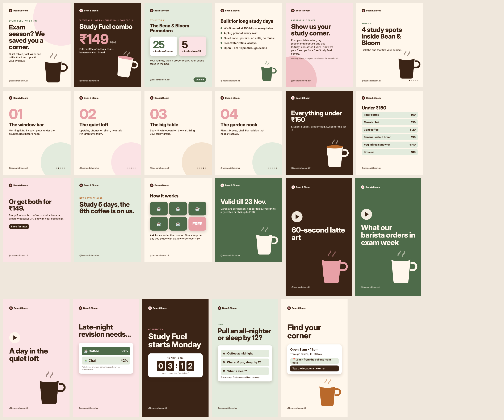

# Digital Marketing — Week 2: social media and content strategy

The brand continues from week 1: **Bean & Bloom**, a fictional study-friendly café near a Bengaluru college.
The campaign is **"Study Fuel"**, running 10–23 Nov during exam season, with a ₹149 coffee + banana bread combo, a Study Streak loyalty card and #StudyFuelCorner user-generated content.



| Assignment | Deliverable |
|---|---|
| 1-week social media content calendar | Week 1 of the [2-week calendar](plan/content-calendar-2wk.md) (Mon 10 – Sun 16 Nov: 11 posts and stories), with the full CSV ([captions, hashtags, alt text](plan/content-calendar-2wk.csv)) |
| 5 Instagram post graphics (Canva) | [01 launch](exports/posts/01-launch.png) · [02 offer](exports/posts/02-offer.png) · [03 study tip](exports/posts/03-tip.png) · [04 amenities](exports/posts/04-amenities.png) · [05 UGC call](exports/posts/05-ugc.png). Built in code from a shared [brand kit](brand-kit.md) with Canva-ready values |
| 3 email templates: welcome, promotional, re-engagement | Responsive HTML: [welcome](email/welcome.html) · [promotional](email/promotional.html) · [re-engagement](email/reengagement.html), with previews in `exports/email-*-{desktop,mobile}.png` |
| Grow a page by 50+ followers organically | [growth-plan.md](plan/growth-plan.md) + the daily follower log in the tracker. This step needs your own Instagram account (see Limitations) |
| **Mini project:** brand campaign | Everything below |

## Mini project: the Study Fuel campaign
| Required | Delivered |
|---|---|
| Brand page | Profile set-up (name, bio, link, pinned posts, highlights) in [growth-plan.md](plan/growth-plan.md), plus the [brand kit](brand-kit.md) |
| **15 posts**: carousels, reel thumbnails, stories | 5 feed posts · 3 carousels (11 slides) · 3 reel covers · 4 stories, in [exports/posts/](exports/posts/) |
| 2-week content calendar | [19 scheduled items](plan/content-calendar-2wk.md), each with time, format, asset, pillar, caption, hashtags, alt text, CTA and success metric |
| 3 email sequences | [Welcome · Promotion · Re-engagement](email/sequences.md): 9 emails with subject lines, preview text, triggers, segments, frequency cap, A/B test |
| Track engagement metrics | [engagement-tracker.xlsx](plan/engagement-tracker.xlsx), with sheets: post tracker (engagement and save rate formulas), summary, targets, daily follower log, in-store redemptions |

### Strategy in one paragraph
Students choose a café for **a table, Wi-Fi and price**, not latte art, so every pillar answers one of those.
* The content mix is roughly 40 % value (study spots, Pomodoro tip, menu under ₹150), 25 % offer, 20 % community (UGC, polls, quizzes) and 15 % behind the scenes (reels).
* Posting happens at 1 pm and 6–9 pm, when students are on their phones.
* Success is measured on actions that bring people in (saves, profile visits, direction taps, in-store redemptions with a college ID), not likes.

## Rebuild
```bash
python design/posts.py && node design/render.js      # 15 campaign assets (23 images incl. carousel slides)
python plan/build_plan.py                            # calendar CSV/MD + tracker xlsx
python email/build_emails.py                         # 3 HTML emails
```

## Limitations
* **The follower growth task needs a real Instagram account.** Creating the account and posting publicly can only be done by you.
  * The page, posts, captions, schedule and tracker are ready to use as they are.
  * The tracker's results columns are deliberately empty: no fabricated metrics.
* Canva wasn't used directly, because it needs a personal account. The [brand kit](brand-kit.md) has every value to rebuild or edit the designs there.
* Target figures in the tracker (for example a 4 % engagement rate) are labelled assumptions, to be replaced with the page's own baseline.
