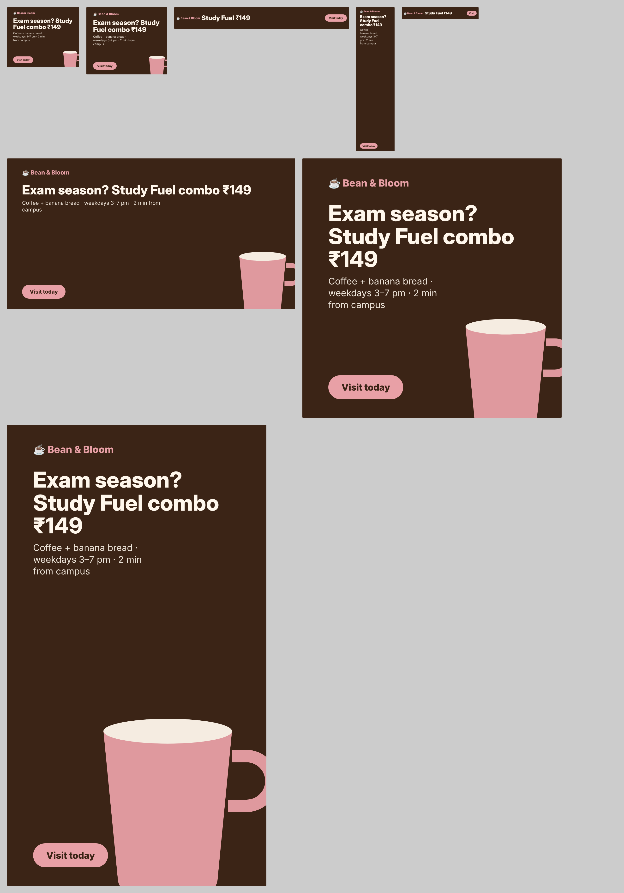

# Digital Marketing — Week 3: paid advertising and analytics

The campaign continues from week 2: **Study Fuel**, for the fictional study café Bean & Bloom, now with paid media.
Full write-up: **[report.md](report.md)** (structure, forecast, honest conclusions, optimisation rules, report template).

| Assignment | Deliverable |
|---|---|
| Google Ads search campaign (demo account) | [Editor-import CSV](ads/google-search-editor.csv) + [campaign sheet](ads/google-search.md): 3 ad groups, 14 keywords, 3 responsive search ads, negatives, sitelinks, callouts. Imports **paused**. Every headline, description and path is checked against Google's character limits by [build_ads.py](ads/build_ads.py), which caught and fixed 3 over-length texts |
| Facebook/Instagram campaign with audience targeting | [meta-campaign.md](ads/meta-campaign.md): Leads objective, 4 ad sets (interests, engagers custom audience, customer-list custom audience, 1 % lookalike), exclusions, 3 ads with copy, creatives |
| 2 landing pages | [Variant A: offer-first](landing/a.html) · [Variant B: problem-first with a 2-field form](landing/b.html), each with a lead-capture form, validation, UTM capture, a consent banner and GA4 events. Previews: `exports/landing-*` |
| Google Analytics + custom dashboard | [ga4-setup.md](analytics/ga4-setup.md) (tag, Consent Mode v2, events, custom dimension, Looker Studio tiles) · [dashboard.html](analytics/dashboard.html), showing the forecast until a GA4/Ads CSV export is loaded |
| **Mini project:** full paid campaign | Search + Display ([6 banner sizes](exports/creatives/)) + Meta with custom audiences + landing page with lead form + GA4, plus the [performance report](report.md) with a forecast ([forecast.py](analytics/forecast.py)) and an A/B sample-size calculation |

## Verified
* **Ad text limits:** all 24 headlines (≤ 30 chars), 8 descriptions (≤ 90), paths, sitelinks and callouts pass.
* **Landing pages** (automated browser test, [results](tests/landing-test-results.json)):
  * an empty submit shows field errors;
  * valid input shows the code;
  * GA4 receives `form_start` → `form_error` → `generate_lead`, carrying the UTM source, medium and campaign;
  * axe-core finds **0 accessibility violations** on both variants.
* **Spreadsheet-style forecast** reproducible from stated assumptions; the low, expected and high cases are all in [forecast.md](analytics/forecast.md).

## Key insight
At a ₹6,020 budget the campaign is forecast to bring about 60 leads and 21 in-store redemptions. That is **₹288 per redemption against about ₹85 margin**, so paid ads only pay back through repeat visits. The plan therefore measures 30-day repeat visits (Study Streak card) and gives clear rules to cut weak channels early.

## Limitations
* **No live ads were run.** Google Ads, Meta Ads Manager, a website builder and GA4 all need your own accounts, and running ads costs money.
  * You can import the campaign into a **Google Ads test account** for free, and it arrives paused.
  * The Meta campaign can be built from the sheet in a few minutes, and left as a draft so it costs nothing.
* The landing pages are plain HTML rather than Carrd or WordPress. They can be hosted free (GitHub Pages or Netlify), or the copy and layout pasted into Carrd.
* Forecast inputs (CPC, CTR, conversion rates) are labelled assumptions. Replace them with real data after the first week.
