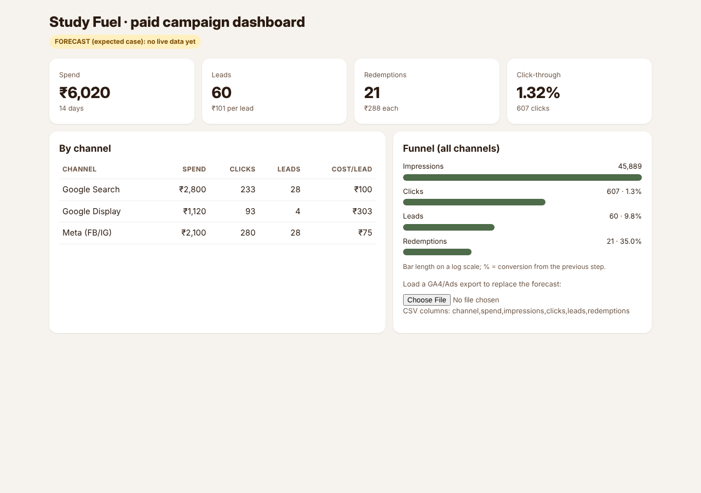

# Study Fuel paid campaign: plan and performance report

**Business:** Bean & Bloom (fictional study café near a Bengaluru college) · **Flight:** 10–23 Nov 2026 · **Budget:** ₹6,020
**Goal:** get students to claim the ₹149 Study Fuel code (lead) and redeem it in store (conversion).
**Status:** pre-launch. Everything is built and tested; no live spend has happened, so the numbers below are a **forecast** with stated assumptions, not results.

## 1. Campaign structure
| Channel | Role | Budget | Build |
|---|---|---:|---|
| Google Search | Capture people already searching ("study cafe near me") | ₹2,800 | 3 ad groups, 14 keywords, 3 RSAs, 10 negatives ([google-search.md](ads/google-search.md), [Editor CSV](ads/google-search-editor.csv)) |
| Google Display | Awareness + remarketing near campus | ₹1,120 | 6 banner sizes + 1.91:1 responsive image ([creatives](exports/creatives/)) |
| Meta (FB/IG) | Reach students where they scroll | ₹2,100 | 4 ad sets (interest, engagers, customer list, lookalike), 3 ads each ([meta-campaign.md](ads/meta-campaign.md)) |
| Landing pages | Convert clicks into leads | — | [A: offer-first](landing/a.html) vs [B: problem-first, 2 fields](landing/b.html) |
| Measurement | Know what worked | — | GA4 with consent mode, 3 custom events, LP-variant dimension, dashboard ([ga4-setup.md](analytics/ga4-setup.md)) |

## 2. Forecast (expected case; low and high cases in [forecast.md](analytics/forecast.md))
| Channel | Clicks | Leads | Redemptions | Cost / lead | Cost / redemption |
|---|---:|---:|---:|---:|---:|
| Google Search | 233 | 28 | 10 | ₹100 | ₹286 |
| Google Display | 93 | 4 | 1 | ₹303 | ₹867 |
| Meta | 280 | 28 | 10 | ₹75 | ₹214 |
| **Total** | **607** | **60** | **21** | **₹101** | **₹288** |

## 3. What the forecast says (the honest part)
1. **Paid ads don't pay back on the first visit.** A redeemed combo earns about ₹85 gross margin, but costs ₹155–₹518 to acquire across the low-to-high cases (first-visit return on ad spend 0.16–0.55).
   * The campaign only makes sense if new customers come back.
   * So the **Study Streak card** (5 visits → free coffee) is part of the plan, and repeat visits are tracked in store.
   * If repeat rates are low, the organic plan from week 2 is the better use of money.
2. **Display is the weakest channel.** It's forecast at ₹303 per lead and judged only on assisted conversions. If it doesn't assist by day 7, move its budget to Search.
3. **The A/B test can't reach significance on paid traffic.** Detecting a lift from 12 % to 15 % needs about 2,000 visitors per variant; the campaign brings about 600 clicks. The result will be reported with a confidence interval and treated as directional, with organic Instagram traffic added.

## 4. Optimisation rules during the flight
* Day 4: pause keywords with ≥ 40 clicks and 0 leads, and Meta ad sets with CTR < 0.6 %.
* Weekly: shift budget toward the lowest **cost per redemption** (counted at the till), not cost per click.
* Add search terms that convert as exact-match keywords, and irrelevant ones (jobs, recipes, chains) as negatives.

## 5. Report template (fill in after launch)
| Metric | Target | Actual | Source |
|---|---:|---:|---|
| Spend | ₹6,020 | | Google Ads + Meta |
| Clicks | 607 | | Ads platforms |
| Landing-page lead rate | 10 % | | GA4 `generate_lead` / sessions |
| Leads | 60 | | GA4 |
| Redemptions | 21 | | Till count with code |
| Cost per redemption | ₹288 | | spend / redemptions |
| A: lead rate vs B: lead rate | — | | GA4, dimension LP variant |
| Repeat visits from new customers within 30 days | ≥ 30 % | | Study Streak cards |
