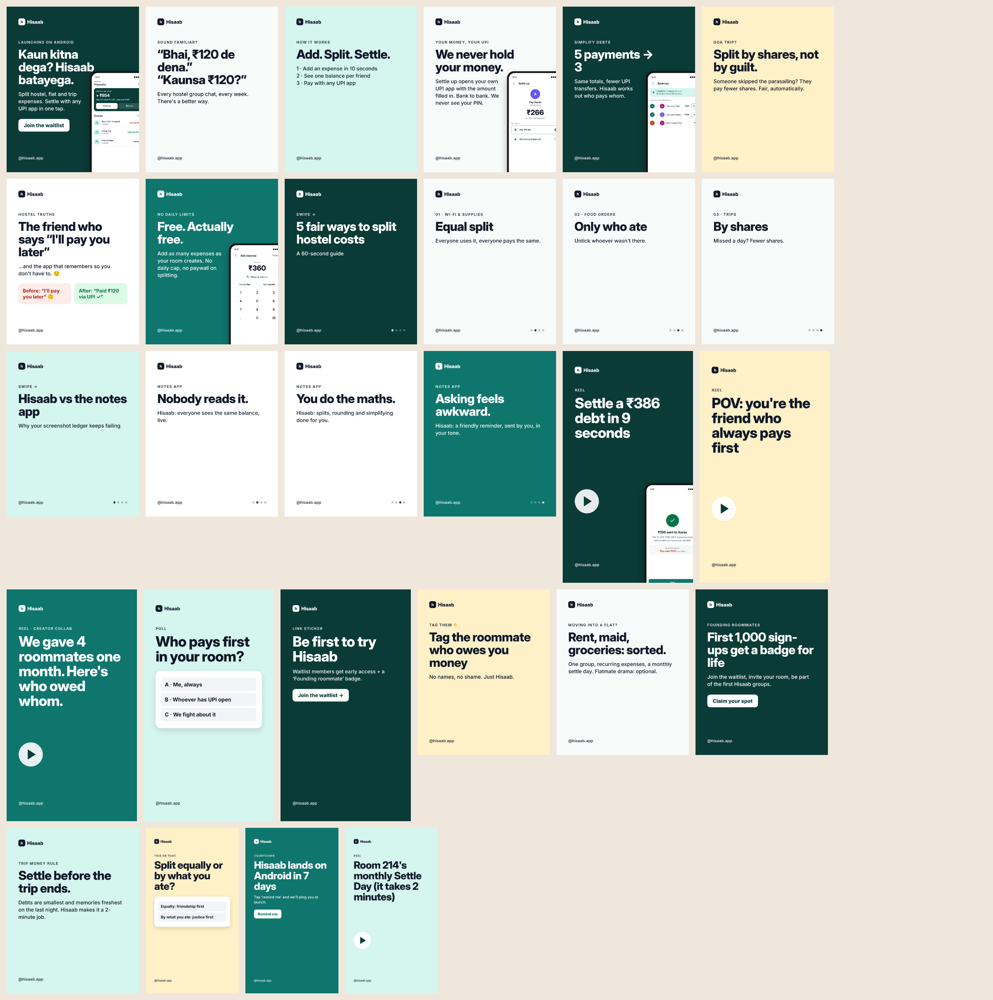

# Digital Marketing — Week 4: strategy and portfolio (major project)

**Startup:** **Hisaab**, a free app to split expenses with roommates and trip friends and settle with UPI (the product designed in the [UI/UX case study](../../ui-ux/week-4/case-study/case-study.md)).
Main document: **[docs/strategy.md](docs/strategy.md)**.

| Assignment | Deliverable |
|---|---|
| Complete digital marketing strategy for a startup | [strategy.md](docs/strategy.md): SMART goal, market research with sources, positioning, 3 personas, funnel, channel plan with KPIs, GA4 measurement, ₹40k budget and timeline, brand and reputation, risks |
| Marketing funnel, awareness to conversion | [funnel diagram](exports/funnel.png) ([source](docs/funnel.mmd)) with KPIs per stage, plus the invite growth loop |
| Influencer outreach pitch | [influencer-pitch.md](docs/influencer-pitch.md): DM/email pitch, selection criteria, brief with ASCI disclosure rules, affiliate tier |
| Professional marketing portfolio | [portfolio/index.html](portfolio/index.html): all 4 weeks ([preview](exports/portfolio.png)) |

## Major project checklist
| Required | Delivered |
|---|---|
| Market research | Strategy §1: 5 insights with sources, competitor gaps, positioning statement |
| Buyer personas | Strategy §2: Diya, Kabir, Rohan, with channels, pains, messages and hooks |
| SEO-optimised website / landing page | [site/index.html](site/index.html) + [pillar guide](site/blog/split-hostel-expenses.html), `sitemap.xml`, `robots.txt`. Includes titles, meta descriptions, canonical, Open Graph and **schema.org** (SoftwareApplication, FAQPage, Organization, Article). **Lighthouse: SEO 100, accessibility 100, performance 100** ([report](docs/lighthouse.md); one image-distortion bug found and fixed) |
| Social media campaign, 20+ posts | **22 posts / 28 images** ([overview](exports/social-overview.png), [exports/posts/](exports/posts/)): 15 feed, 2 four-slide carousels, 4 reel covers, 5 stories, with a [4-week calendar](social/calendar.csv) mapped to funnel stages |
| Google Analytics | Waitlist `sign_up` event live on the site under Consent Mode v2; app event plan, north-star metric and viral coefficient in strategy §5; set-up guide in [week 3](../week-3/analytics/ga4-setup.md) |
| Paid campaigns, Google + Facebook | [ads/paid-plan.md](ads/paid-plan.md): Search (high intent + problem), App campaign at launch, 3 Meta ad sets (cold, lookalike, retargeting), RSA copy within limits, kill and scale rules, forecast |
| Email sequence | [email/launch-sequence.md](email/launch-sequence.md): 6 emails, waitlist → launch → activation → re-engage, with triggers and metrics |
| Strategy document | [docs/strategy.md](docs/strategy.md) |



## Rebuild
```bash
python site/build_site.py && python social/posts.py && node social/render.js && mmdc -i docs/funnel.mmd -o exports/funnel.png
```

## Limitations
* A concept-stage launch plan: no live ads, social accounts or GA property were created, since those need your own accounts and money.
  * Forecasts and targets are labelled assumptions.
  * Lighthouse's only remaining flag is the GA script being blocked in the offline test environment.
* The site isn't deployed. It can be hosted free on GitHub Pages or Netlify (sitemap and canonical URLs use a placeholder domain).
