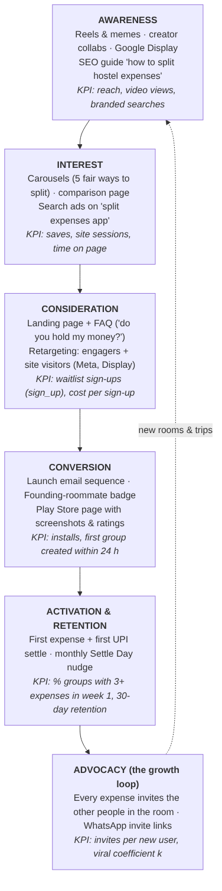

# Hisaab: digital marketing strategy (launch, Nov–Dec 2026)

**Startup:** Hisaab, a free mobile app to split shared expenses with roommates and trip friends and settle in one tap with any UPI app. Product design: [UI/UX case study](../../../ui-ux/week-4/case-study/case-study.md).
**Stage:** pre-launch (Android first). **Marketing budget:** ₹40,000 for 6 weeks (₹20k paid media, ₹12k creators, ₹8k contingency and design).
**Goal (SMART):** **3,000 waitlist sign-ups by launch (14 Dec)** and **1,500 activated groups** (a group with 3+ expenses) by 31 Jan 2027, at a blended cost under ₹15 per sign-up.

## 1. Market research
| Insight | Evidence | So what |
|---|---|---|
| Payment is solved; bookkeeping isn't | UPI processed ~21,860 crore transactions in FY26 ([Business Today](https://www.businesstoday.in/india/story/upi-processes-21860-crore-transactions-in-fy26-peak-growth-seen-in-dec-jan-months-523412-2026-03-31)) | Position on tracking + settling, not on "payments" |
| Big student base living together | ~4.3 crore students in Indian higher education (AISHE 2021-22); a large share live in hostels or PGs | Start with hostels: dense, repetitive shared costs, word of mouth spreads inside rooms |
| The incumbent frustrates free users | Review analyses report anger at Splitwise's free-plan limits ([Kimola](https://kimola.com/reports/splitwise-app-feedback-report-uncover-user-insights-google-play-en-144452)) | "Free, no daily limits" is a credible switching message |
| Payment apps only split one bill | Google Pay's split works per bill, with money to the creator only ([Google Pay Help](https://support.google.com/pay/india/answer/11420982)) | "Running balance across a whole semester or trip" is the differentiator |
| Asking for money is socially awkward | Recurring theme in the UI/UX research and persona work | Tone: humour and relief, never shame; a reminder feature the user controls |

**Competitive positioning:** *For hostel and flat roommates in India who are tired of tracking who paid for what, Hisaab is the free expense-splitting app that keeps one running balance with every friend and settles it with any UPI app, unlike Google Pay's one-bill split or capped free plans.*

## 2. Buyer personas
| | **Diya, 20, "the organiser"** | **Kabir, 21, "the forgetful payer"** | **Rohan, 24, "the flatmate"** |
|---|---|---|---|
| Situation | 3rd-year student in a 4-person hostel room; fronts money for food and Wi-Fi | Same room; pays when reminded | First job in Bengaluru, shares a 3BHK |
| Channels | Instagram reels, college WhatsApp groups | YouTube Shorts, memes | LinkedIn, Instagram, Google search |
| Pain | Feels like a bank; asking feels petty | Confused by many small debts | Rent, maid, groceries and utilities every month |
| Message | "Get paid back without the awkward chat" | "One number, one tap to clear it" | "Rent and bills, settled every month" |
| Funnel hook | Meme/POV reels → waitlist | Friend's invite link | Search ad "split rent with flatmates" → SEO guide |

## 3. Marketing funnel

The engine is the **invite loop**: every expense involves other people, who receive a WhatsApp link to view and pay. So each activated user exposes 2–4 roommates to the product. Paid media and creators only have to start enough rooms.

## 4. Channel plan
| Channel | Role | Assets | KPI (6 weeks) |
|---|---|---|---|
| SEO website | Credibility + organic search | [Landing page + FAQ + comparison](../site/index.html), [pillar guide](../site/blog/split-hostel-expenses.html), schema.org, sitemap; **Lighthouse SEO 100, accessibility 100** ([report](lighthouse.md)) | Top 20 for "how to split hostel expenses"; 15 % of sign-ups organic |
| Instagram + Shorts | Awareness, interest | **22 posts** ([overview](../exports/social-overview.png), [calendar](../social/calendar.csv)): feed, 2 carousels, 4 reels, 5 stories | 150k reach, 4 % engagement, 1,000 profile visits |
| Creators | Trust + reach | [Outreach pitch + brief](influencer-pitch.md): 4 micro-creators, plus an affiliate tier | 300k views, 800 sign-ups via codes |
| Google Ads | High-intent capture | [Search + App plan](../ads/paid-plan.md) | Cost per sign-up ≤ ₹40 |
| Meta Ads | Scale + retargeting | Cold, lookalike, retargeting ad sets ([plan](../ads/paid-plan.md)) | Cost per sign-up ≤ ₹30 |
| Email | Convert + activate | [6-email sequence](../email/launch-sequence.md): waitlist → launch → activation → re-engage | 40 % of the waitlist installs at launch |
| Campus ambassadors | Seed the first rooms | 10 students × ₹1,000 + swag; hostel noticeboard QR posters | 100 rooms in week 1 of launch |

## 5. Measurement (GA4)
Same set-up as [week 3](../../week-3/analytics/ga4-setup.md): Consent Mode v2, custom events, a Looker Studio dashboard.
* **Site events:** `sign_up` (waitlist), `select_content` (comparison and FAQ opens), `file_download` (none yet). Already implemented on the site.
* **App events (Firebase → GA4):** `group_created`, `expense_added`, `settle_started`, `settle_marked_paid`, `invite_sent`.
* **North-star metric:** weekly active groups with 1+ expense.
* **Growth metric:** viral coefficient *k* = invites per new user × invite conversion. Aim for ≥ 0.6, so paid acquisition is amplified 2.5×.
* **Attribution:** UTM on every link, creator codes, and the Google Play install referrer.

## 6. Budget and timeline
| Week | Focus | Spend |
|---|---|---:|
| 1 (16 Nov) | Site live, organic posting, creator outreach, ambassadors recruited | ₹3,000 |
| 2 | Meta cold + Search; first creator reel | ₹8,000 |
| 3 | Lookalikes on sign-ups; creators 2–3 | ₹9,000 |
| 4 | Retargeting; countdown; email #2 | ₹7,000 |
| 5 (14 Dec) | **Launch:** email #3, App campaign, creator 4, campus posters | ₹9,000 |
| 6 | Activation emails, Settle Day content, review and reallocate | ₹4,000 |
| | **Total** | **₹40,000** |

## 7. Brand and reputation
* Voice: a sorted hostel friend. Hinglish where natural, funny without shaming anyone.
* Trust content first, because it's a money app: "we never hold your money", "we never see your PIN" on every channel.
* Reputation management:
  * reply to every Play Store review within 24 h;
  * a public changelog;
  * a crisis playbook for payment-failure complaints (these are UPI-side, so explain the steps and escalate);
  * never fake reviews or testimonials.
* Compliance: ASCI influencer disclosures; DPDP Act consent on forms; no dark patterns on unsubscribe.

## 8. Risks
| Risk | Mitigation |
|---|---|
| Users fear sharing UPI IDs | Settle via the payer's own UPI app; a "record cash" option; clear trust copy |
| Low activation after install | Onboarding creates the first group from WhatsApp; email/push at 24 h |
| Paid CPA too high | Shift to creators and ambassadors; the invite loop carries growth |
| Incumbent copies "no limits" | Compete on UPI-native settling and the India-first experience |
