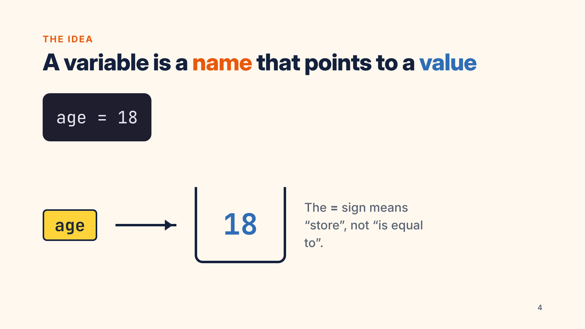

# Week 2: Production & presentation

This week continues the channel planned in week 1: **Code in Small Steps**, short Python lessons for beginners. Its
host is **Mina**. All videos are 1920×1080 at 30 fps, have captions (`.srt`), and are loudness-normalised to about −14
LUFS ([`results/qc.md`](results/qc.md)).

| Task | Deliverable |
|---|---|
| 3-minute screen-recording tutorial | [`exports/screen-tutorial.mp4`](exports/screen-tutorial.mp4) (**3:04**), *How to read a Python error message*, Loom style (screen + face bubble) |
| 10-slide educational presentation with animations | [`slides/deck.html`](slides/deck.html) (presentable: arrow keys or click; animated builds and a live 10-second timer), [`slides/deck.pdf`](slides/deck.pdf), [`slides/png/`](slides/png/), and every slide's animation as [`slides/deck-animated.mp4`](slides/deck-animated.mp4) |
| Talking-head video explaining a concept, with good lighting and audio | [`exports/talking-head.mp4`](exports/talking-head.mp4) (1:05), *What is an algorithm? (Explained with chai)* |
| 3 infographics | [`infographics/read-a-python-error.png`](infographics/read-a-python-error.png), [`variables-labelled-boxes.png`](infographics/variables-labelled-boxes.png), [`for-vs-while.png`](infographics/for-vs-while.png) (1080×1350, for an Instagram or LinkedIn feed; rendered at 2×) |
| **Mini project:** a complete lesson with slides, a 5-minute tutorial combining screen recording and talking head, background music, exported at 1080p | [`exports/lesson-variables-1080p.mp4`](exports/lesson-variables-1080p.mp4) (**5:03**), *Python variables: labelled boxes for values*, with captions in [`lesson-variables.srt`](exports/lesson-variables.srt) |

How each topic was applied (framing, three-point lighting, audio chain, pacing) is in
[`docs/production-notes.md`](docs/production-notes.md).



## Mini project: the lesson
The lesson follows week 1's script 1 and its hook, demo, contrast, try-it, common-error and recap structure. It is
built from 14 segments:

| Time | Segment | What's on screen |
|---|---|---|
| 0:00 | Hook | Full talking head: "Why can Python add 5 and 2 but join the text into 52?" |
| 0:20 | Slides 1–4 | Title, the puzzle, learning objectives, the variable-as-labelled-box animation. Face bubble bottom-right |
| 1:07 | Screen demo | Creating `age`, `name` and `price`; `print()`; `type()`; reassigning `age = 19`. Face bubble top-right |
| 1:44 | Screen demo | Naming rules: `total_score` works; `total score` raises a real `SyntaxError` |
| 2:12 | Slides 5–6 | The three types; how the type decides what `+` does |
| 2:41 | Screen demo | `5 + 2`, `"5" + "2"`, `"5" + 2`, ending in a real `TypeError` |
| 2:53 | Slide 7 | Converting types; `input()` always returns a `str` |
| 3:15 | Screen demo | The fix: `int("5") + 2` |
| 3:22 | Slide 8: try it | A 10-second countdown, while the music rises with no voice over it |
| 3:42 | Screen demo | The solution (`42`, then printed inside a sentence) |
| 3:52 | Slide 9 + screen | The most common error: a misspelt name gives a real `NameError … Did you mean: 'score'?`, then the fix |
| 4:22 | Slide 10 | Recap and the next lesson |
| 4:41 | Outro | Full talking head: practice prompt, subscribe |

**Audio:**
* the voice is slower here (about 130 wpm) than in the other videos, for beginners;
* original lo-fi music sits under the voice, ducked by sidechain compression;
* the voice is cleaned up with a high-pass filter and compression;
* the mix is −13.9 LUFS, with a true peak of −1.5 dBTP.

## Task notes
**Screen tutorial.** Three real errors, each read the same way: the **last line** first (type and message), then
**up** to the file and line, then **follow the chain** through function calls.
* **Errors shown:** a `NameError` from a typo, a `TypeError` from `"Average: " + average`, and a 3-frame
  `ZeroDivisionError` caused by an empty list.
* **Real output:** each program runs for real in `/home/mina/code-in-small-steps`, so every traceback on screen is
  Python 3.13's actual output, including the `^^^^` and `~~~^~~~` markers.
* **On-screen guidance:** call-outs, line highlights, a spotlight on the terminal, a scroll-back to show the top of a
  long traceback, and a closing 3-step summary.

**Talking head.** Explains one concept with an everyday analogy (making chai). It then names three properties of an
algorithm: precise, ordered, finite.
* **Graphics:** keywords slide in on the left as each idea is spoken, and a lower third names the host.
* **Sound:** voice only, no music, so the explanation stays clear.
* **Framing and lighting:** the presenter sits on the right third under three-point lighting (diagram in
  [`docs/three-point-lighting.png`](docs/three-point-lighting.png)).

**Slides.** The slides reuse week 1's brand, cream and navy with an orange accent, in Inter and JetBrains Mono.
* **Animations:** every slide has build animations (fade-up, pop, wipe, arrow grow) and slide 8 has a live countdown.
* **Room for the face bubble:** text sizes and layouts leave the bottom-right corner free.

**To rebuild the deck in Canva** (free account):
1. Create a 1920×1080 presentation.
2. Set the brand colours `#FFF8EE`, `#14213D`, `#E8590C`, `#2F6DB5` and `#FFD43B`.
3. Use one slide per PNG in `slides/png/` as your reference layout.
4. Set *Animate → Rise* on text blocks and *Pop* on cards, in the order of the delays in `deck.html`.

## Honest limitations
* **No camera, microphone, OBS or Loom here.**
  * The presenter is an illustrated character, lip-synced to the volume and brightness of the voice track.
  * The voice is synthetic (espeak-ng with MBROLA).
  * The "screen recording" is a replica of a VS Code window, driven frame by frame. The code in it runs for real and
    the output is genuine.

  The production rules are documented so the same videos can be recorded with a phone and a ₹500 lapel mic.
* **Canva wasn't used** because it needs an account. Rebuild steps are above.

## Reproduce
```bash
cd educational-content-creator/week-2
node src/export_deck.js && node src/export_infographics.js
python3 src/screen_tutorial.py      # ~6 min on 2 CPUs
python3 src/talking_head.py
python3 src/lesson.py               # ~12 min; re-render single segments with: python3 src/lesson.py 4 6
python3 src/qc.py
```
