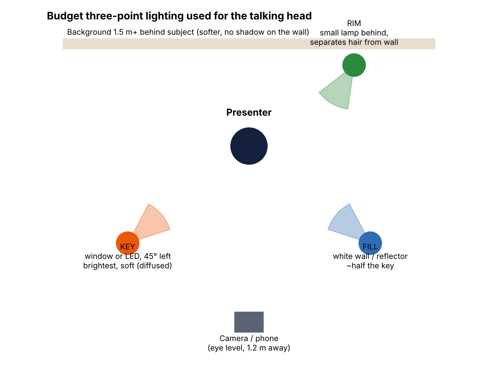

# Production notes: camera, lighting, audio and tools on a budget

These are the week's study topics, applied to this week's videos. The table below maps each topic to how it was
done here, and how to do it with a phone and ₹0–₹1,500 of gear.

## Camera and framing
| Rule | How the talking head follows it | With a real phone |
|---|---|---|
| Lens at eye level | The presenter is drawn straight-on, not from below | Stack books under the phone; the lens sits at eye height |
| Medium shot, head room, eyes on the upper third | Eyes sit on the top-third line, with a little space above the hair | Turn on the grid in the camera app |
| Subject on a third, with space for graphics | The presenter is on the right third; keywords appear on the left | Leave the left third empty for titles and keywords |
| 1080p, 30 fps, locked exposure | Every export is 1920×1080 at 30 fps | Long-press to lock focus and exposure (AE/AF lock) |

## Lighting: budget three-point setup

* **Key light:** a window or a ₹500–₹1,000 LED panel, 45° to one side, diffused with tracing paper. In the video:
  warm light from camera-left, so that side of the face and the wall are brighter, with catch-lights in the eyes.
* **Fill light:** a white wall, or a sheet of white chart paper, on the opposite side. It lifts the shadows to about
  half the key. In the video: a soft shadow on the presenter's left side, not black.
* **Rim light:** a small desk lamp behind the subject. It separates the hair and shoulders from the background. In
  the video: a thin, cool outline on the hair and shoulders.
* **Background:** at least 1.5 m behind the subject, so it falls out of focus and catches no shadow. In the video:
  the shelf and plant are blurred to imitate a shallow depth of field.

## Audio
* **Mic:** a ₹300–₹800 wired lapel mic, 15–20 cm from the mouth, beats any laptop mic. Record in a room with soft
  furnishings (a bed, curtains) to cut echo.
* **Processing chain** (the same as `engine.VOICE_CHAIN`):
  1. high-pass at 80 Hz (removes rumble and fan noise);
  2. low-pass at 12 kHz;
  3. gentle 3:1 compression (keeps loud and quiet words even);
  4. loudness normalisation to −14 LUFS, YouTube's reference level.
* **Music:** sits about 15–20 dB under the voice and ducks automatically when the voice starts (sidechain
  compression). With no voice, as during the 10-second "try it" timer in the lesson, the music comes back up.
* **Measured results:** in the README.

## Voice: pacing and modulation
* **Pace:**
  * the screen tutorial and talking head run at about 138 words per minute;
  * the beginner lesson is slower, at about 130 wpm;
  * a 0.5 s pause after every sentence gives viewers time to read the screen.
* **Pausing:** a pause comes *before* an important result ("Run it." … result). Each question gets its own sentence,
  so the voice rises on it.
* **The voice is synthetic** (espeak-ng with MBROLA), so its modulation is limited. That's the biggest gap against a
  real recording. Read the script aloud twice before recording, and mark the stressed word in each sentence.

## Tools: what the brief named, and what was used
| Brief | Used here | Why |
|---|---|---|
| OBS / Loom screen recording | A replica editor page (`src/editor.html`), captured frame by frame with Playwright, plus a Loom-style face bubble | There's no desktop session in this environment. Every program shown really runs, and the output on screen is the genuine output |
| Canva with animations | An HTML/CSS deck (`slides/deck.html`) with build animations, exported to PDF, PNG and video | Canva needs an account. The deck can be rebuilt in Canva: see the README |
| Camera and mic | The illustrated presenter, lip-synced to the voice track | No camera here. The framing, lighting and audio rules above are applied as if filmed |
