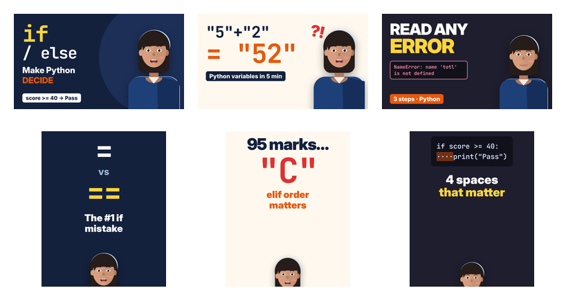

# Week 3: Editing & short-form content

This week covers lesson 2 of **Code in Small Steps**, *If / else: let your program choose*. This time the focus is
the **edit**:
* the talking-head parts were recorded as unedited takes, with long pauses, flubs and "sorry, let me say that again"
  restarts left in, and the edit cuts them down;
* zooms, call-outs and annotations on the screen recordings are added in the edit, not baked into the recording.

| Task | Deliverable |
|---|---|
| Edit a 5-minute educational video with cuts, transitions and text overlays | [`exports/if-else-long-form.mp4`](exports/if-else-long-form.mp4): **5:04**, 1080p30, −14.3 LUFS, captions in [`if-else-long-form.srt`](exports/if-else-long-form.srt) |
| Zoom effects, call-outs and annotations on key concepts | 29 zoom moves and 21 annotations: boxes around code or output, each with a call-out label |
| 3 click-worthy thumbnails | [`thumbnails/yt-if-else.png`](thumbnails/yt-if-else.png), [`yt-variables.png`](thumbnails/yt-variables.png) (for week 2's lesson), [`yt-errors.png`](thumbnails/yt-errors.png) (for week 2's error tutorial) |
| 3 short-form clips (30–60 s) cut from the long-form | [`short-1-equals-vs-double-equals.mp4`](exports/short-1-equals-vs-double-equals.mp4) (34 s), [`short-2-elif-order-matters.mp4`](exports/short-2-elif-order-matters.mp4) (45 s), [`short-3-indentation-error.mp4`](exports/short-3-indentation-error.mp4) (45 s); all 1080×1920 |
| **Mini project:** a content package (long-form, 3 shorts, matching thumbnails, SEO titles and descriptions) | Everything above, plus Shorts covers [`thumbnails/cover-*.png`](thumbnails/) and the SEO sheet [`results/seo.md`](results/seo.md), checked against YouTube's limits |



## What the edit did (`src/edit.py`; the full edit decision list is in `results/edl.json`)
| | Numbers |
|---|---|
| Raw talking-head footage | 146.0 s across 4 takes |
| Kept after the edit | 90.0 s (**38 % cut**) |
| Silences removed | detected automatically with `silencedetect` (−40 dB, ≥ 0.6 s); each kept region padded 0.12 s before and 0.22 s after, so no word is clipped |
| Flubbed takes removed | 3 (the bad line plus its "sorry, let me say that again"), cut using the editor's marks, as an editor finds them by listening |
| Jump cuts | 12. Each alternates between a wide framing and a 116 % punch-in on the face, so the cut reads as deliberate rather than as a glitch |
| Transitions | 7 dip-to-colour (into chapter cards and the try-it card), 4 pushes (from a card into the screen demo), 6 cross-dissolves (between shot types) |
| Text overlays | lower third; chapter chip; key-point panels beside the presenter that appear as each point is spoken; 6 animated chapter cards; try-it card with a 10 s countdown; progress bar |
| Zooms and annotations | 29 eased zoom moves that follow the action (into the code while typing, out to the terminal for the result) and 21 annotations (orange box + yellow call-out, e.g. "72 ≥ 75? False") |
| Audio | 10 ms fades at every cut (no clicks), voice clean-up chain, music ducked under the voice, −14.3 LUFS |

**Chapters:**
0:00 Intro · 0:19 The idea · 1:04 Indentation matters · 1:31 elif · 2:15 Comparing values · 2:49 and / or ·
3:18 Putting it together · 3:55 Try it · 4:29 Recap.

The first edit came out at **4:20**, under the 5-minute brief. I added a real section ("Putting it together": a
ticket-price program that combines elif, `or` and `else`) rather than slowing the cut, which brought it to 5:04.

All code shown runs for real (Python 3.13), including the `IndentationError`, the
`SyntaxError … Maybe you meant '=='`, and the elif-order bug where 95 prints a C.

## Shorts (`src/shorts.py`)
Each Short is a self-contained idea cut from the finished long-form:
1. `=` vs `==`
2. why the order of elif matters
3. the if/else basics plus the 4 spaces of indentation

How they were made vertical:
* **Reframing:** each long-form shot is reframed for 9:16 using a crop for its type: the presenter cropped to head
  and shoulders, screens cropped to the code and terminal, cards centred.
* **Captions:** burned in word by word, with the current word highlighted, because most short-form viewing is muted.
* **Hook and stickers:** a hook title in the first 2.6 s, and a summary sticker.
* **Audio:** the long-form's own audio, normalised to about −14 LUFS.
* **Covers:** each has a matching cover (`cover-equals`, `cover-elif`, `cover-indent`).

## Thumbnails
They follow the rules from the video course:
* 2–4 words and one focal point;
* the presenter with a strong expression;
* high contrast in the channel colours;
* nothing in the bottom-right corner, where YouTube shows the duration.

`at-small-size.png` shows them at mobile-search size, and all three still read.

**A bug the thumbnails caught:** JetBrains Mono's ligatures were drawing `>=` as `≥`, which would confuse beginners
who have to type it. I turned ligatures off everywhere (editor, slides, infographics, thumbnails) and re-recorded the
screen parts.

## Honest limitations
* **The presenter and voice are synthetic**: an illustrated, lip-synced character with an espeak-ng/MBROLA voice.
  The "raw takes" were generated with real pauses and flubs so that cutting them is genuine editing work.
* **Editing was done in code**, as an EDL rendered with Python and ffmpeg, rather than CapCut or DaVinci Resolve. The
  operations are the same ones: ripple delete, punch-in, dissolves, titles, zoom keyframes, ducking.
* **Thumbnails were made in HTML**, not Canva.
* **Not uploaded:** publishing needs your YouTube account. That's week 4.

## Reproduce
```bash
cd educational-content-creator/week-3
python3 src/record.py      # the "shoot": raw takes + clean screen captures (~8 min)
python3 src/edit.py        # the edit (~8 min)
python3 src/shorts.py && python3 src/seo.py && node src/export_thumbs.js
```
