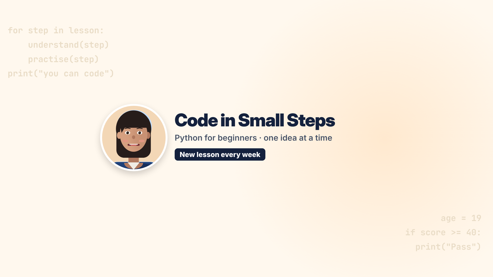

# Week 4: Publishing & monetisation, launching "Code in Small Steps"

This week packages the content brand for launch:
* a complete channel kit;
* 3 upload-ready videos with thumbnails, SEO, captions and end screens;
* 5 Shorts;
* a 5-lesson mini course;
* a landing page;
* a creator portfolio with an analytics pipeline.

| Task / requirement | Deliverable |
|---|---|
| YouTube channel with banner, logo, about section and playlists | [`channel/`](channel/): [`banner.png`](channel/banner.png) (2560×1440, with everything important inside the 1546×423 safe area), [`logo.png`](channel/logo.png) (800×800), [`watermark.png`](channel/watermark.png), and [`channel-setup.md`](channel/channel-setup.md) (about text, 3 playlists, layout, upload defaults). Source: [`channel/art.html`](channel/art.html) |
| Publish 3 videos with thumbnails, full SEO and end screens | [`upload/`](upload/): `01-python-variables.mp4`, `02-read-python-errors.mp4`, `03-python-if-else.mp4`. Each has a 20 s end-screen outro, a thumbnail, `.en.srt` captions, and a `.json` with title, description, chapters, tags, playlist, cards and end-screen element positions. Everything to paste is in [`upload/UPLOAD-SHEET.md`](upload/UPLOAD-SHEET.md) |
| 5 short-form clips | Shorts 1–3 from week 3, plus 2 new ones cut this week: [`exports/short-4-why-5-plus-2-is-52.mp4`](exports/short-4-why-5-plus-2-is-52.mp4) (58 s) and [`exports/short-5-read-errors-bottom-up.mp4`](exports/short-5-read-errors-bottom-up.mp4) (45 s), with covers in [`thumbnails/`](thumbnails/). Titles and descriptions are in [`upload/SHORTS-SHEET.md`](upload/SHORTS-SHEET.md) |
| Mini course outline (5 lessons, Notion or Google Docs) | [`course/mini-course-outline.md`](course/mini-course-outline.md) (imports directly into Notion or Google Docs) and [`.pdf`](course/mini-course-outline.pdf). Each lesson has a description, objectives, a practice task, a self-check and common mistakes |
| Landing page for the brand | [`landing/index.html`](landing/index.html): one static file with its own images, responsive and with dark mode. It can go on GitHub Pages for free |
| Portfolio with analytics | [`portfolio/index.html`](portfolio/index.html) (best work, Shorts, design, process, analytics) and [`analytics/report.md`](analytics/report.md) from [`src/analytics.py`](src/analytics.py) |



## The launch slate
The channel launches with its existing backlog: the two lessons and the debugging tutorial made in weeks 2 and 3.
This week remastered them for upload and added end screens.

| # | Video | Length | Playlist | End screen → |
|---|---|---|---|---|
| 01 | Python Variables for Beginners: Why "5" + "2" Gives "52" | 5:03 + 0:20 | Python from zero | 02 |
| 02 | How to Read a Python Error Message (Traceback Explained for Beginners) | 3:04 + 0:20 | Debugging basics | 03 |
| 03 | Python If Else Explained for Beginners (elif, and/or, Common Mistakes) | 5:04 + 0:20 | Python from zero | 01 |

**SEO**, checked by script in `src/upload.py`:
* titles are 56–70 characters, within YouTube's 100;
* descriptions open with the hook and contain the keyword;
* chapters start at 0:00 and each lasts at least 10 s;
* each description has a practice task and a "watch next" link;
* tags stay within 500 characters.

**Cards** cross-link the lessons at the moment a viewer would need the other video.

**End screens:** the last 20 s of each video is a designed outro. Its dashed slots line up with YouTube's end-screen
elements (next lesson, best for viewer, subscribe), so the elements sit cleanly when placed at the positions in
[`upload/endscreen.json`](upload/endscreen.json).

**Pre-launch quality check** (`src/analytics.py`, measured on the final files):

| Video | Loudness | True peak | Captioned |
|---|---|---|---|
| 01 | −13.9 LUFS | −1.5 dBTP | 84 % of content time |
| 02 | −14.1 LUFS | −1.7 dBTP | 91 % |
| 03 | −14.3 LUFS | −1.5 dBTP | 82 % |

The uncaptioned time is pauses and music, such as the 10-second try-it countdowns.

## New Shorts (`src/shorts_more.py`)
**How they're made:**
* **Reframing:** same vertical compositor as week 3. The shot type is detected from the frame itself (cream slide or
  dark editor), and each segment gets its own crop. Slides keep the face bubble; screen shots crop to the code and
  terminal.
* **Captions:** word by word, timed from each video's own `.srt`.
* **Hook:** a hook title in the first 2.6 s.

**The two new Shorts:**
* **4 · Why "5" + "2" = "52"** (58 s, from video 01): the type decides what `+` does, the real `TypeError`, then the
  `int("5")` fix.
* **5 · Read errors from the bottom** (45 s, from video 02): a real `NameError` read bottom-up, including Python's
  "Did you mean: 'total'?".

## Analytics: what's real and what's pending
The brief asks for "analytics from your first week". **Those numbers can only come from a live channel, so none are
shown or invented.**

The pipeline is ready. After 7 days:
1. Open YouTube Studio → Analytics → Advanced mode → Content.
2. Export the report as CSV.
3. Save it as `analytics/first-week.csv`.
4. Run `python src/analytics.py`.

That fills the first-week table and charts (views, watch time, average view duration, impressions CTR, subscribers).
The report already lists healthy first-week targets and what to change if each one is low.

## What you need to do to go live (all free)
1. **Create the channel.** Sign in to YouTube with a Google account, choose *Create a channel*, and name it **Code in
   Small Steps**. Then follow [`channel/channel-setup.md`](channel/channel-setup.md) for the handle, logo, banner,
   about text and playlists. About 15 minutes.
2. **Upload the 3 videos** from `upload/`. Paste the metadata from `UPLOAD-SHEET.md`, upload the `.srt` captions,
   and set the thumbnail. Custom thumbnails need a verified account: phone verification is free. Then add the end
   screens and cards, and tick *Altered content: Yes*.
3. **Upload the 5 Shorts**, one every 2 days, each linked to its long-form video.
4. **Landing page:** in the GitHub repo, go to Settings → Pages, deploy from `main`, and open
   `/educational-content-creator/week-4/landing/`. The YouTube links point at `@codeinsmallsteps`; edit them if the
   handle differs.
5. **Course outline:** in Notion, use *Import → Markdown* on `course/mini-course-outline.md`, or open it in Google
   Docs.

## Honest notes
* **The videos are not published here.** Publishing needs your Google account, and I don't create accounts or sign
  in for you. Everything is prepared so publishing is copy and paste.
* **Synthetic presenter:** the presenter is an illustrated character and the voice is synthetic, as in weeks 2–3. The
  about text and every description say so, and the upload sheet sets YouTube's altered-content disclosure.
* **Design tools:** the channel art and covers were made in HTML and CSS, not Canva. Notion and Google Docs weren't
  used because they need an account; the outline is in a format both import.

## Reproduce
```bash
cd educational-content-creator/week-4
node src/export_art.js                 # logo, banner, watermark, end-screen background, Shorts covers
python3 src/shorts_more.py             # Shorts 4-5 (~6 min)
python3 src/upload.py                  # upload packages (~8 min)
python3 src/outline_pdf.py && python3 src/analytics.py
```
