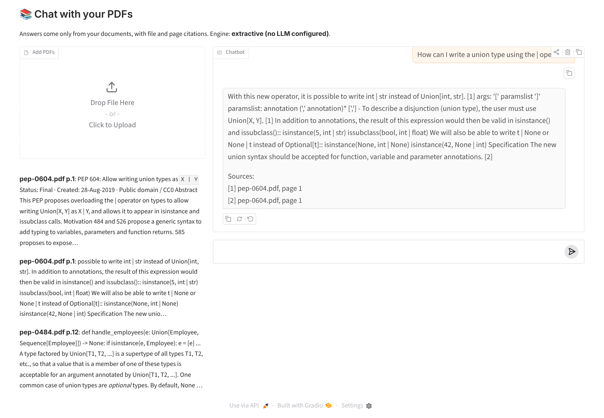

# Week 2: RAG, vector databases & agents

The corpus is **66 Python Enhancement Proposals** (PEPs): real technical design documents of 254 k words, all public
domain or CC0, so they can be indexed and quoted freely.

| Task | File | Result |
|---|---|---|
| Vector database with ChromaDB and 50+ documents | [`index.py`](index.py) | 66 documents → 1,818 chunks (1,200 characters, 200 overlap) in a persistent Chroma collection with metadata (PEP, title, status, type, created, URL) |
| RAG pipeline with LangChain | [`common/rag.py`](common/rag.py), [`rag.py`](rag.py) | Hybrid retrieval (vector + BM25, reciprocal-rank fusion), an LCEL chain, and answers with [n] citations. **Retrieval hit@5 94 %, MRR 0.84** on 16 questions; **2 of 2 out-of-scope questions answered "I don't know"** |
| Conversational memory (buffer, summary, window) | [`common/memory.py`](common/memory.py), [`memory_demo.py`](memory_demo.py) | The same 6-turn conversation under each memory type: no memory 3/6, **buffer 5/6, summary 5/6, window 4/6** turns retrieve the right PEP. Window "forgets" the first topic, exactly as designed |
| Agent with 3 tools (web search, calculator, document retrieval) | [`agent.py`](agent.py) | LangChain tools, with LangGraph's ReAct agent when an LLM is configured or a transparent router without one. 6 runs, including a chained one (two PEP lookups, then the calculator) |
| **Mini project:** knowledge base from PDFs, LangChain + ChromaDB, chat interface with source citations | [`kb-chat/`](kb-chat/) | PDF ingestion (page-level), a Chroma index, and a **Gradio chat** with file and page citations, retrieved passages, streaming and memory. 10 PDFs / 106 pages: **hit@5 100 %, cites the right PDF 90 %, abstains on 2/2 unanswerable** |



## What runs where (please read)
| Piece | With a free key or local model | In this repo's results |
|---|---|---|
| Embeddings | Google `text-embedding-004` (`GEMINI_API_KEY`) | **LSA embeddings:** TF-IDF → 256-dimension truncated SVD, fitted on the corpus (`common/models.py`), offline |
| Answer generation | Gemini / Ollama / OpenAI-compatible through LangChain (`chat_model()`) | **Extractive:** the best-matching sentences from the retrieved chunks, each cited, with abstention when nothing matches |
| Agent planning | `langgraph.prebuilt.create_react_agent` | A rule-based router (logged step by step) |
| Summary memory | the LLM writes the summary | an extractive summary (the topic and the first sentence of each folded turn) |

This sandbox can't reach any model hub or LLM API, so **every committed result was produced offline**. The
retrieval numbers are real measurements. The extractive answers are grounded and cited, but they are stitched-together
source sentences rather than fluent prose, and they sometimes include a less relevant sentence (see
[`results/rag_examples.md`](results/rag_examples.md)).

**To switch to an LLM:** add `GEMINI_API_KEY=…` (free at aistudio.google.com), or install Ollama and set
`OLLAMA_MODEL=qwen2.5:1.5b`, then rerun. Nothing else changes.

## 1 · Vector database
* **ChromaDB** `PersistentClient` with cosine HNSW.
* **Chunking:** a recursive splitter that respects paragraphs.
* **Metadata:** usable for filtering, e.g. `where={"status": "Final"}`.
* **Speed:** indexing takes about 10 s.

## 2 · RAG
**Retriever.** Pure vector search with offline embeddings misses exact terms such as `:=`, `zip` or `strict`, and
pure BM25 misses paraphrases, so the retriever fuses both:
* top 30 from each method, merged by reciprocal rank;
* at most 2 chunks per PEP, so the context covers several sources.

**Prompt:** answer only from the numbered sources, cite them, and say "I don't know" otherwise.

**Evaluation** ([`results/rag_eval.json`](results/rag_eval.json)):

| Metric | Value |
|---|---|
| Right PEP in the top 5 / at rank 1 | 15 of 16 (94 %) / 13 of 16 (81 %) |
| Mean reciprocal rank | 0.838 |
| Answer cites the expected PEP | 14 of 16 (88 %) |
| Out-of-scope questions abstained (sourdough, World Cup) | 2 of 2 |

The one miss, "How should constants be named?", went to PEP 435 (Enum) instead of PEP 8. The style guide's sentence is
buried in a long naming section.

## 3 · Memory
Each strategy also rewrites follow-ups into standalone search queries:
* a pronoun follow-up ("Which methods does **it** generate?") is expanded with the previous question;
* "**going back to the first topic**" uses the oldest topic the memory still holds.

| Memory | Right PEP in the top 3 | Size after 6 turns |
|---|---|---|
| none | 3 / 6 | 0 tokens |
| buffer (all turns) | **5 / 6** | ~474 tokens, and grows every turn |
| window (k=2) | 4 / 6: fails on "the first topic", which has left the window | ~62 tokens |
| summary (summary + last turn) | **5 / 6** | ~255 tokens (an LLM summary would be shorter) |

Details, including each memory's final contents: [`results/memory.md`](results/memory.md).

## 4 · Agent
**Tools:**
* `web_search`: DuckDuckGo, falling back to the GitHub and PyPI APIs;
* `calculator`: a safe AST evaluator, with no `eval`;
* `document_search`: the hybrid retriever.

All runs are in [`results/agent_runs.md`](results/agent_runs.md):
* "latest version of httpx" → web search → **0.28.1** from live PyPI;
* `(1250 * 18) / 7 + sqrt(144)` → calculator → **3226.285714**;
* "How many years apart were PEP 8 and PEP 572 created?" → 2 document lookups (2001, 2018) → calculator → **17**;
* "most-starred web scraping projects" → live GitHub stars.

## 5 · Mini project: chat with your PDFs (`kb-chat/`)
* **Ingestion** (`kb.py`):
  * `pypdf` reads each PDF page by page, keeping the file and page number;
  * a content hash identifies each file, and re-uploading a file replaces its chunks;
  * scanned PDFs without a text layer are reported, not silently skipped.
* **Demo library:** `make_pdfs.py` typesets the 10 typing-related PEPs as PDFs (106 pages).
* **App** (`app.py`, Gradio): upload PDFs, chat, see the retrieved passages beside the answer. Answers stream and cite
  `file, page`, and summary memory handles follow-ups.
* **Evaluation** (`evaluate.py` → [`results.json`](kb-chat/results.json), [`examples.md`](kb-chat/examples.md)):

| Metric | Value |
|---|---|
| Right PDF in the top 5 | 10 / 10 |
| Mean reciprocal rank | 0.81 |
| Answer cites the right PDF | 9 / 10 |
| Unanswerable questions | 2 / 2 abstained |

## Run
```bash
pip install chromadb langchain langchain-core langchain-text-splitters langchain-community rank-bm25 gradio pypdf reportlab scikit-learn
cd generative-ai-llm/week-2
python index.py && python rag.py && python memory_demo.py && python agent.py
cd kb-chat && python make_pdfs.py && python kb.py && python evaluate.py && python app.py    # http://localhost:7860
# optional: echo "GEMINI_API_KEY=..." > .env   (then pip install langchain-google-genai)
```
