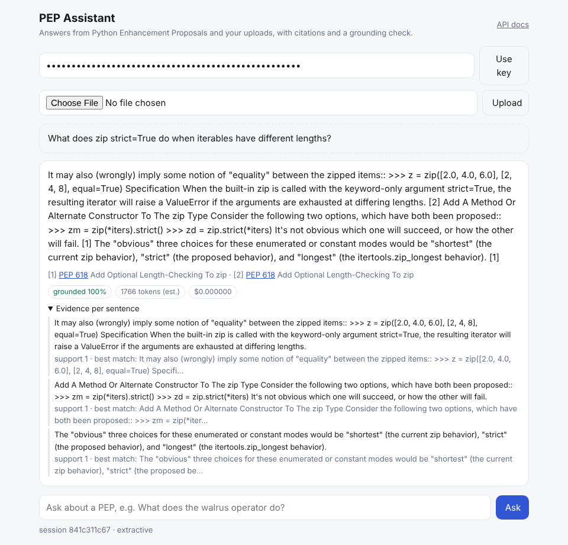
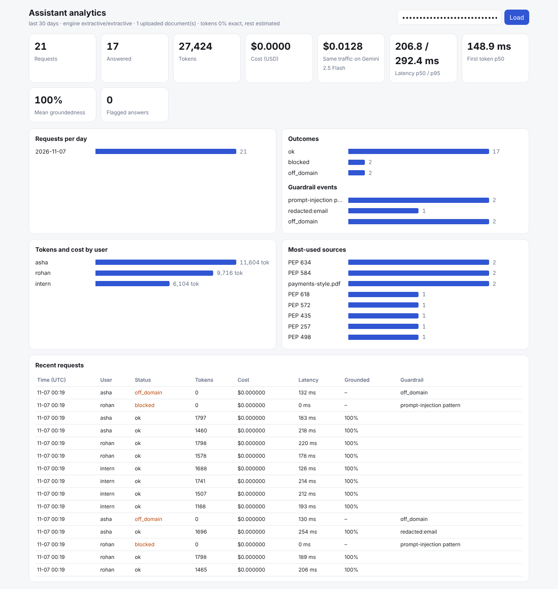

# Week 4: Production LLM applications

Everything this week is one deployable service, **PEP Assistant** ([`assistant/`](assistant/)). It's a domain
assistant for Python's language standards (66 PEPs, public domain) and the user's own documents. Each task is a part
of it, with its own tests and measurements.

| Task | Where | Result |
|---|---|---|
| Production API for an LLM app, with streaming | [`app/main.py`](assistant/app/main.py), [`app/llm.py`](assistant/app/llm.py) | FastAPI with **Server-Sent-Events token streaming**, API-key auth, rate limits, JSON errors with request IDs, and pluggable LLM providers (Gemini / OpenAI-compatible / Ollama / offline). First token in **149 ms median** on the offline engine |
| Hallucination detection | [`app/grounding.py`](assistant/app/grounding.py), `POST /v1/check` | Every answer sentence is checked against the sources (similarity, numbers, negation, citation). On 300 held-out labelled claims: **precision 1.00, recall 0.84, F1 0.91**. Weak spots measured: swapped single words (6 % caught), numbers present elsewhere in the source (70 %) |
| Token and cost tracking | [`app/usage.py`](assistant/app/usage.py), [`pricing.yaml`](assistant/app/pricing.yaml), `GET /v1/usage` | A per-request ledger (tokens exact or estimated, USD cost, latency, time to first token), **per-user daily token budgets** (`429 budget_exceeded`), what-if cost on Gemini 2.5 Flash, and an analytics API |
| API documentation | [`docs/API.md`](assistant/docs/API.md), [`docs/openapi.json`](assistant/docs/openapi.json), `/docs` | OpenAPI 3 with descriptions, schemas and examples; a generated reference with **real captured request/response examples**, an error-code table and a streaming guide |
| **Major project:** domain AI assistant (RAG + memory + multimodal + guardrails + streaming + auth + analytics + deployment) | [`assistant/`](assistant/) | All of the above plus PDF/image uploads (OCR or Gemini vision), per-session memory, an admin **analytics dashboard**, Docker / Compose / Render configs, and **15 passing end-to-end tests** |



## Architecture
```
client ── HTTPS ──► FastAPI (auth · rate limit · request id · JSON errors)
                     │
                     ├─ input guardrails: injection patterns ✗ · PII/secret redaction · length
                     ├─ memory: standalone-question rewrite + last 3 turns + running summary   (SQLite)
                     ├─ retrieval: BM25 + LSA, RRF fusion, 2 chunks/doc, PEP pinning, user docs (private)
                     ├─ domain guard: nothing relevant ⇒ polite refusal (no LLM call, 0 tokens)
                     ├─ generation (streamed): Gemini | OpenAI-compatible | Ollama | offline extractive
                     ├─ output guardrails: redaction · grounding check per sentence ⇒ warning if < 75 %
                     └─ usage ledger: tokens, cost, latency, TTFT, guardrail events                (SQLite)
uploads ──► PDF text (pypdf) | image ⇒ Gemini vision or Tesseract OCR | text ──► user's private index
admin ──► /admin/analytics ──► /dashboard
```

## What runs where (please read)
No LLM API is reachable from this sandbox, so **every committed result uses the offline `extractive` engine**. It
answers with the best-matching source sentences, cited, streamed word by word, and abstains when nothing matches.
* **Tokens:** they're estimated (marked `exact: false`) and **cost $0**. The ledger also reports what the same
  traffic would cost on Gemini 2.5 Flash ($0.013 for the demo run).
* **Switching to an LLM:** set `GEMINI_API_KEY` (free at aistudio.google.com). Answers then come from Gemini, token
  counts become exact (from the provider's usage metadata), images are described by Gemini vision, and an optional
  LLM-as-judge check runs beside the rule-based grounding check. Nothing else changes.
* **Answer quality:** the extractive answers are grounded and cited, but they are stitched-together source sentences,
  sometimes including a heading or a less relevant sentence (see [`results/demo_transcript.md`](assistant/results/demo_transcript.md)).

## 1 · Production API with streaming
**Endpoints:**
* `POST /v1/chat` returns JSON, or with `"stream": true` an SSE stream: `meta` (session and sources), `token` × n,
  then `done` (answer, grounding report, usage, cost, warnings);
* `/v1/documents`, `/v1/sessions`, `/v1/usage` and `/v1/check`;
* admin `/admin/analytics` and `/admin/users`;
* `/health`.

Full reference: [`docs/API.md`](assistant/docs/API.md).

**Production details:**
* API keys are random 32-byte tokens; only the SHA-256 hash is stored, and an admin is bootstrapped from the
  `ADMIN_KEY` secret.
* Per-key rate limit (`429` with `Retry-After`).
* Every error is JSON with a `request_id`; unexpected exceptions are logged, never leaked.
* Auth, budget and guardrail errors are raised **before** the stream starts, so they arrive as proper HTTP errors
  rather than a broken stream.
* Structured JSON logs.

**Latency** (demo traffic, offline engine, in-process): end-to-end p50 207 ms / p95 292 ms; **time to first token
p50 149 ms**.

## 2 · Hallucination detection
For each answer sentence ([`app/grounding.py`](assistant/app/grounding.py)):
1. `support` = the best match over source sentences and adjacent sentence pairs of 0.5 × key-word coverage + 0.5 ×
   LSA similarity;
2. every **number** in the claim must appear in the sources;
3. a **negation** mismatch with the closest source sentence is flagged;
4. a cited `[n]` must be supported by source *n* itself.

The answer's groundedness is the share of supported sentences, and below 75 % the user sees a warning. The chat UI
shows the evidence per sentence. The same check is offered standalone as `POST /v1/check` for any answer.

**Evaluation** ([`eval/run_eval.py`](assistant/eval/run_eval.py) → [`results/eval.json`](assistant/results/eval.json)):
600 claims generated from the corpus.
* **Supported:** exact source sentences, light paraphrases, and merges of two adjacent sentences.
* **Unsupported:** a changed number, an inserted negation, a swapped key term, or a sentence from another PEP.
* Split 300 dev / 300 test.

| Test set (300 claims) | |
|---|---|
| Precision / recall / F1 for "unsupported" | **1.00 / 0.84 / 0.91** |
| Supported claims kept (copy / paraphrase / merge) | 100 % / 100 % / 100 % |
| Caught: sentence from another PEP / negation | 100 % / 100 % |
| Caught: changed number | 70 % (missed when the new number appears elsewhere in the same source) |
| Caught: one swapped word ("list"→"dict") | **6 %**. A one-word change keeps similarity high; this needs an NLI model or the LLM judge |

> **Honest caveats:**
> * The claims are synthetic and easier than real LLM output.
> * Dev F1 barely moves across thresholds (0.932–0.937 between 0.50 and 0.88), so the most paraphrase-friendly
>   value, 0.50, is used. A correct answer that merged two sentences scored 0.57, which a higher threshold would
>   have wrongly flagged.

## 3 · Token and cost tracking
**Every request is logged** ([`app/store.py`](assistant/app/store.py) `usage` table) with:
* user, session and endpoint;
* provider and model;
* prompt and completion tokens, and whether they're exact or estimated;
* cost in USD from [`pricing.yaml`](assistant/app/pricing.yaml);
* latency and time to first token;
* status (`ok` / `off_domain` / `blocked`), guardrail events, groundedness and the top source.

**Prices:** Gemini list prices per 1 M tokens, dated, with the source noted. They change often, so verify them at
ai.google.dev/pricing.

**Controls:**
* **Per-user daily token budget:** the next request gets `429 budget_exceeded` until 00:00 UTC. The test creates a
  1,000-token user and checks this.
* **Cost savings built into the pipeline:**
  * off-topic and blocked questions **never reach the LLM** (0 tokens);
  * retrieval sends only the top 5 chunks;
  * memory sends 3 turns plus a short summary instead of the whole history.

**Reporting:**
* `GET /v1/usage` for a user's own numbers;
* `GET /admin/analytics` for everything: by day, by user, by outcome, latency and TTFT percentiles, mean
  groundedness, flagged answers and top sources.

Demo run ([`results/analytics.json`](assistant/results/analytics.json)): 21 requests from 3 scripted users,
27,424 tokens (estimated), $0 actual, **$0.0128 if served by Gemini 2.5 Flash**.



## 4 · API documentation
* **OpenAPI 3** from FastAPI: tags, endpoint descriptions, request and response schemas with examples, and auth and
  error conventions. Browse it at `/docs` (Swagger) or `/redoc`; the exported spec is
  [`docs/openapi.json`](assistant/docs/openapi.json).
* **[`docs/API.md`](assistant/docs/API.md)**, generated by [`docs/gen_docs.py`](assistant/docs/gen_docs.py) from the
  live app:
  * basics (auth, errors, limits), the endpoint table and an error-code table;
  * **real captured examples**: chat, a streaming transcript, upload, hallucination check, a guardrail block, usage
    and user creation;
  * a browser streaming recipe.

## 5 · Major project: the full assistant
| Requirement | How |
|---|---|
| **RAG** | Hybrid BM25 + LSA retrieval over 2,017 chunks, RRF fusion, document diversity, naming "PEP 8" pins that PEP. Retrieval on 16 questions: **hit@5 94 %, MRR 0.85**; answers cite the right PEP 88 % of the time |
| **Memory** | Per-session history in SQLite: the last 3 turns verbatim plus a running summary; follow-ups ("Can it make them immutable?") are rewritten into standalone queries; `GET/DELETE /v1/sessions/{id}` |
| **Multimodal** | Uploads: **PDF** (page-level, cited as "p. 2"), **images** (Gemini vision with a key, else **Tesseract OCR**; tested on a rendered screenshot), text. Each user's documents are private (a test checks another user can't retrieve them). Scanned PDFs and text-less images are rejected with a clear reason |
| **Guardrails** | Injection patterns blocked (**11/11**); emails, phones, Luhn-valid cards and API keys **redacted before storage, logging or the LLM** (**9/9**); **0/20** false positives on ordinary questions; a domain guard declines off-topic questions (**7/10** held-out, with **0/23** in-domain questions wrongly declined); output redaction; a grounding warning |
| **Streaming** | SSE `meta` / `token` / `done`; the chat UI renders tokens live |
| **Auth** | Hashed API keys, user/admin roles, admin-created users, per-user budgets and rate limits |
| **Analytics dashboard** | `/dashboard`: KPIs, requests per day, outcomes, guardrail events, tokens by user, top sources, recent requests |
| **Deployment** | [`Dockerfile`](assistant/Dockerfile) (non-root, Tesseract, health check), [`docker-compose.yml`](assistant/docker-compose.yml) (persistent volume), [`render.yaml`](assistant/render.yaml) (free plan), [`.env.example`](assistant/.env.example) |
| **Tests** | [`tests/test_assistant.py`](assistant/tests/test_assistant.py): **15 passed**, covering auth, grounded answers, streaming (the tokens equal the final answer), memory, guardrails and redaction-at-rest, OCR upload and privacy, PDF pages, upload errors, the hallucination endpoint, budgets and admin, the rate limit and the OpenAPI spec |

**Guardrail honesty:** the attack and personal-data test prompts were written by the same person as the rules, so
11/11 and 9/9 are optimistic. Pattern matching stops common injections, not a determined attacker, which is why the
system prompt also tells the model to ignore instructions inside sources, and sources are user-scoped.

**Domain guard misses:** it answered "best time to visit Goa?", "rules of cricket" and "what causes earthquakes?"
with loosely matching PEP text. Those answers are still grounded in PEP sentences, just irrelevant.

## Deploy (free)
* **Docker:** `cp .env.example .env` (set `ADMIN_KEY`), then `docker compose up --build`. Chat is at :8000/,
  analytics at :8000/dashboard and the docs at :8000/docs.
* **Render:** connect the repo and use [`render.yaml`](assistant/render.yaml), with `ADMIN_KEY` (and optionally
  `GEMINI_API_KEY`) as secrets.
  > The free plan has no persistent disk, so the SQLite data resets on redeploy. Use Fly.io or Railway volumes for
  > persistence.
* **Not done here:** this sandbox can't pull Docker base images or reach any cloud, so the image wasn't built and
  nothing was deployed. The app was run with uvicorn and tested end to end.

## Run locally
```bash
cd generative-ai-llm/week-4/assistant
pip install -r requirements-dev.txt          # plus the tesseract-ocr system package for image uploads
pytest -q tests                              # 15 passed
python eval/run_eval.py                      # retrieval, answers, hallucination detector, guardrails -> results/eval.json
python eval/simulate.py                      # demo traffic -> results/demo_transcript.md, analytics.json; prints the demo admin key
ADMIN_KEY=dev-admin-key uvicorn app.main:app # http://localhost:8000  (chat), /dashboard, /docs
python -m app.admin create-user asha         # prints a user API key
python docs/gen_docs.py                      # regenerates docs/API.md + docs/openapi.json
```
