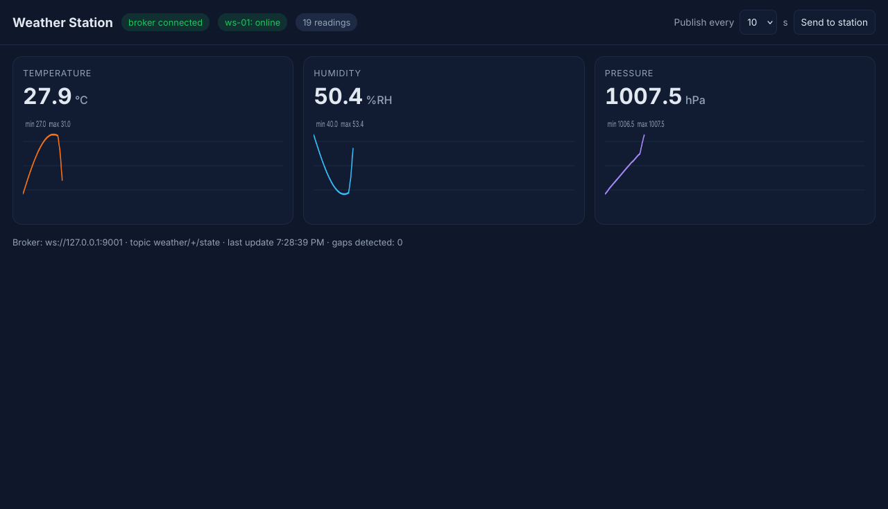
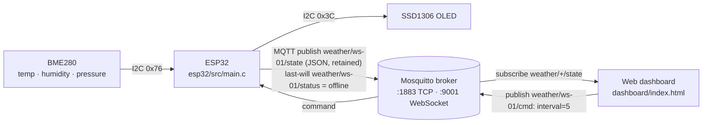
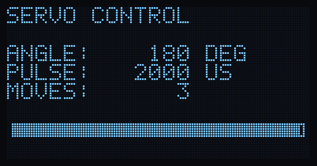

# IoT & C Embedded Programming — Week 3: Wireless IoT & Displays

Two firmwares and one shared C library:

- **`avr/servo_oled.c`** (ATmega328P / Uno): servo angle typed over serial, hardware PWM, status on an SSD1306 OLED over I2C. Verified in **simavr**.
- **`esp32/`** (ESP-IDF): the **WiFi weather station** mini project. BME280 + OLED, MQTT publish/subscribe with the project's **own C MQTT client**, auto-reconnect, last-will. Built in CI.
- **`common/`**: MQTT 3.1.1 client, BME280 compensation and station logic in portable C99. The ESP32 and the PC build use the *same files*, so the PC build tests the firmware's logic against a **real Mosquitto broker**.



## Brief checklist

| Brief item | Where | Evidence |
| --- | --- | --- |
| **Servo via PWM, angle from Serial** | `avr/servo_oled.c`: Timer1 fast PWM (mode 14) with ICR1 = 39999 at 2 MHz gives exactly 50 Hz; 0–180° maps to 1000–2000 µs. Input is validated (digits only, 0–180, max 7 chars). | `make sim`: 8/8 commands. 0°, 45°, 90°, 135°, 180° give pulses of 1000/1250/1500/1750/2000 µs at 20,000 µs period; `abc`, `200`, `1234567890` are rejected with `ERR`. `results/servo-sim-run.txt` |
| **Sensor data on an OLED over I2C** | Own SSD1306 driver (init sequence, page addressing, 5×7 font in `avr/font5x7.h`) on the AVR and the ESP32 | The simulated OLED's framebuffer is saved as an image: `results/oled-180.png` |
| **ESP32 on WiFi, data to a cloud dashboard** | `esp32/src/main.c`: WiFi station with automatic reconnect, data published as JSON over MQTT; `dashboard/index.html` charts it live over MQTT-over-WebSockets | Screenshot above: dashboard showing live readings from the station through Mosquitto |
| **MQTT publish/subscribe in embedded C on the ESP32** | `common/mqtt.c`: CONNECT (with last-will), PUBLISH (retained), SUBSCRIBE, PINGREQ, DISCONNECT, incoming PUBLISH dispatch. No library and no malloc; it runs over lwIP sockets on the ESP32. | Packet bytes unit-tested against the MQTT spec; end-to-end test against Mosquitto (below) |
| **Mini project: WiFi weather station** | ESP32 + BME280 (temperature, humidity, **pressure**) + OLED, publishes `weather/<id>/state` and `weather/<id>/status`, obeys `weather/<id>/cmd` (`interval=<s>`); live web dashboard with three graphs | All below |

## How it fits together



## Test results

| Test | Command | Result |
| --- | --- | --- |
| Unit: MQTT remaining-length encoding (spec table 2.4), CONNECT/PUBLISH/SUBSCRIBE bytes, BME280 maths against the **Bosch datasheet example** (25.08 °C, 100,653 Pa), humidity vs the datasheet floating-point formula at 11 points, register parsing incl. signed H4/H5 | `make test` | **39 checks, 0 failures** (ASan + UBSan) |
| End-to-end MQTT: station → real Mosquitto broker → subscriber, plus a command back to the station | `make mqtt-test` | **6/6 pass**: `online` status, ≥ 8 JSON readings with seq/t/h/p, command received, faster publishing after `interval=1`, clean `offline` at the end. Capture: `results/mqtt-capture.txt` |
| Servo + OLED firmware on a simulated ATmega328P | `make sim` | **8/8 pass**, OLED image `results/oled-180.png` |
| ESP32 firmware compiles with ESP-IDF (PlatformIO, espressif32 6.9.0) | CI job `esp32` (`pio run`) | **Builds clean**: RAM 34.5 KB (10.5%), flash 841 KB (80% of the 1 MB app partition; most of it is the WiFi stack) |
| Dashboard in a real browser | headless Firefox | Connected, 19 readings, 0 gaps, the `interval` button changed the station's rate (`results/dashboard.png`) |



**How the PC build fakes a BME280 honestly:** `host/station_pc.c` doesn't make up °C values. For each target temperature, humidity and pressure it searches for the **raw ADC values** a real chip would produce, then runs them through the same `bme280_compensate()` the ESP32 uses. Every published number therefore goes through the real conversion code.

## Wiring (ESP32 DevKit)

| ESP32 | BME280 | SSD1306 (0.96", I2C) |
| --- | --- | --- |
| 3V3 | VIN | VCC |
| GND | GND | GND |
| GPIO21 (SDA) | SDA | SDA |
| GPIO22 (SCL) | SCL | SCL |

BME280 at `0x76` (SDO to GND), OLED at `0x3C`. Servo (Uno sketch): signal to D9, power from a separate 5 V supply with a common GND, since the Uno's regulator can't supply a stalled servo.

## Run it

```sh
# PC side: broker + dashboard + PC station
mosquitto -c dashboard/mosquitto.conf            # TCP 1883, WebSocket 9001
python3 -m http.server -d dashboard 8000         # open http://localhost:8000
make all && ./build/station_pc 127.0.0.1 1883 600

# ESP32
cp esp32/src/secrets.example.h esp32/src/secrets.h   # WiFi name/password, broker IP (never committed)
cd esp32 && pio run -t upload -t monitor

# tests
make test && make mqtt-test && make sim
```

`dashboard/mosquitto.conf` opens the broker to the local network without a password, for a home lab only. For anything public, add `password_file` and TLS.

**Not done here:** no physical ESP32, BME280, OLED or servo was used. The ESP32 firmware is compile-checked in CI and its logic is exercised by the PC build. To show it on hardware, flash it, then photograph the OLED and screenshot the dashboard.
