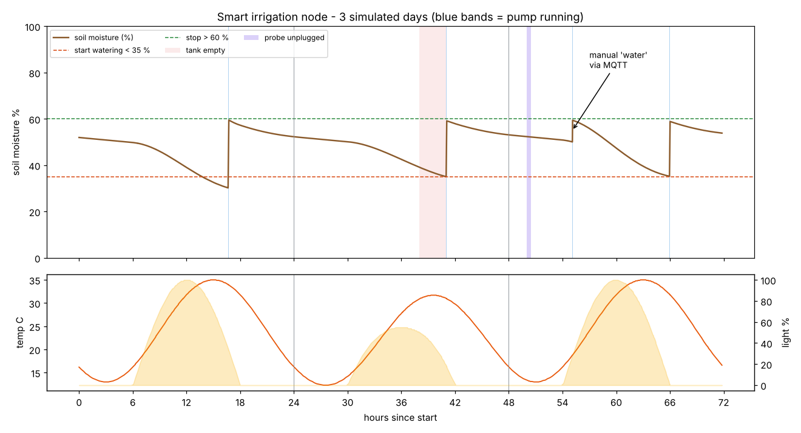
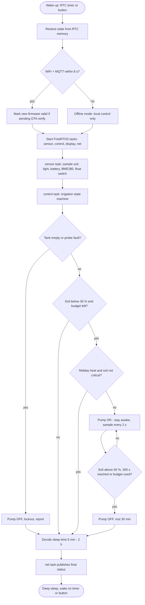
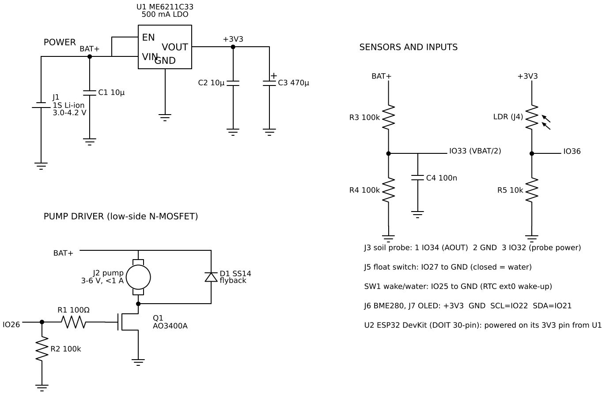
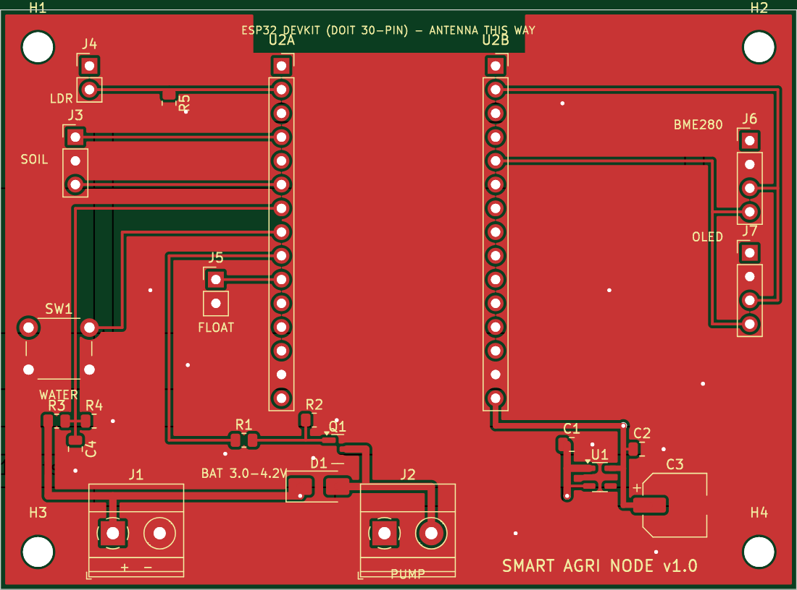
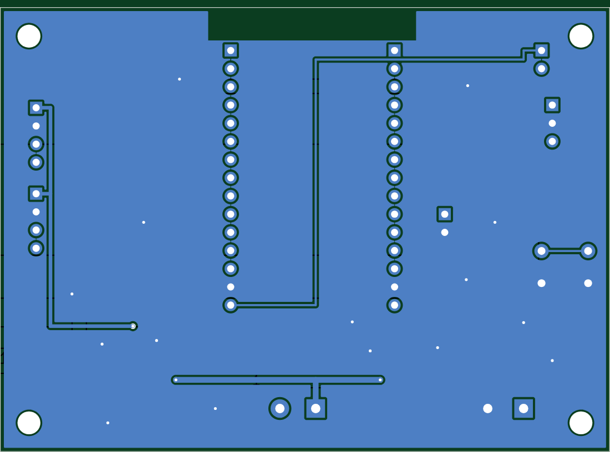
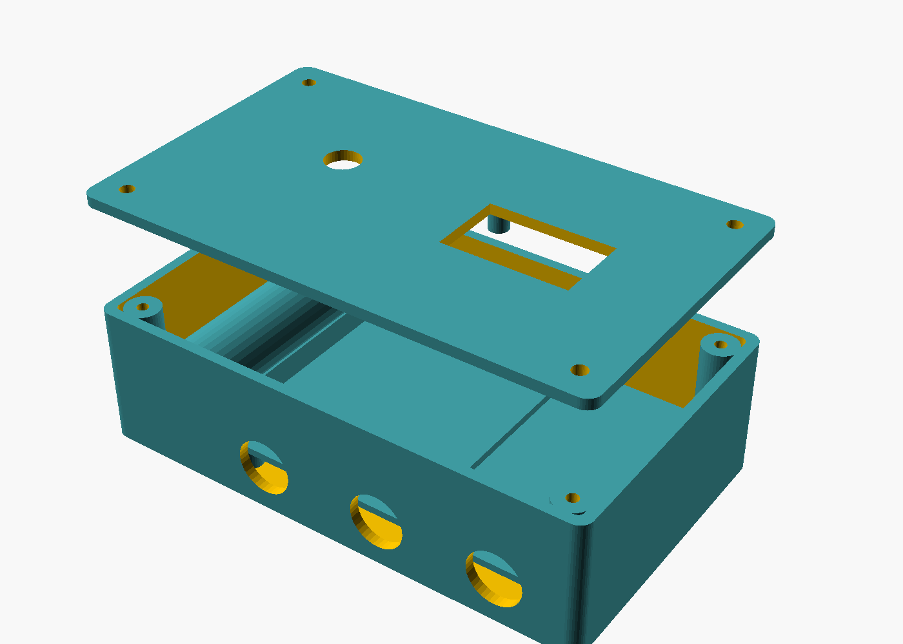

# IoT & C Embedded Programming — Week 4: Smart Agriculture System (Major Project)

An ESP32 node that watches soil moisture, temperature and light, waters plants through a pump, reports over MQTT, sleeps most of the time to run on one 18650 cell, and updates itself over the air with automatic rollback. Includes a **KiCad PCB** that passes DRC with Gerbers ready to order, a **3D-printable enclosure**, and full documentation.



## Brief checklist

| Requirement | Where | Evidence |
| --- | --- | --- |
| **Two FreeRTOS tasks: sensor reading and display update** | `app/app.c`: **four** tasks. `sensor` (samples, queue), `control` (irrigation state machine, owns the pump, highest priority), `display` (OLED), `net` (MQTT publish/commands). A queue, a mutex around shared status, and an event group for publish/sleep. | Runs on the **real FreeRTOS kernel** (V11.1.0 POSIX port) in CI, and on the ESP32 inside ESP-IDF's FreeRTOS |
| **Deep sleep, wake on button press** | `esp32/main/main.c`: `esp_deep_sleep_start()` with the timer *and* `ext0` wake-up on GPIO25. The button means "water now". State survives in `RTC_DATA_ATTR` memory. | Sleep length is chosen per cycle (5 min near the threshold, 30 min when wet, 2 h on a low battery). Simulation: awake **1.4 %** of the time |
| **OTA firmware updates** | `hal_ota()`: MQTT command `ota=https://...` → `esp_https_ota` into the inactive slot (`partitions.csv`, two 1.9 MB slots), certificate-bundle verified, then reboot. **Rollback**: the new image stays "pending verify" until it reaches the MQTT broker; 3 failed boots roll back to the previous firmware. The pump is switched off before any reboot. | Built in CI; the command path is exercised in the simulation |
| **Documentation with circuit diagrams and flowcharts** | `docs/schematic.png`, `docs/flowchart.png`, `hardware/` (PCB, BOM), this README | Below |
| **Major project: soil moisture, temperature, light, relay pump, OLED, WiFi + MQTT, FreeRTOS, deep sleep, OTA, PCB, enclosure, documentation** | All of the above, plus `hardware/agri-node.kicad_pcb`, `hardware/agri-node-gerbers.zip`, `hardware/enclosure.scad` and `hardware/stl/` | Below |

## Irrigation rules (`common/agri.c`)

| Rule | Why |
| --- | --- |
| Start below **35 %** soil moisture, stop above **60 %** (hysteresis) | Avoids short on/off cycles |
| Each watering lasts at most **300 s** | A stuck probe or a burst pipe can't empty the tank |
| Rest **30 min** between waterings | Water needs time to soak in before the probe reads it |
| **1,200 s per day** budget, reset at midnight; manual watering can't exceed it | Protects the tank and the plants |
| Skip watering above **34 °C** or **85 %** light, unless the soil is critically dry (< 17.5 %) | Midday water mostly evaporates |
| **Tank empty** (float switch): pump locked out, including manual commands; resumes when refilled | Pumps burn out running dry |
| **Probe fault** (reading outside its calibration ±400): locked out until it reads sensibly again | An unplugged probe reads "bone dry" and would flood the bed |

**36 unit tests** (`make test`, ASan + UBSan) cover every rule and edge, including the midnight budget reset, manual override limits and fault recovery. They caught a real bug during development: after a fault cleared, the controller used a stale timer, so recovery behaved differently depending on how long the fault had lasted. It now re-evaluates immediately.

## Firmware simulation: 3 days in about 4 seconds

`sim/` runs the *same* `app/app.c` against a soil/weather model. Days 1 and 3 are hot and sunny, day 2 is cloudy, and the sensors return raw ADC values derived from the model. Two builds:
- `make sim-freertos`: the real **FreeRTOS kernel** (POSIX port, fetched at a pinned release). Runs in CI.
- `make sim`: a small pthread stand-in for the same API (`sim/shim/`) for quick local runs.

| Scripted event | Expected | Result (FreeRTOS, CI) |
| --- | --- | --- |
| Day 2, 14:00–17:00: tank empty | Pump never runs; waters once refilled | PASS (lockout at 14:00, watered at 17:05 just after the refill) |
| Day 3, 02:00–02:30: probe unplugged | Sensor-fault lockout, recovers | PASS |
| Day 3, 07:00: MQTT `water` | Manual watering at the next wake-up | PASS |
| Day 3, 12:00: MQTT `ota=...` | Reaches the OTA handler | PASS |
| Whole run | No watering > 300 s, daily budget never exceeded, ≥ 1 watering/day, asleep > 95 % | PASS: 4 waterings, ~290 s of pumping per day, **awake 1.3–1.45 %** |

On day 1 the soil crosses 35 % around 13:00 but the controller waits out the heat and waters at about 16:40 (chart above; exact minutes vary by a few between runs because of sensor noise). That is the heat rule doing its job.



## Hardware



| | |
| --- | --- |
|  |  |

- **PCB** (`hardware/make_pcb.py` → `agri-node.kicad_pcb`): 85 × 62 mm, 2 layers, generated with KiCad 7's Python API. It carries a 30-pin ESP32 DevKit on sockets. Each sensor has its own straight lane to its GPIO row, GND is poured on both layers with stitching vias, there's a copper keep-out under the antenna, and 0.8 mm tracks carry the battery and pump current. **DRC: 0 errors, 0 unconnected pads** (`python3 hardware/run_drc.py`; only silkscreen-overlap warnings remain). Ready to order: `hardware/agri-node-gerbers.zip` (Gerbers + Excellon drill, JLCPCB/PCBWay compatible).
- **Pump driver**: AO3400A low-side MOSFET (fully on at 2.5 V gate drive, so the ESP32's 3.3 V pin drives it directly), 100 Ω gate resistor, 100 kΩ pull-down so the pump stays off while the ESP32 boots, SS14 flyback diode.
- **Power**: 1S 18650 → ME6211C33 LDO (40 µA quiescent) with 470 µF bulk for WiFi bursts; the DevKit is fed on its 3V3 pin. Battery voltage is sensed through a 100k/100k divider on GPIO33.
- **BOM**: `hardware/BOM.csv`, 25 lines, about ₹2,000 for a complete node.
- **Enclosure** (`hardware/enclosure.scad`, STLs in `hardware/stl/`): 116 × 69 × 34 mm, PETG/ASA. Board standoffs for M3 heat-set inserts, an 18650 cradle, three PG7 cable-gland holes on the bottom face, a vent/drain hole, a lid with lip and gasket groove, an OLED window, and button access.



### Pin map

| ESP32 | Function | | ESP32 | Function |
| --- | --- | --- | --- | --- |
| GPIO34 | Soil probe signal (ADC1_CH6) | | GPIO26 | Pump MOSFET gate |
| GPIO32 | Soil probe power (on only while sampling) | | GPIO27 | Float switch (pull-up) |
| GPIO36 | LDR (ADC1_CH0) | | GPIO25 | Wake/water button (ext0) |
| GPIO33 | Battery ÷ 2 (ADC1_CH5) | | GPIO21/22 | I2C SDA/SCL: BME280 0x76, OLED 0x3C |

## Power budget (`docs/power-budget.md`)

Uses the simulated duty cycle (138 wake-ups/day, ~21 min awake/day, ~290 s of pumping/day) and **datasheet** currents, not measurements:

| Build | mAh/day | Days on one 18650, no sun |
| --- | ---: | ---: |
| Bare ESP32-WROOM module (next PCB revision) | 75 | 34 |
| DOIT DevKit, power LED removed | 97 | 26 |
| DOIT DevKit as bought | 263 | 10 |

A 1 W panel supplies about 800 mAh/day on a 4-sun-hour day, so with a TP4056 charger the node runs indefinitely. The biggest improvement left is in the hardware, not the firmware: the DevKit's USB-UART chip and LED dwarf the ESP32's own 10 µA sleep current.

## Build and run

```sh
make test            # irrigation logic, 36 checks
make sim             # 3-day simulation (pthread stand-in) + chart
make sim-freertos    # same on the real FreeRTOS kernel (clones V11.1.0)
cd esp32 && cp main/secrets.example.h main/secrets.h && pio run -t upload -t monitor
python3 hardware/make_pcb.py && python3 hardware/run_drc.py   # in hardware/
openscad -D 'part="base"' -o base.stl hardware/enclosure.scad
```

MQTT topics: `farm/<node>/state` (retained JSON: soil, temp, humidity, light, battery, pump, tank, state, reason, water used today), `farm/<node>/status` (online/offline last-will), `farm/<node>/cmd` (`water`, `stop`, `ota=<https url>`), `farm/<node>/ota` (update progress).

**Not done here:** no hardware was built. The firmware is compile-checked for the ESP32 in CI, and its logic runs in the simulator. The PCB has not been fabricated. Next: order the boards, assemble, measure real sleep current, and calibrate `raw_dry` / `raw_wet` against your soil.
