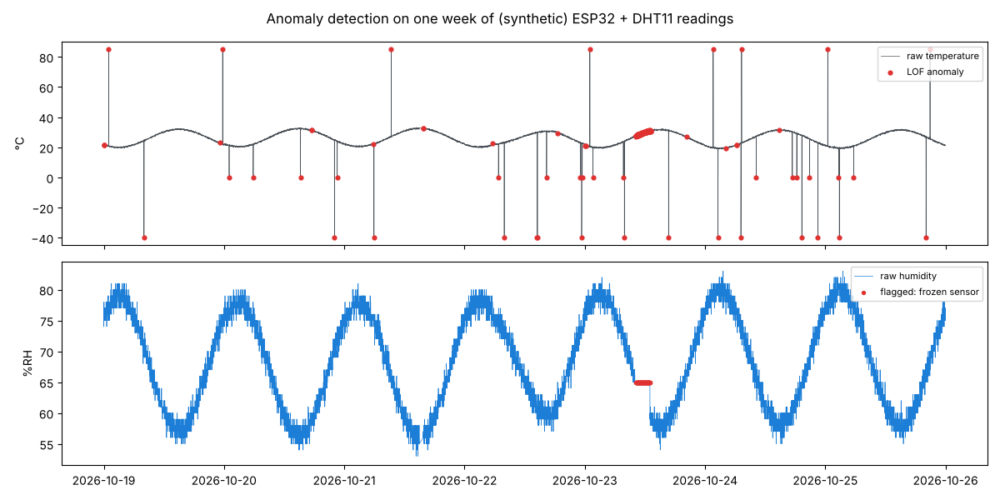
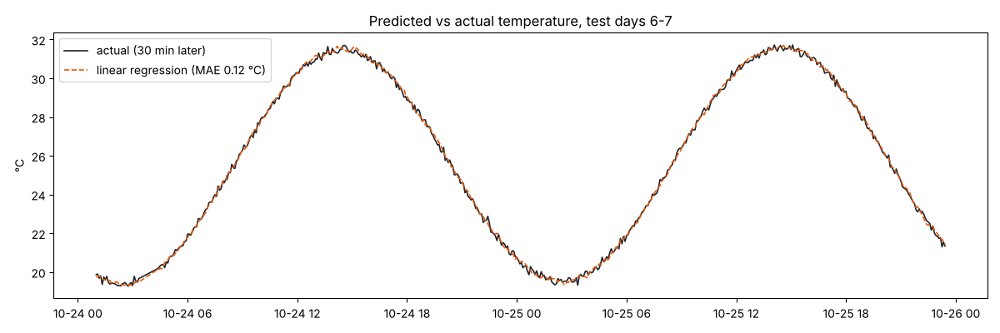
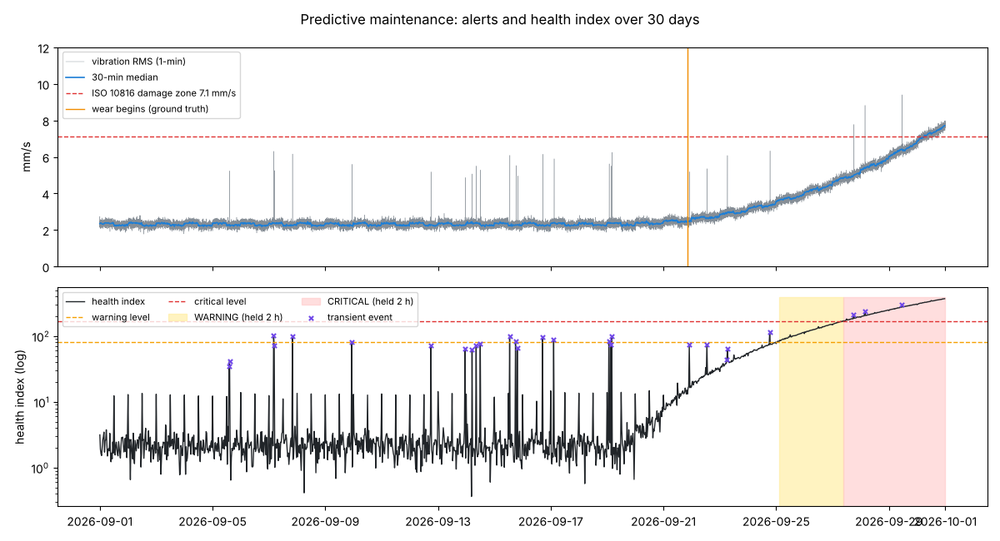
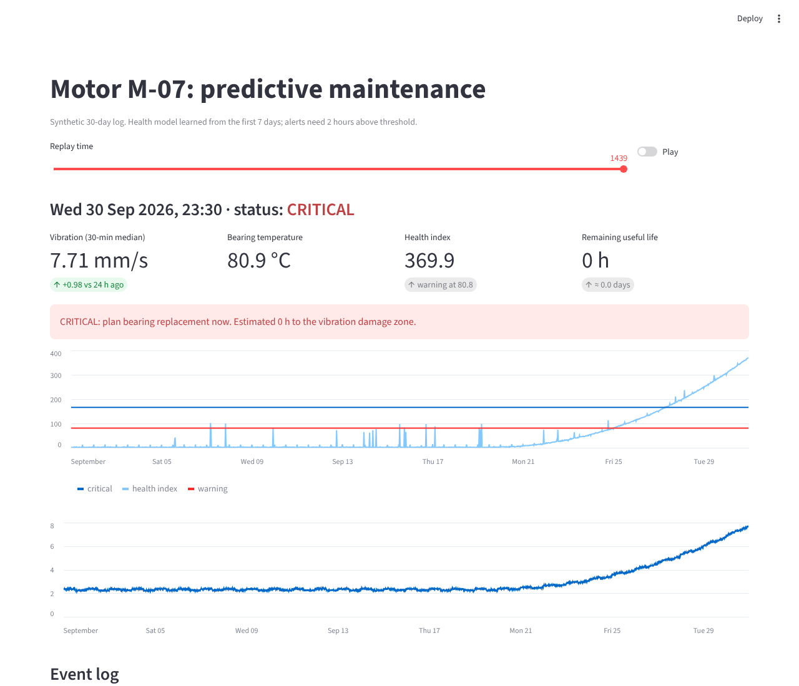

# IoT with AI — Week 2: AI & ML for IoT Data

Data: **synthetic, clearly labelled** (`simulate_sensors.py`, seeded). No physical sensor ran for a week, so the logs were generated *with the faults real IoT logs have*: lost packets, a 45-minute WiFi outage, retransmitted duplicates, late packets, DHT11 glitch spikes, a frozen humidity sensor, and an unplugged LDR. Every fault is recorded as ground truth, so each cleaning or detection step can be **scored** instead of eyeballed.

| Brief item | Where | Result |
| --- | --- | --- |
| **Collect 1 week of sensor data and preprocess it with Pandas** | `preprocess.py` → `data/env_clean.csv`, `data/env_15min.csv`, `results/cleaning_report.md` | Dedupe → re-sort → 1-minute grid → datasheet range checks → Hampel spike filter (per-sensor noise floor) → stuck-sensor detection → time interpolation of gaps ≤ 5 min only (longer gaps stay empty). **214 of 214 injected faults caught, 1 false flag** in 10,080 minutes |
| **Train a simple anomaly-detection model** | `models.py` §1 | Three methods compared on the same faults; **Local Outlier Factor: precision 0.86, recall 0.94, F1 0.90** (table below) |
| **Linear regression to predict future values** | `models.py` §2 | Temperature **30 minutes ahead**: MAE **0.115 °C** vs 0.519 °C for "same as now" (78% better). Chronological split: days 1–5 train, days 6–7 test |
| **Plot predictions vs actual with Matplotlib** | `results/forecast.png`, `results/anomaly.png` | Below |
| **Mini project: predictive maintenance with an ML model and a Python dashboard that alerts** | `maintenance/` (engine, evaluation, Streamlit app) | First warning **124 h before failure**, critical 69 h before, **0 false alerts** in 18 healthy days, 0 alerts from 25 transient spikes, remaining-life estimate within +2 to +18 h |

## Anomaly detection (`results/models.md`)

| Method | Precision | Recall | F1 |
| --- | ---: | ---: | ---: |
| Rolling z-score (temperature) | 0.49 | 0.17 | 0.26 |
| Isolation Forest (4 features) | 0.38 | 0.19 | 0.25 |
| **Local Outlier Factor, novelty mode (4 features)** | **0.86** | **0.94** | **0.90** |

All three are fitted on days 1–2, with the alert threshold at the 99.5th percentile of *training* scores, so no test labels were used for tuning. The interesting result is **why the Isolation Forest fails**. The frozen sensor's spread is exactly 0, lower than anything in training. An Isolation Forest only splits within the range it saw, so an out-of-range point shares a leaf with the lowest normal readings and gets an ordinary score. LOF scores distance to the nearest training neighbours, so it keeps rising the further outside the range a point goes.




## Mini project: predictive maintenance (`results/maintenance.md`)

A motor logs vibration RMS, bearing temperature and current every minute for 30 days. The bearing starts wearing on day 21 and reaches the **ISO 10816 class II damage zone (7.1 mm/s)** on day 30.

- **Health index:** 30-minute windows (median and p95 vibration, temperature and its rate of change). The **load effect is regressed out** first, because vibration and heat rise with load on every shift change and that isn't a fault. The index is the robust Mahalanobis distance (Minimum Covariance Determinant) from the first 7 healthy days.
- **Alerts need persistence:** WARNING or CRITICAL only after **2 hours** above the level. A 3-minute transient (dropped tool, voltage dip) is logged as an event, not an alert.
- **Remaining useful life:** a quadratic fit to the last 48 hours of the health index, extrapolated to the index value that corresponds to 7.1 mm/s.

| Check | Result |
| --- | --- |
| First WARNING | **124 h before failure** (78 h after wear began) |
| First CRITICAL | 69 h before failure |
| False alerts over 18 healthy days (36 shift changes) | **0** |
| Transient spikes | 27/27 windows flagged as events, **0** alerts |
| RUL asked 96 / 72 / 48 / 24 / 12 h before failure | 114 / 76 / 50 / 34 / 16 h |

The RUL estimate is consistently a little **optimistic**, because the wear accelerates faster than a quadratic. In practice, schedule the repair at half the estimate. That would still have given 2–3 days' notice here.



**Dashboard** (`streamlit run maintenance/app.py`): a replay slider and a Play button let you watch the health index climb. It shows status, vibration, temperature, health index and remaining life, a coloured alert banner and an event log. It is tested headless with Streamlit's `AppTest` (CRITICAL at the end of the log, "Normal operation" on day 5).



## Run

```sh
pip install -r requirements.txt
python simulate_sensors.py && python preprocess.py && python models.py && python maintenance/evaluate.py
python -m pytest tests          # 6 tests, incl. the dashboard
streamlit run maintenance/app.py
```

For real data, replace `data/env_raw.csv` with your node's export using the same columns. The week 1 ESP32 sketch sends exactly these fields to ThingSpeak, which can export CSV.
