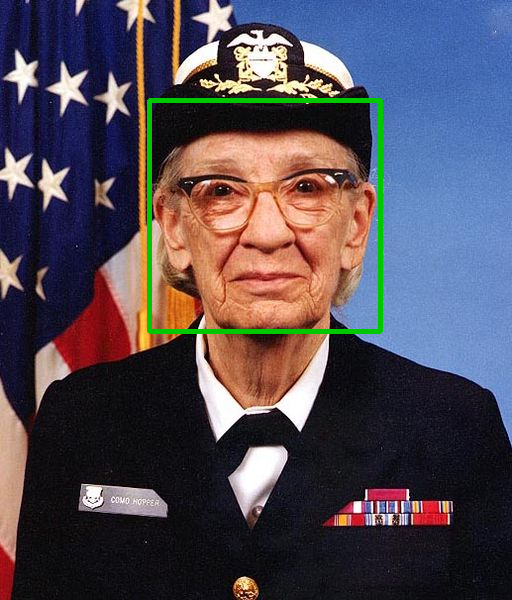
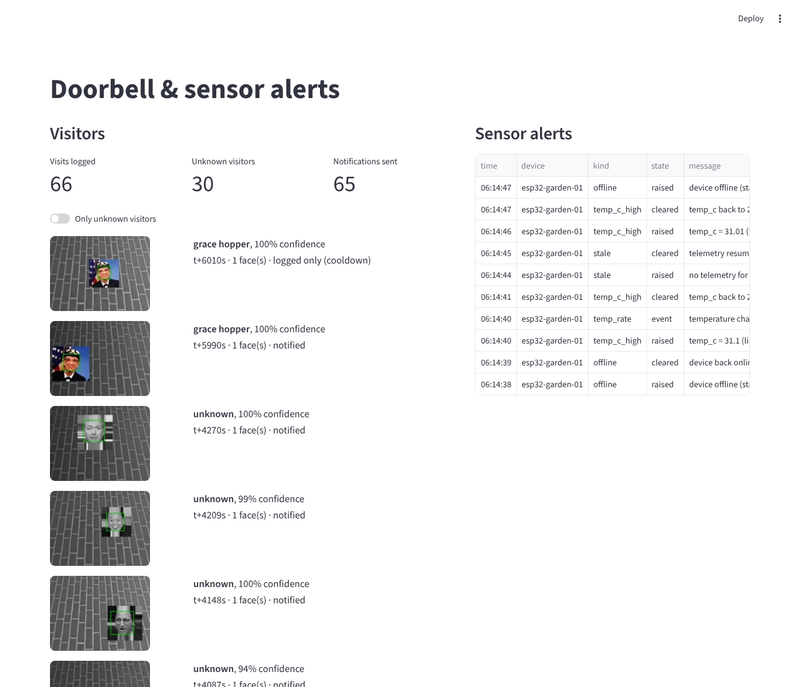

# Week 3: Edge AI on IoT devices, real-time MQTT pipelines and a smart doorbell

Everything runs on a Raspberry Pi 4 class CPU with the TFLite runtime (`ai-edge-litert`, a few MB) and OpenCV.
TensorFlow is only needed on a PC to train. All numbers below were produced by the scripts in this folder;
the results files have the full tables.

| Part | What it is | Headline result |
|---|---|---|
| [face/](face/detect.py) | Haar-cascade face detection, live camera loop for the Pi | 92/100 LFW faces found, 0/100 false hits |
| [tinyml/](tinyml/) | Image classification CNN, full-int8 TFLite, Pi script for a photo of a digit | **97.8 %** int8 accuracy, **15.3 KB**, 22 µs |
| [voice/](voice/kws.py) | Offline keyword spotting: *light on/off, fan on/off, status* → MQTT | **95.3 %** on voices never heard, 12 KB |
| [mqtt/](mqtt/pipeline.py) | Real-time pipeline: device publisher, rule-based alerter, SQLite log | all 6 rule types fire correctly |
| [doorbell/](doorbell/) | **Mini project**: smart doorbell with face recognition | **0 / 30** strangers taken for a resident |

## 1. Face detection ([results](results/face_detection.md))
`face/detect.py` uses OpenCV's frontal-face Haar cascade with histogram equalisation (helps with backlit
doorways) and an optional eye check. On the two bundled portraits it finds exactly one face each (50–70 ms
at 512 px on this PC). On scikit-image's LFW subset it detects 92 of 100 faces with no false detections on
100 non-face patches. `--camera` runs live with a Pi Camera (picamera2) or any USB webcam.



## 2. TinyML image classification ([results](results/tinyml_digits.md))
A 9,930-parameter CNN on scikit-learn's handwritten digits, converted to a **full-integer int8** TFLite model
(int8 input and output, as microcontrollers and the Coral Edge TPU need). Quantisation cost 0.2 points
(98.0 % → 97.8 % on 450 unseen images). `tinyml/classify_pi.py` takes a phone or Pi Camera photo of a
digit on paper, thresholds it with Otsu, centres it and resizes it to the 8×8 training format. A test draws
a "1" and checks the model reads it.

## 3. Voice control ([results](results/voice.md))
A keyword spotter in the style of TensorFlow Lite Micro's `micro_speech`: 1-second clips → 40 log-mel bands
× 49 frames → a 7,062-parameter CNN → 12 KB int8.
* **Data**: no speech dataset could be downloaded here, so the clips are synthesised with espeak-ng in 8
  English accents × 3 speeds × 3 pitches × 3 noise levels, plus 8 distractor phrases ("open the door",
  "lights", "fan" …) and pure noise as `_unknown`.
* **Honest test**: the Scottish and Caribbean voices are held out completely, so the score shows how the
  model copes with new speakers. I first used `en-in`, which espeak silently replaces with the default
  voice; that leaked training audio into the test set and inflated accuracy to 97.7 %. I found it by
  comparing audio hashes and removed it. The real figure is **95.3 %**, with 4.9 % of distractors or
  noise mistaken for a command.
* **On the Pi**: `python voice/kws.py listen` slides a 1-second window every 250 ms over a USB microphone,
  acts only when the same command wins twice in a row at > 80 %, and publishes `home/light/set on` etc.

## 4. Real-time MQTT pipeline ([results](results/mqtt_alerts.md))
* **Publisher** (`publish`): replays week 2's cleaned 15-minute data as an ESP32 would send it, to
  `sensors/<device>/telemetry`. It announces `online` on a retained status topic and registers `offline`
  as its **MQTT last-will**, so the broker reports the device if it vanishes without saying goodbye.
* **Alerter** subscribes to `sensors/+/telemetry` and `sensors/+/status`, publishes to `alerts/<device>`
  and stores every alert in SQLite. Rules:
  * threshold with **hysteresis**: raise above 31 °C, clear below 30 °C, so readings around the limit
    don't spam alerts;
  * **rate of change**: more than 2 °C within 5 readings;
  * **stale data**: no telemetry for N seconds;
  * **offline**: the status topic or last-will.
* Tested against a real Mosquitto broker with an injected +6 °C spike and a WiFi drop. Every rule fired
  once at the right time, and natural daily warming never triggered the rate rule.

## 5. Mini project: smart doorbell ([model](results/doorbell_model.md), [end to end](results/doorbell_e2e.md))

```
bell button / motion ─► 3-frame burst ─► Haar face detection ─► 25×25 grey crop ─► int8 CNN (9 KB)
      ─► average over burst ─► "grace_hopper 97 %" or "unknown" ─► SQLite log + MQTT doorbell/front/visit
      (JSON with a 10 KB JPEG snapshot) ─► phone / dashboard          60 s cooldown per person
```

* **Enrolment**: put photos in `doorbell/known/<name>/` and run `python doorbell/recognise.py`. The demo
  enrols the two portraits bundled with matplotlib and scikit-image. Strangers are faces from Labeled
  Faces in the Wild: 70 for training, and 30 people kept out entirely for testing.
* **Safety first**: a resident is only named at ≥ 75 % confidence. Otherwise the visitor is "unknown",
  because a missed resident only costs a slightly different notification, while a stranger named as a
  resident is the real failure. The doorbell never unlocks anything.
* **A bug I found and fixed**: the first version gave strangers' 25×25 patches to the model directly while
  live faces went through detection and cropping. In full scenes 3 of 30 strangers were taken for a
  resident. After routing every face through the same detect → crop path in training, it is **0 of 30**
  (and 0 of 60 in the model test).

End-to-end on 90 composed visits through the real broker:

| Visit type | Result |
|---|---|
| Resident (40 visits) | 34 named correctly, 0 confused with the other resident, 1 "unknown", 5 face not detected |
| Stranger (30 unseen people) | 29 "unknown visitor", **0 taken for a resident**, 1 face not detected |
| Bell, nobody there (20) | 20 no false face |
| MQTT | phone subscriber received 65 / 65 notifications with snapshots; repeat ring in 20 s logged, not re-sent |
| Speed | 114 ms median per 3-frame visit on this PC (roughly 0.5–0.7 s expected on a Pi 4) |

`streamlit run doorbell/dashboard.py` shows visitors with snapshots next to the live sensor alerts:



## Limitations (stated plainly)
* No physical Pi, camera or microphone was available, so the device scripts (`--camera`, `listen`) are
  written for the Pi, but every model and the MQTT path were measured on a PC with the same TFLite runtime.
* The doorbell enrols only **two people, each from a single photo** (augmented). Real use needs 5–10 photos
  per person in different light. The 5 missed residents were Haar detection failures under strong tilt or
  harsh lighting. A DNN detector (OpenCV's YuNet, about 0.3 MB) would fix most of them.
* Voice training audio is synthetic. Real recordings, e.g. Google Speech Commands, would be the next step
  before trusting it with real voices.

## Run it
```bash
pip install -r requirements.txt            # on the Pi: ai-edge-litert opencv-python-headless paho-mqtt numpy
sudo apt install mosquitto espeak-ng
python face/detect.py && python tinyml/train_digits.py && python voice/kws.py train
python doorbell/recognise.py && python doorbell/doorbell.py --evaluate --mqtt localhost
python mqtt/pipeline.py alerter &  python mqtt/pipeline.py publish
pytest -q tests                            # 7 tests, including a live broker
```
