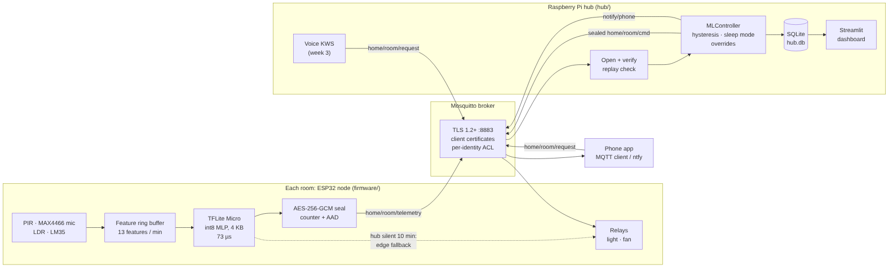
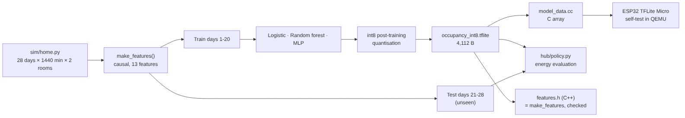
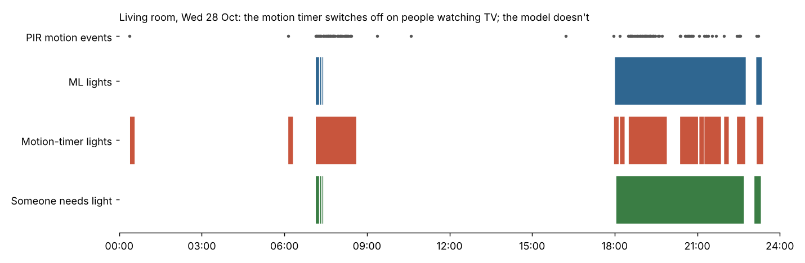
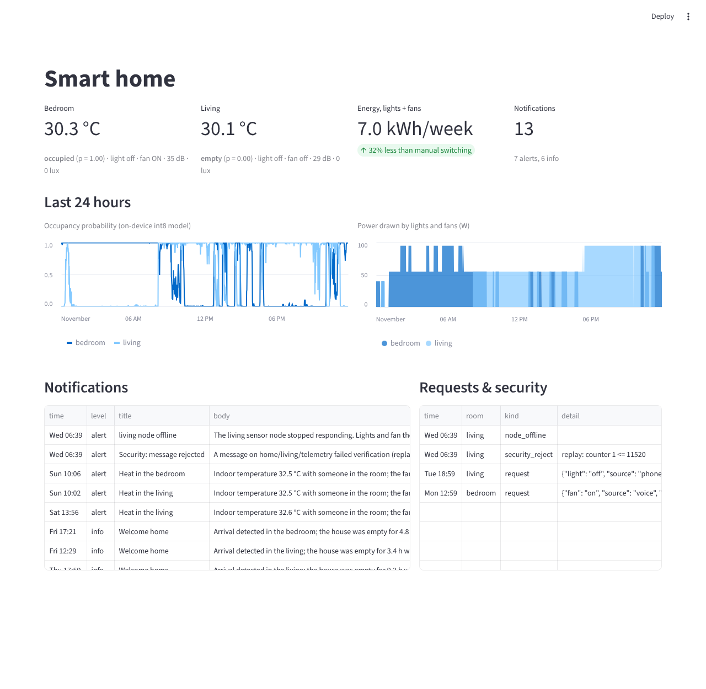

# Week 4 major project: AI-powered smart home

An end-to-end smart home:
* **ESP32 room nodes** sense temperature, motion, light and sound, and run an **occupancy model on the chip
  with TensorFlow Lite Micro**.
* A **Raspberry Pi hub** uses the predictions to switch lights and fans, saving energy without leaving people
  in the dark.
* **Voice control** comes from week 3's keyword spotter. The phone gets **notifications**, and there is a
  **real-time dashboard**.
* All traffic is **encrypted and authenticated**: TLS with device certificates, per-device ACLs and end-to-end AES-GCM.



| | Result | Evidence |
|---|---|---|
| Occupancy model, int8 on the ESP32 | **97.9 %** accuracy on 8 unseen days; still detects **97 %** of minutes where people sit still (motion timer: 32 %) | [results/occupancy.md](results/occupancy.md) |
| On-device inference (TFLite Micro) | outputs **identical** to the Python interpreter on 96/96 test vectors, **73 µs**, 4.1 KB model, 1.1 KB arena | CI job `esp32-tflite-micro` (firmware built with ESP-IDF 5.3, run in QEMU) |
| Energy optimisation | **−32 %** energy vs manual switching, light missing while needed 0.8 h/week (motion timer: −37 % but 21 h/week of misses) | [results/energy.md](results/energy.md) |
| Whole system, end to end | 23,040 sealed messages over TLS, **4 ms** median sensor → hub → relay; same decisions as the offline evaluation | [results/e2e.md](results/e2e.md) |
| Security | 11 security tests (6 against the real broker config, 5 on the payload crypto) plus 3 C ↔ Python interop tests; replay attack and power cut detected live | [docs/security.md](docs/security.md) |

## 1. Sensors and data ([sim/home.py](sim/home.py))
Each room node has a PIR (HC-SR501), a MAX4466 microphone (sound level in dB), an LDR and an LM35. No house
was available to record from, so a minute-level simulator supplies 4 weeks of data for a 2-person, 2-room home:
* work-day and weekend routines, working from home, evenings out, sleep;
* realistic sensor noise and false PIR triggers;
* a hot climate (26–35 °C).

The hard part is built in on purpose: **15 % of occupied minutes have no motion in the last 10 minutes**
(TV, desk work, sleep). That is where motion-timer "smart" switches fail.

## 2. ML pipeline ([ml/occupancy.py](ml/occupancy.py), [results](results/occupancy.md))


* **Features.** 13 causal features computed from the past only: motion counts over 1/5/15/30 minutes,
  minutes since the last motion, sound mean/max/std, temperature trend, time of day, weekend, room. The firmware
  computes the same features in a 30-minute ring buffer ([features.h](firmware/main/features.h)); a test checks
  the C++ values against the Python ones to 0.002.
* **Honest split.** Train on days 1–20, test on whole unseen days 21–28.

| Model | Accuracy | F1 | Recall while people sit still | Empty room called occupied |
|---|---:|---:|---:|---:|
| Motion in last 10 min (PIR timer) | 0.811 | 0.744 | 0.32 | 7.2 % |
| Logistic regression | 0.900 | 0.883 | 0.87 | 9.6 % |
| Random forest (200 trees) | 0.976 | 0.971 | 0.96 | 2.5 % |
| **MLP int8 (649 parameters, 4,112 B)** | **0.979** | **0.975** | **0.97** | **2.0 %** |

The tiny MLP matches the random forest and quantises to int8 with no loss, so it fits a microcontroller.

## 3. AI model on the ESP32 with TensorFlow Lite Micro ([firmware/](firmware/main/main.cc))
ESP-IDF 5.3 project using `espressif/esp-tflite-micro` (ESP-NN optimised kernels):
* `MicroMutableOpResolver<2>` (fully connected + logistic only) and a 4 KB tensor arena (1,084 B used).
* Features → standardise → int8 → `Invoke()` once a minute.
* **Boot self-test**: 96 vectors from unseen days are replayed through the on-chip model and compared with the
  Python interpreter. CI builds the firmware and runs this in the **ESP32 QEMU emulator**:
  `SELFTEST PASS: 96/96 outputs identical to the Python interpreter … 73 us per inference, arena used 1084 of 4096 bytes`.
* Networking: WiFi, SNTP time, `esp-mqtt` over `mqtts://` with the device certificate, last-will, and AES-GCM
  sealed telemetry (mbedTLS). Hub commands are verified before the relays move.
* **Edge autonomy**: if the hub is silent for 10 minutes, the node switches its light and fan from its own prediction.

Wiring: PIR → GPIO27, mic → GPIO34, LDR → GPIO35, LM35 → GPIO32, light relay → GPIO25, fan relay → GPIO26.

## 4. Smart automation and energy ([hub/policy.py](hub/policy.py), [results](results/energy.md))
The hub's controller:
* adds hysteresis (on above 0.6; off only after 3 minutes below 0.4);
* puts the bedroom into "sleep mode" at night (light off, fan stays on).

Compared on the unseen days:

| Policy | Energy/week | Saving | Light missing while needed | Fan missing while needed | Lights cut off on someone |
|---|---:|---:|---:|---:|---:|
| Manual switches | 10.3 kWh | – | 2.5 h | 0.0 h | 4 |
| Motion timer, 10 min | 6.5 kWh | 37 % | 7.6 h | 13.8 h | 49 |
| **AI occupancy model** | **7.0 kWh** | **32 %** | **0.8 h** | **1.1 h** | **3** |



## 5. Hub, voice, notifications and dashboard ([hub/hub.py](hub/hub.py))
* **Voice and phone**: requests on `home/<room>/request` (from the week-3 keyword spotter or the phone) override
  the automation for 60 minutes. A device kept on in an empty room is switched back to automatic after 30
  minutes, and the phone is told.
* **Notifications** on `notify/phone`, and pushed to a phone via [ntfy](https://ntfy.sh) when `NTFY_TOPIC` is
  set (free, no account):
  * someone is in a room above 32.5 °C;
  * welcome home after a long absence;
  * node offline;
  * a message failed security checks.
* **Dashboard**: `streamlit run hub/dashboard.py` shows each room's state, occupancy and power over 24 hours,
  notifications and security events.



## 6. Security ([docs/security.md](docs/security.md))
TLS 1.2+ only, with mutual authentication by ECDSA certificates from a private CA. The certificate name is the
MQTT username, and a least-privilege ACL decides what each identity may do. On top of that, AES-256-GCM per
device with a replay counter and topic-bound associated data. Tested:
* no certificate, plain text, or a foreign CA → refused;
* a device writing another room's topic → dropped;
* tampered, replayed or moved messages → rejected;
* C and Python implementations interoperate.

## 7. End to end ([hub/demo.py](hub/demo.py), [results](results/e2e.md))
The run: real broker config, the hub, two device twins replaying the 8 test days through the same int8 model,
plus phone and voice clients.
* **23,040** sealed messages, each answered by a sealed command; **4 ms** median round trip.
* Hub decisions match the offline evaluation except during deliberate overrides; energy is 7.0 kWh/week, as estimated.
* Injected events all behaved correctly:
  * a voice "fan on" in an empty bedroom was reverted with a notification;
  * a replayed message from an attacker holding a stolen device certificate was rejected and reported;
  * a power cut was reported through the last-will.

Two bugs found on the way:
* **TCP Nagle delay.** Round trips were 88 ms until `set_tcp_nodelay` on the broker and `TCP_NODELAY` on the clients.
* **FreeRTOS simulator hang** (IoT-C week 4). The simulator never exited because `exit()` was called from a POSIX-port task.

## Run it
```bash
pip install -r requirements.txt && sudo apt install mosquitto libmbedtls-dev
python sim/home.py && python ml/occupancy.py && python ml/export_vectors.py && python hub/policy.py
python hub/demo.py                  # whole system, 8 days, writes results/e2e.md and hub/hub.db
streamlit run hub/dashboard.py
pytest -q tests                     # 16 tests: security, firmware C++ on host, end to end
# real hardware
./security/gen_certs.sh && mosquitto -c security/mosquitto_tls.conf
cd firmware && ./provision.sh esp32-living && idf.py menuconfig build flash monitor
python hub/hub.py --certs security/certs
```

## Limitations
* Sensor data is simulated. No physical ESP32 or Pi was available, so the firmware was verified by building it
  with ESP-IDF and running its model self-test in QEMU, and the network path with device twins. Sound and
  light readings need a one-off calibration per unit (menuconfig offsets).
* Occupancy is per room, not a head count. "Welcome home" cannot tell residents from intruders without a second
  signal (phone presence, door contact, or week 3's doorbell recognition).
