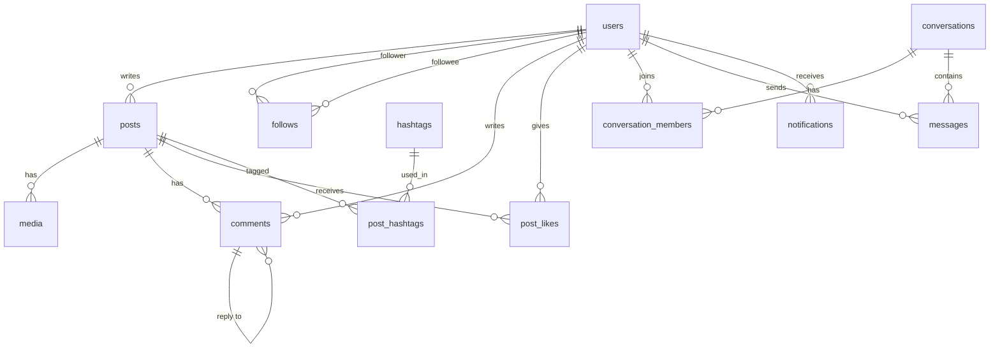

# Social Media App: Database Schema

DDL: `social-media-schema.sql` (PostgreSQL). `schema_check.py` loads it into SQLite, checks that the constraints reject bad rows and runs the queries below. Its output is in `schema_check_output.txt`.



## Normalisation

| Normal form | Rule | How the schema meets it |
| --- | --- | --- |
| **1NF** | Atomic values, no repeating groups | A post's photos are rows in `media`, not a comma-separated column. Hashtags are rows in `post_hashtags`, not a text array. |
| **2NF** | No non-key column depends on only part of a composite key | Junction tables (`follows`, `post_likes`, `post_hashtags`, `conversation_members`) hold only their key columns plus `created_at`, which depends on the whole pair. |
| **3NF** | No non-key column depends on another non-key column | Author details live only in `users`; posts store `author_id`, not the username. Tag text lives only in `hashtags`. Counts (likes, followers) are computed, not stored. |

**Deliberate denormalisation at scale:** counting likes on every feed read gets expensive. At high volume I would add `posts.like_count`, maintained by the like/unlike transaction (or a trigger), and accept a small risk of drift that a nightly job corrects. That is a measured performance choice, not the starting design.

## Integrity rules in the schema
- `follows`: composite PK stops duplicate follows; `CHECK (follower_id <> followee_id)` stops self-follows.
- `post_likes`: composite PK gives one like per user per post.
- `UNIQUE` on username, email and tag; `CHECK` on `media.kind` and `notifications.type`.
- `ON DELETE CASCADE` so deleting a user removes their posts, likes, follows and messages, with no orphans.

## Indexes and the queries they serve

| Query | Index |
| --- | --- |
| Home feed: posts by people I follow, newest first | `follows` PK (follower_id first) + `idx_posts_author_time` |
| Profile page: one user's posts | `idx_posts_author_time` |
| "Who follows me" / follower count | `idx_follows_followee` |
| Comments under a post, in order | `idx_comments_post` |
| Posts for a hashtag | `idx_post_hashtags_tag` |
| Unread notifications badge | partial index `idx_notifications_unread` (only unread rows) |

```sql
-- Home feed for user 1
SELECT u.username, p.body, (SELECT COUNT(*) FROM post_likes l WHERE l.post_id = p.id) AS likes
FROM posts p
JOIN follows f ON f.followee_id = p.author_id
JOIN users u   ON u.id = p.author_id
WHERE f.follower_id = 1
ORDER BY p.created_at DESC, p.id DESC
LIMIT 20;
```

For very large follow graphs this pull-based feed would move to fan-out-on-write (a per-user feed table filled by a worker), except for accounts with millions of followers, which stay pull-based.
