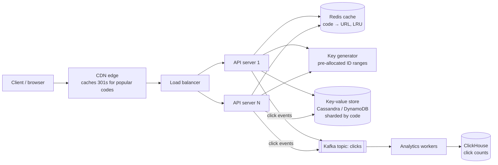

# System Design: URL Shortener

## 1. Requirements

**Functional**
- Shorten a long URL to a 7-character code (`sho.rt/aB3x9Kq`); optional custom alias and expiry.
- Redirect `GET /{code}` to the long URL.
- Owner can see click counts and delete links.

**Non-functional**
- Redirects are the hot path: p99 < 50 ms, 99.99% available.
- Codes are unguessable enough that links can't be enumerated.
- Analytics may lag by up to a minute; redirects must never wait on analytics.

## 2. Capacity estimate

| Quantity | Assumption | Result |
| --- | --- | --- |
| New links | 100 M / month | ≈ 40 writes/s average, 400/s peak |
| Redirects | 100 reads per write | ≈ 4,000 reads/s average, 40,000/s peak |
| Storage per link | code 7 B + URL ~200 B + metadata ~100 B ≈ 0.5 KB with index | 100 M × 12 × 5 years × 0.5 KB ≈ **3 TB** over 5 years |
| Code space | 62 characters (a–z, A–Z, 0–9), length 7 | 62⁷ ≈ 3.5 × 10¹², over 500× the 6 × 10⁹ links needed |
| Cache | 20% of links get 80% of traffic; cache one day's hot set | ≈ 3.3 M links/day × 0.2 × 0.5 KB ≈ **350 MB** of Redis |

The system is read-heavy (100:1), so the design optimises the read path with a cache in front and a store that scales horizontally by key.

## 3. Architecture

**Redirect path (read):** CDN → load balancer → API server → Redis hit (about 95%) → `301`/`302`. On a miss, read the KV store and fill the cache. The click event goes to Kafka asynchronously, so analytics never slows a redirect.

**Create path (write):** API server takes the next ID from its pre-allocated range, encodes it to base62, writes `code → URL` to the KV store and returns. There is no read-before-write and no collision retry.

## 4. API

| Method | Path | Body / params | Response |
| --- | --- | --- | --- |
| `POST` | `/api/v1/links` | `{ "url": "https://…", "alias": "optional", "expires_at": "optional ISO date" }` | `201 { "code": "aB3x9Kq", "short_url": "https://sho.rt/aB3x9Kq" }`; `409` alias taken; `422` invalid URL |
| `GET` | `/{code}` | – | `302 Location: <long url>`, or `404`, or `410` if expired |
| `GET` | `/api/v1/links/{code}` | auth | `200 { url, created_at, expires_at, clicks }` |
| `DELETE` | `/api/v1/links/{code}` | auth, owner only | `204` |
| `GET` | `/api/v1/links/{code}/stats?from=&to=` | auth | `200 { clicks_by_day: [...] }` |

Auth is a bearer token (JWT). Creation is rate-limited per user and per IP with a token bucket, as in the blog API, to stop spam.

**301 vs 302:** a 301 is cached by browsers, which saves load but loses click counts. Use **302** for links with analytics and 301 only where the owner opts out of tracking.

## 5. Generating codes

| Option | Pros | Cons |
| --- | --- | --- |
| Hash the URL (MD5, take 7 chars) | Same URL gives the same code | Collisions need checks and retries; leaks the URL→code mapping |
| Random 7 chars | Simple, unguessable | Must check for collisions on every write |
| **Counter + base62 with ID ranges (chosen)** | No collisions, no extra read, fast | Sequential codes are guessable, so the ID is shuffled first |

The key generator hands each API server a block of 10,000 IDs (stored in ZooKeeper/etcd or a single DB row updated atomically), so servers create codes without talking to each other. To make codes non-sequential, each ID passes through a reversible permutation (e.g. a 42-bit Feistel cipher keyed by a secret) before base62 encoding. That keeps it collision-free while unguessable.

## 6. Data model

`links(code PK, long_url, owner_id, created_at, expires_at)`: a key-value access pattern, so a wide-column store sharded on `code` (consistent hashing) scales linearly. Custom aliases go in the same table; the write uses `INSERT IF NOT EXISTS` to detect a taken alias. Expired rows get a TTL in the store, plus a nightly cleanup job.

## 7. Scaling and reliability
- **Stateless API servers** behind the load balancer, autoscaled on CPU and p99.
- **Cache:** Redis cluster with LRU eviction; cache-aside with a 24 h TTL. A negative cache entry (60 s) for unknown codes stops scans from hammering the DB.
- **Database:** replication factor 3 across zones; reads at `LOCAL_QUORUM`.
- **Hot keys:** a viral link is served from the CDN edge and a local in-process cache on each server.
- **Failure modes:** if Redis is down, fall back to the DB with a circuit breaker. If Kafka is down, buffer click events locally and drop them after a limit (analytics can lose data; redirects cannot fail). If the key generator is down, servers keep using their current ID block.
- **Abuse:** check new URLs against a malware/phishing list, with per-user quotas and a report endpoint.

## 8. Trade-offs summary
Consistency is relaxed where it is cheap (analytics, cache staleness after delete ≤ TTL; delete also evicts the key) and kept strict where it matters (alias uniqueness, no code collisions).
