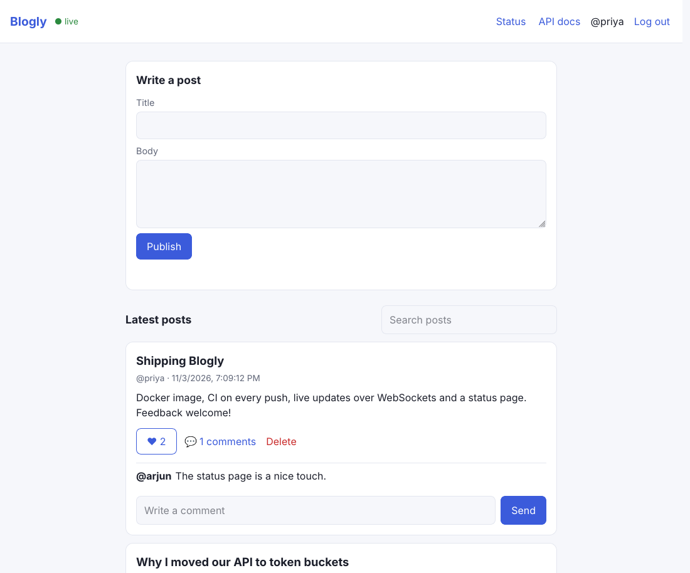
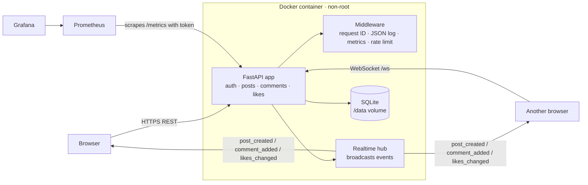
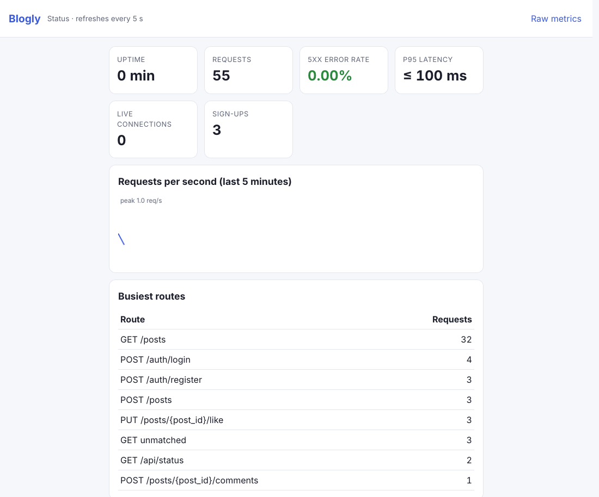

# Blogly: Software Engineer Week 4 Major Project

A small production-style blogging SaaS: accounts, posts, comments and likes **that update live in every open browser**, packaged as a Docker image, tested and shipped by a GitHub Actions pipeline, and monitored with Prometheus + Grafana and a built-in status page.



## Brief checklist

| Requirement | How it is met |
| --- | --- |
| Dockerise: Dockerfile + docker-compose multi-container | `Dockerfile` (multi-stage, non-root user `app`, `HEALTHCHECK`); `docker-compose.yml` runs **api + Prometheus + Grafana** with a persistent volume |
| CI/CD with GitHub Actions: lint, test, build, deploy | `.github/workflows/blogly.yml`: ruff → pytest with a 90% coverage gate → real-browser E2E → Docker build + container smoke test → compose smoke test (checks that Prometheus scrapes the API and Grafana loads the dashboard) → push to `ghcr.io` → Render deploy hook |
| Deploy to a cloud with environment variables | `/render.yaml` service `blogly` (Docker, free plan). `JWT_SECRET` and `METRICS_TOKEN` are generated by Render, never committed. The app refuses to start without a 32+ character secret. |
| Monitoring and logging | `/metrics` (Prometheus: requests by route/status, latency histogram, in-flight, WebSocket clients, events, sign-ups), Grafana dashboard as code, `/status` live dashboard, one **JSON log line per request** with an `X-Request-ID` you can trace |
| Full-stack app with auth, REST API, database | FastAPI + SQLite backend (JWT + scrypt), vanilla-JS front end in `blogly/static/` that writes all user text with `textContent`, so there is no XSS |
| Real-time features | `/ws` WebSocket: new posts, comments, likes and deletes are pushed to every client; the browser reconnects with exponential back-off |
| API documentation | Swagger UI at `/docs`, OpenAPI at `/openapi.json` |
| Professional README, design-to-deployment lifecycle | This file |

## Architecture



Write path: `POST /posts` → validate (pydantic) → insert → the hub broadcasts `post_created` to every socket → other browsers prepend the card without reloading.

## The lifecycle, step by step

| Stage | What was done | Evidence |
| --- | --- | --- |
| **Design** | Requirements and API carried over from week 3 (system design, schema, OpenAPI). Week 4 adds real-time, observability and delivery. | `../week-3/docs/`, diagram above |
| **Build** | `blogly/`: `app.py` (routes), `realtime.py` (WebSocket hub, thread-safe publish from sync handlers, connection cap), `observability.py` (metrics with route templates so label cardinality stays bounded, JSON logs), `static/` (UI and status page) | Code |
| **Test** | **44 API/unit tests at 99% branch coverage** (auth edge cases, ownership, pagination, search, rate limits, WebSocket events, metrics, logging, 500 handling) plus **3 browser E2E tests**: Alice posts, and Bob's window shows it, her like count and comment count update live; HTML is escaped | `tests/`, CI logs |
| **Package** | Multi-stage image on `python:3.12-slim`, dependencies in a venv, runs as UID 10001, healthcheck hits `/health`, which also queries the database | `Dockerfile` |
| **Integrate** | Every push runs the pipeline; `main` publishes `ghcr.io/<owner>/blogly:<sha>` and `:latest` | `.github/workflows/blogly.yml` |
| **Deploy** | Render (free) builds the Dockerfile; Actions triggers the deploy only after tests and smoke tests pass | `/render.yaml` |
| **Operate** | `/status` (below), Prometheus + Grafana via compose, JSON logs with request IDs, `429` with `Retry-After` under abuse | `monitoring/`, `docs/screenshots/status.png` |



## Run it

```sh
cd software-engineer/week-4
export JWT_SECRET=$(python -c "import secrets; print(secrets.token_urlsafe(48))")

# Option 1: the whole stack in Docker
docker compose up --build          # app :8000 · Prometheus :9090 · Grafana :3000 (admin/admin, dashboard "Blogly")

# Option 2: plain Python
pip install -r requirements-dev.txt
uvicorn blogly.app:app --reload    # http://127.0.0.1:8000 · /docs · /status · /metrics

# Tests
python -m pytest --cov=blogly --cov-branch      # unit + API
E2E=1 python -m pytest tests/test_e2e.py         # two headless Firefox windows
ruff check .
```

| Variable | Default | Purpose |
| --- | --- | --- |
| `JWT_SECRET` | required | Signs access tokens (32+ chars) |
| `BLOG_DB` | `blog.db` (`/data/blog.db` in Docker) | SQLite file |
| `METRICS_TOKEN` | empty (open) | If set, `/metrics` needs `Authorization: Bearer <token>` |
| `RATE_LIMIT_PER_MIN` / `LOGIN_LIMIT_PER_MIN` | 60 / 5 | Token-bucket limits per user / per IP for auth |
| `LOG_LEVEL` | `INFO` | JSON request logs on stdout |

## Known limits and next steps
- **SQLite on one instance.** The WebSocket hub is in-process, so scaling past one container needs Postgres plus a pub/sub (Redis) to fan events out across instances.
- **Render free plan:** no persistent disk (data resets on restart) and the service sleeps when idle (first request ~30 s).
- Sessions are JWTs with a 1-hour life and no refresh token or revocation list yet.

**Live URL:** to be added after the Render deploy.
