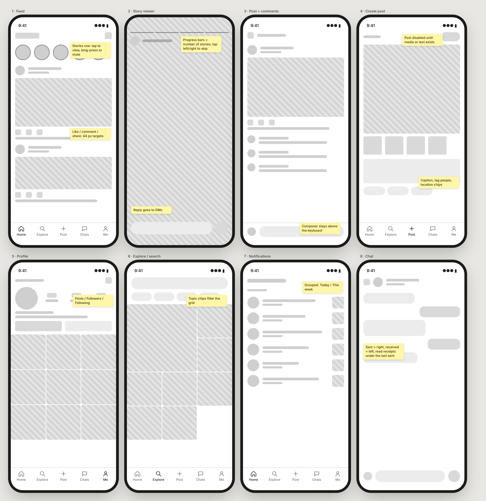
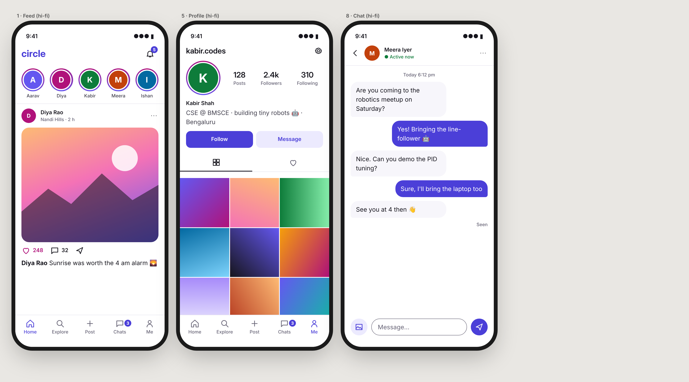
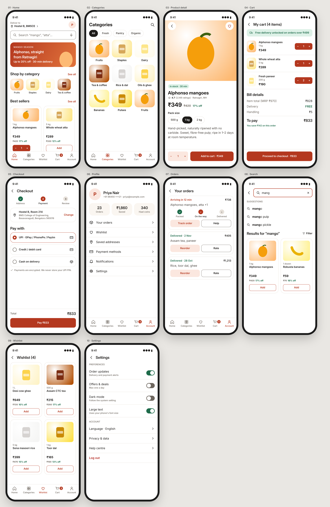

# UI/UX Design — Week 2: wireframing and visual design

Every screen is built from one design-token file. Screens are coded as HTML/CSS and exported as 2× PNGs at
iPhone 14 size (390 × 844), so colours, type and spacing are guaranteed consistent and the contrast check runs
on the real values. Open any `design/*.html` in a browser to inspect them, or see the PNGs in [exports/](exports/).

| Assignment | Deliverable |
|---|---|
| Low-fi wireframes, 8 screens of a social app | [exports/wireframes/](exports/wireframes/) · [overview](exports/wireframes-overview.png) |
| Typography scale and colour palette system | [design/tokens.json](design/tokens.json) → [style guide](exports/style-guide.png) |
| 3 wireframes converted to high fidelity | [exports/circle-hifi/](exports/circle-hifi/) · [overview](exports/circle-hifi-overview.png) |
| WCAG contrast checks | [contrast-report.md](contrast-report.md): **27/27 pairs pass AA** |
| **Mini project:** 10-screen e-commerce app + style guide | [exports/haat/](exports/haat/) · [overview](exports/haat-overview.png) · [style guide](exports/style-guide.png) |

## 1. Circle: social app wireframes (low fidelity)


The 8 screens are:
1. feed
2. story viewer
3. post with comments
4. create post
5. profile
6. explore and search
7. notifications
8. chat

They are greyscale only, so the review is about structure, not colour. Yellow sticky notes record the
interaction decisions: what a tap or long-press does, when "Post" is enabled, that the composer stays above the
keyboard, and that action targets are 44 px.

## 2. Type and colour system ([tokens.json](design/tokens.json))
* **Type**: *Inter Display* for headings, *Inter* for text, on a **1.25 (major third) scale** from a 16 px base:
  12 / 14 / 16 / 20 / 25 / 31 / 39 px. Every line height sits on a 4 px grid (16 / 20 / 24 / 28 / 32 / 38 / 44).
  Weights: 400 for body text, 600 for labels, 700–800 for display sizes.
* **Colour**: each app has one brand hue with 600/500/100 steps, a neutral ink ramp (900/700/500), surface and
  canvas, plus semantic colours.
  * Haat uses a warm terracotta, with green for savings.
  * Circle uses an indigo, with a magenta accent for likes.
* **Spacing**: 4/8 px scale (4, 8, 12, 16, 24, 32, 48, 64). **Radius**: 8 / 12 / 20 / pill.
* [build.py](design/build.py) turns the tokens into CSS variables, the style-guide page and the contrast report,
  so the documentation can't drift from the design.

## 3. Circle: high-fidelity mockups


The feed, profile and chat wireframes (screens 1, 5 and 8), with the same layout and the visual layer added:
* story rings in a brand gradient;
* coloured avatars with initials (no stock photos of real people);
* unread badges;
* sent and received chat bubbles with a "Seen" receipt.

## 4. Accessibility (WCAG 2.2): [contrast-report.md](contrast-report.md)
All 27 text and UI colour pairs used in the screens are computed from the tokens:
* body text 9.5–18:1;
* the lightest grey text (`ink-500`) 5.2–5.7:1;
* white on the brand buttons 6.0:1 (Haat) and 7.0:1 (Circle).

**One real issue the check found:** the divider colour `line` is only 1.3:1. That's allowed for purely
decorative dividers (SC 1.4.11 exempts them), so the system now has an explicit rule. Anything that identifies
a control uses `ink-500` (≥ 3:1) instead: input borders, outline buttons, radio buttons, switch tracks.

Other checks built in:
* touch targets ≥ 44–48 px;
* the focus ring is shown in the style guide;
* status is never shown by colour alone (orders say "Delivered" or "Arriving in 12 min"; switches have a knob
  position and `role="switch"` with `aria-checked`);
* the "Large text" setting respects the phone's font size.

## 5. Mini project: Haat e-commerce app (10 screens)


| # | Screen | Key decisions |
|---|---|---|
| 01 | Home | Delivery address first (hostel use case), voice search, seasonal banner, categories, best sellers with an inline quantity stepper |
| 02 | Categories | 3-column visual grid, filter chips |
| 03 | Product detail | Stock and delivery promise above the title, ratings with count, MRP vs price and % saving, pack-size chips, sticky add-to-cart showing the total |
| 04 | Cart | Free-delivery progress message, steppers, transparent bill (MRP, delivery, handling), "you save ₹142" |
| 05 | Checkout | 3-step progress, address card with "Change", UPI first (most common in India), a security reassurance line |
| 06 | Profile | Summary stats, standard account menu |
| 07 | Orders | Live order with a tracking stepper; past orders with Reorder and Rate |
| 08 | Search | Matched part in bold in suggestions, result grid, filter |
| 09 | Wishlist | Same product card component as everywhere else |
| 10 | Settings | Switches labelled with what they do, a clear destructive "Log out" |

The [style guide](exports/style-guide.png) shows the colours, the type scale in use, spacing, the button, input
and tag components with their states, and the contrast table.

## Rebuild
```bash
python design/build.py      # tokens -> tokens.css, style-guide.html, contrast-report.md (exit 1 if any pair fails)
python design/screens.py    # -> wireframes.html, circle-hifi.html, haat.html
node design/render.js       # -> exports/**/*.png (Playwright, 2x)
```

## Limitations
* Built in code, not Figma. Every PNG can be dropped into Figma, and the tokens map directly onto Figma variables.
* Product imagery is illustrative vector art, not photography.
* No usability test yet; that's a natural week-3 activity.
