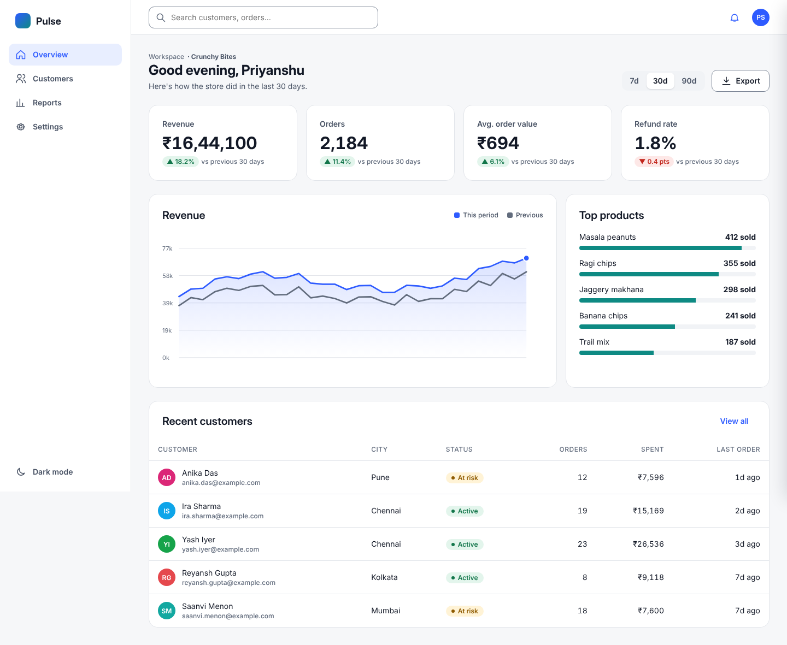
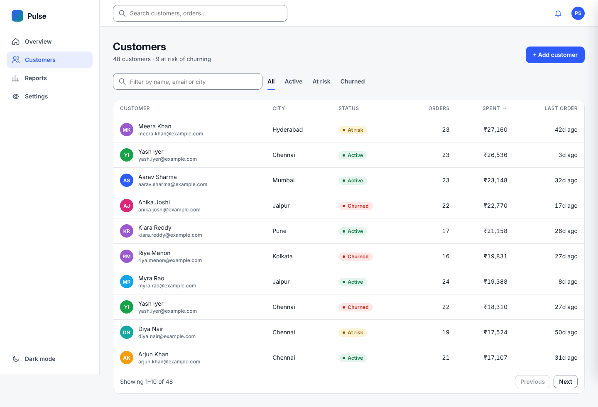
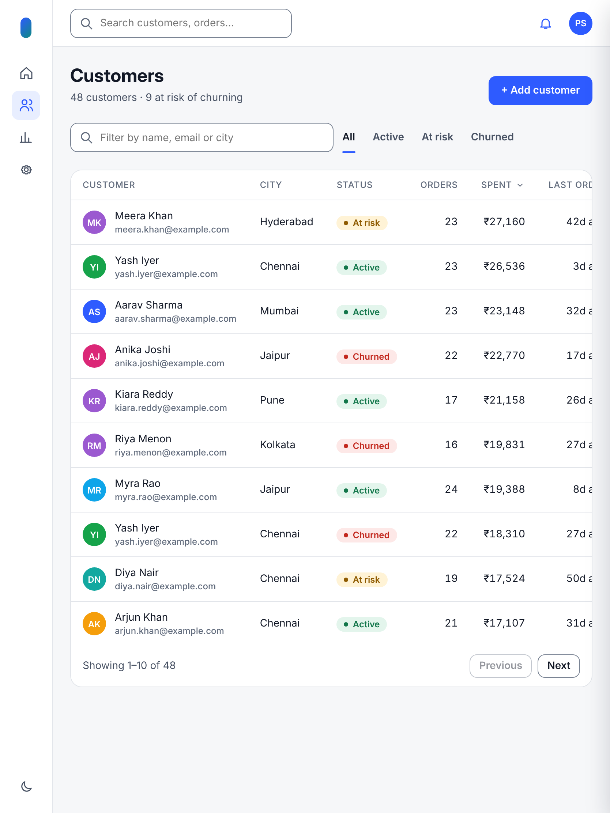
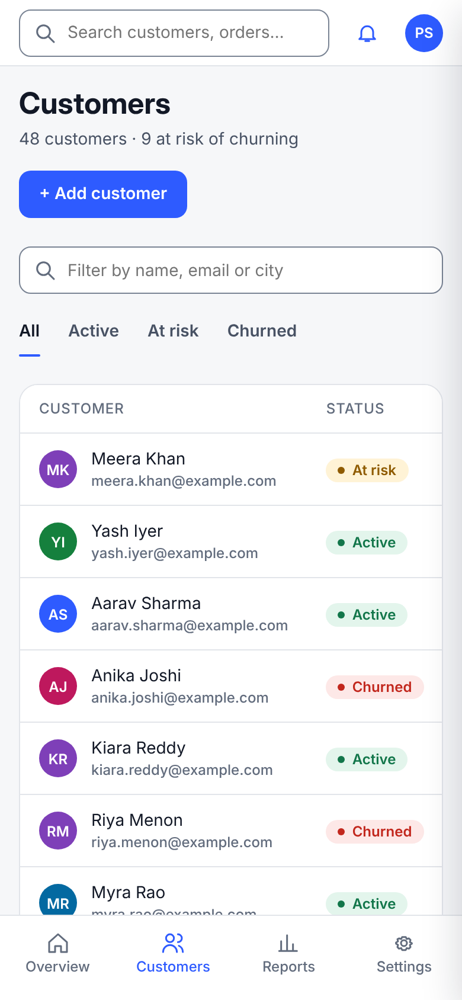

# UI/UX Design — Week 3: design systems and prototyping

| Assignment | Deliverable |
|---|---|
| Component library: buttons, inputs, cards, navigation | [pulse/components.html](pulse/components.html) → [light](exports/components.png) · [dark](exports/components-dark.png) |
| Interactive prototype with ≥ 5 screen transitions | [pulse/index.html](pulse/index.html) (open it in a browser) · [walkthrough video](exports/prototype-walkthrough.mp4) · [GIF](exports/prototype-walkthrough.gif) |
| Responsive layouts: mobile, tablet, desktop | `exports/{mobile,tablet,desktop}-*.png` (below) |
| Heuristic evaluation of an existing app | [heuristic-evaluation.md](heuristic-evaluation.md): 9 findings with severity and fixes |
| **Mini project:** SaaS dashboard design system + 5-screen animated prototype | **Pulse**, all of the above |

## Pulse: a sales dashboard for a small D2C brand
The user is the owner of "Crunchy Bites", a snack brand selling on Instagram, its website and marketplaces.
They check sales every evening and need to answer three questions fast:
1. How did we do?
2. Who is about to stop buying?
3. Where does revenue come from?



### Design system
* **Tokens** ([tokens.css](pulse/tokens.css)):
  * type scale 12–31 px (Inter / Inter Display);
  * 4/8 px spacing, 3 radii;
  * semantic colours (`--text-2`, `--danger-soft`, …) defined twice, for **light and dark**;
  * 4 chart colours;
  * 3 motion durations and 2 easings;
  * reduced-motion support.
* **Components** ([components.css](pulse/components.css), [library page](pulse/components.html)):
  * buttons (4 variants × default / hover / focus / disabled / loading);
  * inputs with hint and error, select, search, checkbox, radio, switch, segmented control;
  * KPI and content cards, status badges, avatars;
  * sortable **table** with pagination and an empty state;
  * line, bar and donut **charts**;
  * sidebar, tabs and breadcrumbs (**navigation**);
  * **modal**, slide-over drawer, toast, skeleton.
* **Accessibility built in:** every field has a visible label and errors say how to fix them; sort state is in
  `aria-sort`; tabs use `role="tab"`; the drawer and modal are dialogs that take focus and close with Esc; charts
  carry an `aria-label` stating their data; status always has a word, never colour alone.
  [contrast-report.md](contrast-report.md): **28/28 pairs pass AA** in both themes. The first draft failed two chart
  colours on white (teal 2.9:1, amber 2.2:1), so the light theme now uses darker shades.

### The 5 screens and their transitions
| Screen | What you can do | Motion |
|---|---|---|
| 1 Overview | KPIs with change vs the previous period, revenue vs previous period, top products, recent customers; 7d/30d/90d toggle, export | Cards rise in a stagger; the line chart draws; product bars grow |
| 2 Customers | Live filter, status tabs, sort by any column, paging, empty state ("No customers match …" + Clear) | Page change via the View Transitions API |
| 3 Customer detail | Click a row (or Enter on it): lifetime spend, monthly spend chart, activity timeline, "Send win-back offer" | Drawer slides in over a fading scrim; toast confirms the action |
| 4 Reports | Revenue by city, channel-mix donut, retention by signup month | Bars grow from the baseline in sequence; donut segments fade in |
| 5 Settings | Store profile form with validation, notification switches, delete test workspace | Switch knobs slide; the destructive modal scales in; buttons show a loading state, then a toast |

That makes 11 distinct transitions, plus a dark-mode toggle and keyboard shortcuts (`/` to search, Esc to close).
The [walkthrough video](exports/prototype-walkthrough.mp4) records one pass through all five screens.

### Responsive layouts
| Desktop 1440 | Tablet 834 | Mobile 390 |
|---|---|---|
| Full sidebar, 4 KPI columns, chart and list side by side | Sidebar collapses to an icon rail, 2 KPI columns, cards stack | Bottom navigation, 2 KPI columns, low-priority table columns hidden, single-column forms, full-screen drawer |
|  |  |  |

Other states: [modal](exports/desktop-modal.png) · [dark mode](exports/desktop-overview-dark.png) ·
[empty state](exports/desktop-empty-state.png) · [mobile drawer](exports/mobile-customer-drawer.png) · [tablet drawer](exports/tablet-customer-drawer.png)

## Heuristic evaluation ([full report](heuristic-evaluation.md))
The evaluated product is the **SkillNexis course page** itself: a real product I used every day for this course,
which let me check each finding in the live page.

Highest-severity issues:
* the final week's confirmation says "Week 4 is now unlocked!";
* locked weeks open an empty, unexplained content area;
* the submission field has no label;
* some courses' weekly briefs list no concrete tasks.

The report has 9 findings, prioritised fixes, and how each was verified.

## Rebuild
```bash
node shoot.js && node shoot2.js     # screenshots at 3 breakpoints, states, component sheets, walkthrough video
```

## Limitations
* The prototype is code rather than a Figma file; it runs in any browser, and tokens map to Figma variables.
* Data is generated sample data.
* The heuristic evaluation had a single evaluator (Nielsen recommends 3–5).
