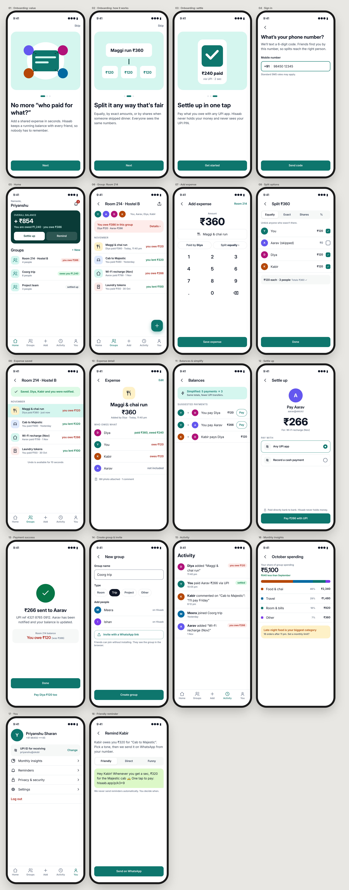

# UI/UX Design — Week 4: portfolio and handoff (major project)

| Assignment | Deliverable |
|---|---|
| Design specs and asset exports for developer handoff | [handoff/handoff.md](handoff/handoff.md) (tokens, components, behaviour, screen inventory) · [annotated specs](exports/spec-overview.png) · [assets/](handoff/assets/) (19 SVG icons, app icon SVG + 1x/2x/3x/1024 PNG) · [contrast.md](handoff/contrast.md) |
| UX copy for 3 onboarding screens | [ux-copy.md](ux-copy.md): voice rules, final copy, rationale, rejected alternatives · screens [01](exports/screens/01-onboarding-value.png), [02](exports/screens/02-onboarding-how-it-works.png), [03](exports/screens/03-onboarding-settle.png) |
| Case study document for one project | [case-study/case-study.md](case-study/case-study.md) · web version [case-study/index.html](case-study/index.html) |
| Portfolio on Behance or a personal website | [portfolio/index.html](portfolio/index.html): a personal portfolio site with 5 projects ([preview](exports/portfolio.png)) |
| **Major project:** full UI/UX case study | **Hisaab**: below |

## Hisaab: settling hostel and trip expenses without the awkwardness
A UPI-first expense-splitting app for students. Full story in the [case study](case-study/case-study.md).

| Required | Where |
|---|---|
| Real-world problem | Shared hostel and trip costs: easy to pay over UPI, hard to track, awkward to ask for |
| User research: personas, journey map, competitive analysis | Case study §2: secondary research with sources, 2 proto-personas, a 5-stage journey map, a 4-way competitor table (Splitwise, Google Pay split, notes app, Hisaab) |
| Wireframes | [exports/wireframes-overview.png](exports/wireframes-overview.png) (key flow, greyscale) |
| Complete design system | [design/tokens.css](design/tokens.css), component specs in [handoff.md](handoff/handoff.md) §2, 15/15 contrast pairs AA |
| 15+ high-fidelity screens | **18 screens**: [exports/screens/](exports/screens/) · [board](exports/screens-overview.png) |
| Prototype of the key flows | [design/prototype.html](design/prototype.html) (open it in a browser) · [video](exports/prototype-walkthrough.mp4) · [GIF](exports/prototype-walkthrough.gif) |
| Presented as a Behance-style case study | [case-study/index.html](case-study/index.html) ([top of page](exports/case-study-top.png)) |



### Quality checks
* **axe-core 4.10 (WCAG 2.2 AA): 0 violations** on the screens and the prototype.
  * The first run caught 12 tappable icons built as unnamed `div`s; they are now real focusable buttons with labels.
  * The same audit re-run on week 3 found 2 contrast problems my calculations had missed: the active nav label at 4.46:1 and some avatar colours. Both are fixed there too.
* **Cognitive walkthrough of the prototype:**
  * adding an expense takes 4 taps; settling from Home takes 3 taps plus the UPI app;
  * one flow bug was fixed: Back after saving reopened the filled-in form, which risks duplicate expenses;
  * a second prototype bug was fixed too: hidden screens were intercepting taps.

## Rebuild
```bash
python design/hisaab.py && node design/render.js     # screens, wireframes, spec, prototype video
```

## Limitations
* Research is secondary research plus proto-personas, clearly labelled. The planned 5-person usability test is in case study §9.
* The portfolio is a static site in this repo, not a Behance account.
  * Behance needs a personal Adobe account, so it's left for you to create.
  * The site can be published for free with GitHub Pages.
* Designs are built in code, not Figma; the PNG exports and tokens import directly into Figma.
