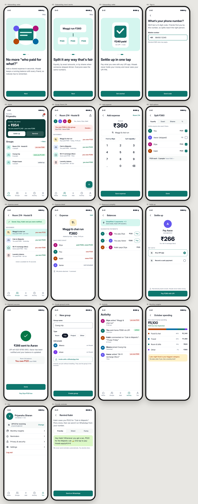
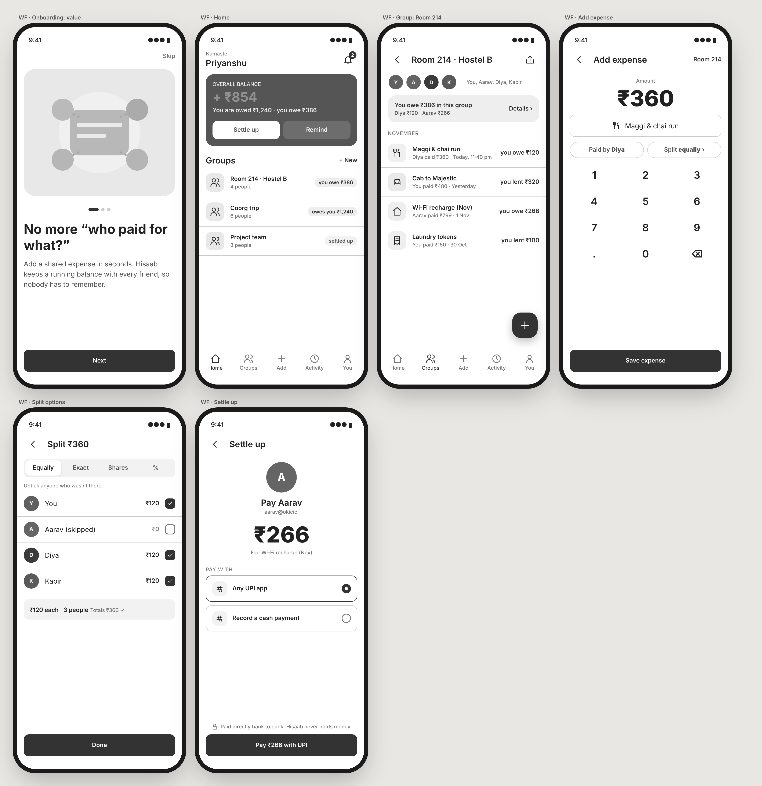
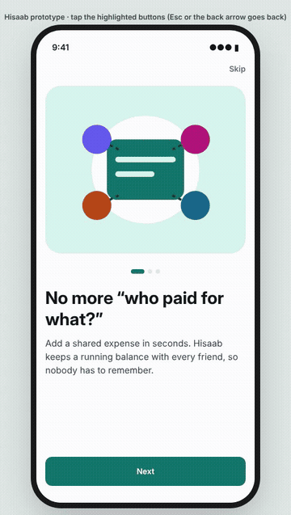

# Hisaab: settling hostel and trip expenses without the awkwardness

**Role:** solo UI/UX designer (research, IA, interaction and visual design, prototyping, handoff) · **Timeline:** 1 week ·
**Platform:** Android and iOS (mobile-first) · **Tools:** HTML/CSS design-in-code, Playwright for exports, axe-core for accessibility

## 1. The problem
In a hostel room or on a group trip, money moves in small, frequent amounts: a ₹360 Maggi run, a ₹480 cab, the month's
Wi-Fi recharge. Paying is effortless now, because almost every student has UPI (India processed about 21,860 crore UPI
transactions in FY26 [1]). **Keeping track of who owes whom is not.** It lives in screenshots, notes apps and
memory, and asking a friend for ₹120 feels petty enough that people stop asking.

**How might we** let a group of friends record shared expenses in seconds and settle them over UPI, without anyone
having to play accountant or debt collector?

## 2. Research
Constraint: one week and no budget for interviews, so this was **secondary research plus proto-personas**, labelled
as assumptions to validate (see section 9).

* **Market:** UPI is the default payment rail for students, and peer-to-peer transfers are instant and free. The
  gap is *bookkeeping*, not payment.
* **Review mining:** the main Splitwise complaints in app-store review analyses are recent restrictions on the free
  plan and pushes towards Pro [2]. Competitors report a daily cap on new expenses for free users. That claim comes
  from interested parties and couldn't be verified independently [3].
* **Payment apps:** Google Pay's *Split expense* splits **one bill** you paid. Only the creator receives money, and
  there is no running balance across many expenses [4]. That works for one dinner, not a semester in Room 214.

### Competitive analysis
| | Splitwise | Google Pay "Split expense" | Notes app / group chat | **Hisaab (proposed)** |
|---|---|---|---|---|
| Running balances across many expenses | ✅ | ❌ one bill at a time [4] | ❌ manual | ✅ |
| Unequal splits (exact, shares, %) | ✅ | ❌ amounts per bill only | manual maths | ✅ |
| Pay what you owe inside the flow | ❌ links out, no UPI focus | ✅ (to the creator only) | ❌ | ✅ any UPI app, to whoever is owed |
| Free for heavy daily use | reported daily cap on free plan [2][3] | ✅ | ✅ | ✅ (no money held, low cost to run) |
| Friends without the app | invite needed | ✅ (GPay users) | ✅ | ✅ WhatsApp link, view in browser |
| Avoids awkward reminders | generic push | request notification | ❌ | ✅ user-sent, tone presets |

**Opportunity:** Splitwise's ledger, Google Pay's in-flow payment, and nothing that makes asking for money awkward.

### Proto-personas
| | **Diya, 20, the organiser** | **Kabir, 21, the forgetful one** |
|---|---|---|
| Context | 3rd-year CSE, shares Room 214 with three others; usually fronts the money for food and recharges | Pays when asked, but loses track; hates being chased |
| Goals | Get paid back without looking stingy; one place for the room's shared costs | Know exactly what he owes and clear it in one go |
| Frustrations | Keeps a notes-app ledger nobody reads; asking for ₹120 feels petty | Five different "you owe me" messages; maths he can't check |
| Quote | “I'm not a bank, but I end up acting like one.” | “Just tell me the number and let me pay.” |
| Needs from Hisaab | Fast entry, unequal splits, friendly reminders | One balance, one tap to settle, a clear history |

### Journey map: Diya, one month in Room 214
| Stage | Pays for a late-night order | Tries to track it | Month end | Asks friends | Gets paid |
|---|---|---|---|---|---|
| Doing | Pays ₹360 by UPI at 11:40 pm | Notes app: “Maggi 360/3” | Scrolls UPI history to rebuild the month | Messages each roommate separately | Checks her bank app three times |
| Thinking | “I'll sort it later” | “Was Aarav there or not?” | “I'm sure I'm missing things” | “Will this look stingy?” | “Did Kabir pay the Wi-Fi share?” |
| Feeling | 🙂 | 😐 | 😩 | 😬 lowest point | 😐 relief, but incomplete |
| **Opportunity** | Add in under 10 s, right after paying | Untick who wasn't there | Running balance, always current | Tone-picked reminder that *she* sends | Payment marks itself settled; balance updates |

## 3. Design principles
1. **Ten seconds or it won't happen:** adding an expense starts with the amount keypad, and smart defaults do the rest (paid by me, split equally, everyone in the group).
2. **One number per relationship:** people care about "what do I owe", not the ledger. The ledger is one tap away.
3. **The app asks for money, not you:** neutral wording, user-controlled reminders, never automatic nagging.
4. **Never touch the money:** UPI intents only. This is said plainly on screen, because trust is the product.

## 4. Information architecture and key flows
Tabs: **Home** (overall balance + groups) · **Groups** · **Add** · **Activity** · **You**.
The three critical flows were wireframed first, in greyscale, to settle structure before visuals:

* **A. Onboard:** value → split → settle promise → phone sign-in
* **B. Add an expense:** FAB → amount → split → save → confirmation
* **C. Settle up:** balance → simplified payments → UPI → success with the updated balance

## 5. Design system
* **Colour:** a calm teal (trust, not "bank blue"), plus semantic **owe (red) / owed (green)** with tints, amber for nudges, and a neutral ink ramp.
* **Type:** Inter Display for numbers and titles (amounts are the hero, up to 52 px / 800), Inter for text, on a 1.25 scale.
* **Spacing and radius:** a 4/8 grid, with 16 px gutters and 12–20 px radii.
* **Accessibility:** all 15 colour pairs pass WCAG AA ([contrast.md](../handoff/contrast.md)), and amounts are never colour-only: every red or green number carries "you owe" or "owes you".
* **Components:** balance hero, group row, expense row, amount pill, segmented split control, keypad, FAB, payment option, success state.

## 6. High-fidelity screens (18)
Onboarding ×3, sign-in, home, group, add expense, split options, saved, expense detail, balances & simplify, settle up,
payment success, create group & invite, activity, monthly insights, profile, friendly reminder. See the board at the top
and [exports/screens/](../exports/screens/).

Some decisions worth calling out:
* **Home leads with one signed number** (+ ₹854) and two actions, *Settle up* and *Remind*. Diya's and Kabir's main jobs are one tap away.
* **Split options default to "Equally" with checkboxes**, because the most common exception is "someone wasn't there", not percentages. The running total ("₹120 each · 3 people · Totals ₹360 ✓") prevents maths doubts.
* **Simplify debts** shows the saving ("5 payments → 3"), so people understand why the suggested payments differ from the raw ledger.
* **Settle up** names the payee's UPI ID, what the payment is for, and the reassurance "Paid directly bank to bank".
* **The success screen** shows the *new* balance ("You owe ₹120, was ₹386") and offers the next payment. One session can clear everything.
* **Reminders** come in three tones and are sent from the user's own WhatsApp: the awkward part becomes a choice, not a chore.

## 7. Prototype
[prototype.html](../design/prototype.html) links all 18 screens. The three key flows are fully clickable, with push and back
transitions and keyboard support ([walkthrough video](../exports/prototype-walkthrough.mp4)).

## 8. Evaluation so far
* **Accessibility audit (axe-core 4.10, WCAG 2.2 AA):** the first run found 12 tappable icons that were plain
  `div`s with labels. They became real focusable buttons with names, and the screens and prototype now report **0
  violations**. The same audit, run on my week-3 dashboard, caught contrast failures that my own token table had
  missed. Lesson: compute *and* audit.
* **Cognitive walkthrough** of the three key flows against the personas' goals:
  * add expense: 4 taps with defaults;
  * settle a debt from Home: 3 taps plus the UPI app;
  * one issue found and fixed in the prototype: after saving, *Back* returned to the filled-in form, which invites duplicate expenses. Back now goes Home once a flow has finished.

## 9. What I'd validate next
* **5 moderated usability tests** with hostel students, giving each the three flows as tasks.
  Success metrics: add an expense in under 15 s; correctly identify "what do I owe Diya?"; no one doubts that an equal split is fair.
* **Reminder tone A/B test:** does "Friendly" get paid faster than "Direct"?
* **Risky assumption:** that users are comfortable with Hisaab knowing their UPI ID. Test the copy and a "record cash
  payment" fallback.

## 10. Outcome
A complete, developer-ready design:
* 18 screens and a clickable prototype;
* a token-based design system;
* a handoff package with specs, assets, behaviour rules and a screen inventory ([handoff.md](../handoff/handoff.md));
* onboarding UX copy with its rationale ([ux-copy.md](../ux-copy.md)).

**Biggest learning:** the hard part of splitting expenses is social, not mathematical. The best design decisions
here (one number, user-sent reminders, "never holds money") came from naming the awkwardness, not the arithmetic.

---
**Sources**
[1] Business Today, “UPI processes 21,860 crore transactions in FY26” (31 Mar 2026), https://www.businesstoday.in/india/story/upi-processes-21860-crore-transactions-in-fy26-peak-growth-seen-in-dec-jan-months-523412-2026-03-31
[2] Kimola, “Splitwise app faces criticism for changes in pricing and limitations” (review analysis), https://kimola.com/reports/splitwise-app-feedback-report-uncover-user-insights-google-play-en-144452
[3] Split Circle blog, “Splitwise daily limit” (a competitor; figures unverified), https://split-circle-landing.pages.dev/en/blog/splitwise-daily-limit
[4] Google Pay Help (India), “Split expenses with a group”, https://support.google.com/pay/india/answer/11420982
