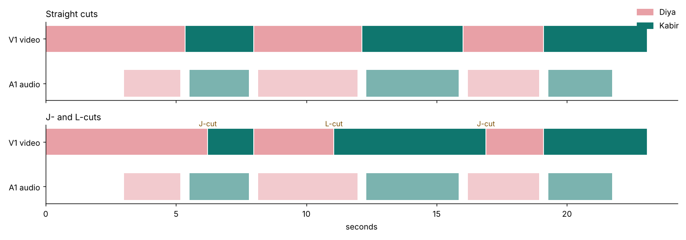

# Video Editing — Week 2: audio and advanced editing

Everything was edited with **ffmpeg**, driven by scripts in [src/](src/), so every cut, fade, text animation and mix setting can be inspected and re-rendered.
Footage was made without a camera:
* **screen recordings** of a working app prototype (the Hisaab app from the UI/UX course);
* **real photographs** for b-roll and the colour exercise (scikit-image's bundled sample images);
* **synthesised voices** (espeak-ng with MBROLA voices) and **original music** synthesised for this project, so there are no licensing issues.

## Mini project: 3-minute tutorial
**[exports/tutorial.mp4](exports/tutorial.mp4)**, "Split hostel expenses in 3 minutes (and settle up with UPI)": 3:05, 1080p30, H.264 + AAC, [subtitles (SRT)](exports/tutorial.srt).

| Required | How it's done |
|---|---|
| Hook intro | 8 s cold open: "Four roommates. Forty small payments a month. One question nobody can answer: who owes whom?" Kinetic text timed word-group by word-group to the narration, over colour-corrected b-roll |
| Voiceover narration | 10 scenes, 38 sentences. Each sentence is synthesised separately so its exact start and end are known; the screen recording's taps are scheduled to those times (e.g. "tap the plus button" lands on the tap) |
| Background music | Original 78 bpm lo-fi track ([src/music.py](src/music.py)), **ducked under the voice** with sidechain compression (threshold 0.03, ratio 8) |
| Text call-outs | 20 call-outs slide in from the right with an ease-out ("Paid by: Diya", "5 payments → 3"…), plus burned-in captions placed beside the phone, never over it |
| Colour correction | The hook's b-roll is the corrected clip from the exercise below |
| Subscribe CTA end screen | Recap "Add. Split. Settle." plus a SUBSCRIBE button and a 5 s end-screen hold |
| Delivery | Loudness-normalised to the YouTube target, measured at **−14.6 LUFS** integrated, true peak −1.5 dB; captions as a soft SRT for upload |

Structure: hook → title → why it matters → onboarding → home → add an expense → split → settle with UPI → extras → outro.

## Weekly assignments
| Assignment | Deliverable |
|---|---|
| 1-minute voiceover synced with footage | [voiceover-sync-excerpt.mp4](exports/voiceover-sync-excerpt.mp4): the tutorial's first 60 s. Narration is aligned sentence by sentence, with on-screen actions timed to the words |
| J-cut and L-cut in a dialogue sequence | [dialogue_jl.mp4](exports/dialogue_jl.mp4) vs [dialogue_straight.mp4](exports/dialogue_straight.mp4) (same audio, hard cuts). See [timeline](exports/dialogue-timeline.png) below |
| 3 text animations: title, lower third, subtitle | In the dialogue ([excerpt](exports/text-animations.mp4)): **title** scales up and fades in · **lower thirds** slide in with an ease-out cubic the first time each person speaks · **subtitles** fade in and out per line. The tutorial adds kinetic text and sliding call-outs |
| Colour correction on 3 under/over-exposed clips | [color-correction.mp4](exports/color-correction.mp4) (before / after) · [waveform scopes](exports/color-scopes.png) · [measurements](results/color-correction.md) |

### J-cuts and L-cuts


Two "cameras" (one per speaker, on opposite sides of the frame to respect the 180° rule) run for the whole scene, and each avatar's ring pulses with that person's voice. The edit is the only difference between the two versions:
* **J-cut** (1→2, 4→5): we *hear* the next speaker about 0.7 s before we *see* them, which pulls the viewer into the reply.
* **L-cut** (3→4): we cut to Kabir *listening* about 0.9 s before Diya finishes, so his reaction carries the moment.
* Hard cut on the last line, so the punchline lands on the speaker. No shot is shorter than 1.5 s (checked in the script; a first draft produced a 0.7 s shot and was re-cut).

### Colour correction
The settings were found by measurement, not guesswork: a grid search ([src/tune.py](src/tune.py)) over gamma, brightness and contrast matches each corrected frame's mean luma and luma range to the original photo, which is what a colourist does by eye with a waveform.

| Clip | Problem | Mean luma before → after (original) |
|---|---|---|
| Coffee | Underexposed | 25 → **104** (103) |
| Rocket | Overexposed, washed out | 174 → **73** (71) |
| Astronaut | Blue colour cast + underexposed | 94 → **123** (118) |

The coffee clip's blacks stay slightly lifted (darkest 62 vs 35), because detail crushed by the underexposure can't be fully recovered.
The faults were introduced deliberately into clean photos, so the original gives a ground truth to check against.

## Rebuild
```bash
python src/voice.py && node src/record.js && python src/music.py 196 && python src/broll.py && python src/render.py
python src/dialogue.py && python src/compare.py
```

## Limitations
* The voices are synthetic (MBROLA). A real recorded voiceover would sound warmer; the pipeline swaps one in by replacing `build/vo_*.wav` and re-running `render.py`.
* No camera footage: talking-head "shots" in the dialogue are animated avatars, which is enough to show J/L-cut timing.
