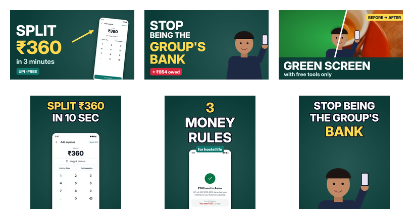

# Week 3: Motion graphics, green screen, thumbnails and short-form video

This week covers keyframe animation, chroma keying, thumbnail design and vertical short-form editing (Reels and Shorts).
Everything was made with free tools only: **ffmpeg, Python (Pillow and NumPy), Playwright footage from week 2, and
espeak-ng with MBROLA voices**.

The footage is the clickable Hisaab prototype from my UI/UX course, recorded in week 2, so the whole package works as
one channel's content.

| Task | Deliverable |
|---|---|
| 5-second animated intro / logo reveal with keyframes | [`exports/logo-reveal.mp4`](exports/logo-reveal.mp4) and the graph-editor view [`exports/logo-keyframes.png`](exports/logo-keyframes.png) |
| Edit a green-screen clip and replace the background | [`exports/greenscreen-composite.mp4`](exports/greenscreen-composite.mp4), the 4-up breakdown [`exports/greenscreen-breakdown.mp4`](exports/greenscreen-breakdown.mp4), the raw plate [`exports/greenscreen-raw.mp4`](exports/greenscreen-raw.mp4) |
| Design 3 YouTube thumbnails | [`exports/thumbnails/yt-*.png`](exports/thumbnails/) (1280×720) |
| 30-second Instagram Reel with trending transitions and music | [`exports/reel-30s.mp4`](exports/reel-30s.mp4) |
| **Mini project:** Shorts/Reels package, 3 videos (15–60 s) with captions, music, zooms, speed ramps, plus matching thumbnails | [`short-1-split-in-10s.mp4`](exports/short-1-split-in-10s.mp4) (18.5 s), [`short-2-money-rules.mp4`](exports/short-2-money-rules.mp4) (19.0 s), [`short-3-group-bank.mp4`](exports/short-3-group-bank.mp4) (17.1 s), covers [`exports/thumbnails/cover-short-*.png`](exports/thumbnails/) |



## 1. Logo reveal with keyframes (`src/logo_reveal.py`)
Each animated property has keyframes, each written as (time, value, easing into the next key). Frames are interpolated
the same way as in After Effects or Premiere:

* **Tile:** scale 0 → 1 with a *back* ease (overshoots, then settles), while rotating −90° → 0°.
* **Letter "h":** rises 80 px and fades in inside the tile.
* **Ring burst:** expands behind the tile.
* **Slide:** the tile slides left with an ease-in-out to make room for the wordmark.
* **Wordmark:** "Hisaab" is uncovered by a wipe mask.
* **Tagline and exit:** the tagline fades in, then everything fades out at 4.4 s.
* **Sound:** a whoosh and a two-note chime are synced to the keys, normalised to −16 LUFS.

The keyframe graph ([`logo-keyframes.png`](exports/logo-keyframes.png)) plots every curve, with the keyframes marked.

## 2. Green screen (`src/greenscreen.py`, `src/tune_key.py`)
There is no studio here, so I **generated a green-screen plate** with the problems a real one has:

* an unevenly lit backdrop, with a hot spot and dark corners;
* sensor noise;
* green spill on the subject's edges;
* fine hair strands;
* a semi-transparent glass;
* x264 compression.

Because the plate is generated, the true matte is known, so each key can be **scored**.

| Key | Filter | Green spill left on edge pixels | Matte error (MAE) | Holes in solid subject |
|---|---|---|---|---|
| Naive hard key | `colorkey=0x2EB14A:0.20:0` | **15.1 %** of edge pixels visibly green | 0.0041 | 0.14 % |
| Tuned key | `chromakey=0x2EB14A:0.10:0.02, despill=green:mix=0.6:expand=0.1` | **0 %** | 0.0053 | 0.68 % |

* **Tuning:** I grid-searched similarity and blend against the true matte (`results/key-tuning.csv`). Then I added
  despill, which removes the green fringe the hard key leaves on the hair and shoulders (panel 3 vs panel 4 of the
  breakdown).
* **New background:** the colour-corrected café b-roll from week 2, blurred to fake a shallow depth of field.
* **Lesson learned the hard way:** my first plate had a **teal phone screen**, and *both* keys removed it, because teal
  sits too close to the key colour. It is the classic "don't wear green on a green screen" problem, and the prop is now
  a white screen.
* **Honest limitation:** the semi-transparent glass keys as either solid (the chai) or gone (the empty top).
  Real transparency needs a difference or luma key, or rotoscoping. The 2–3 px hair strands are also mostly lost after
  compression, as they would be with a cheap camera.

## 3. YouTube thumbnails (`src/thumbs.py`)
| Thumbnail | For | Idea |
|---|---|---|
| `yt-1-split-hostel-expenses.png` | the week-2 tutorial | one big number (₹360), the app screen, and an arrow to the result |
| `yt-2-group-bank.png` | a "stop being the group's bank" video | a relatable line, the presenter, and a red "+₹854 owed" badge |
| `yt-3-green-screen.png` | a green-screen tutorial | a diagonal before/after split |

**Rules I followed:**
* 3–4 words at most;
* text larger than a third of the frame height;
* yellow and white on dark teal for contrast;
* one focal point;
* nothing important in the bottom-right corner (YouTube puts the duration there).

`at-small-size.png` shows them at **246×138 px**, roughly how mobile search shows them. All three still read at that
size.

**Canva:** I didn't use Canva, because it needs an account. These were designed in code, from the same brand kit:
* teal `#0B3B37` and `#0F766E`, mint `#D5F5EF`, yellow `#FFD84D`;
* Inter Display ExtraBold.

To rebuild them in Canva, open a YouTube Thumbnail template (1280×720), add the brand kit and drop in the PNG layers.
Doing it there would be a free account and a few minutes of work; nothing here depends on it.

## 4. The Reel, 30 s (`src/shorts.py reel`)
A beat-synced montage: "POV: you're the friend who always pays first" → the app solves it → "Save this for your
roommates".

* **Music:** an original 120 bpm track (`src/beat.py`). The filtered intro lasts 4 bars, and the **drop at 8.0 s** lands
  exactly on the first whip pan.
* **Beat grid:** every cut lands on a beat (`cuts_on_beat: true` in `results/edl.json`).
* **Transitions:** whip pan (motion-blurred slide), zoom punch with a white flash, RGB-split glitch, and flash.
  Each one has a whoosh or glitch sound on the cut.
* **Clips:** 2-second shots, each with a pop-in label, a slow push-in zoom, and a speed ramp on the "Settled" moment.
* **Specs:** 1080×1920, 30 fps, −14.3 LUFS.

**About "trending music":** trending audio is licensed and can only be added inside Instagram or YouTube, from their
audio libraries. The exported Reel carries my own track, so it has no copyright problems. When posting, you can swap
it for a trending sound in the app and keep the same cut points, which sit on a 120 bpm grid.

## 5. Mini project: Shorts package (`src/shorts.py a b c`, `src/vertical.py`)
| | Short | Length | Hook | Effects worth noting |
|---|---|---|---|---|
| 1 | **Split ₹360 in 10 seconds** | 18.5 s | yellow hook title in the first 2.4 s | speed ramp up to **8.3×** through idle UI, then **0.5×** slow-motion on "Saved"; zoom punch to the amount, then to "Split equally" |
| 2 | **3 money rules every hostel room needs** | 19.0 s | an animated "3 MONEY RULES" card | rule stickers, 5.0× ramp through the payment wait, 0.55× slow-motion on the success tick |
| 3 | **Stop being the group's bank** | 17.1 s | the green-screen presenter + hook title | my keyed presenter (from task 2) reused on a brand background; 1.75× push-in on the balance |

**Shared across all three:**
* **Captions:** burned in word by word, with the current word highlighted in yellow and 2–3 words on screen at a time.
* **Voice-over and music:** MBROLA voice-over, with the original beat ducked under the voice (sidechain compression).
* **Sound and loudness:** whooshes on transitions; audio normalised to about −14 LUFS (the platforms' target).
* **Speed ramps:** each ramp is a time-remap curve. Its relative speeds are smoothly interpolated, then scaled so the
  chosen source range exactly fills the clip, the same idea as Premiere's time remapping. `results/edl.json` lists
  every clip's source range, its minimum and maximum speed, and its transition.
* **Safe zone:** all text stays within x 80–920 and y 260–1480, clear of the Reels/Shorts UI (the top bar, and the
  caption and buttons at the bottom and right). The covers keep their text in the central 4:5 area, so it still reads
  in the profile grid crop.
* **Covers:** `cover-short-1/2/3.png` (1080×1920) match each Short's hook text and visual.

**Honest limitations:**
* **Word timings are estimated:** espeak does not export them, so I weighted each word's length within its sentence's
  measured audio span. That is close enough for 2–3-word chunks, but a real edit would use forced alignment or the
  editor's auto-captions.
* **The voice is synthetic** (MBROLA), and the presenter is an illustration, not a filmed person.
* **Not posted:** nothing was uploaded to Instagram or YouTube; that needs your account.

## Reproduce
```bash
cd video-editing/week-3            # needs week-2's build/ (run week-2's record.js and broll.py first)
python src/logo_reveal.py
python src/greenscreen.py && python src/tune_key.py
python src/beat.py 64
python src/shorts.py               # reel + 3 shorts (about 4 minutes)
python src/thumbs.py
```
