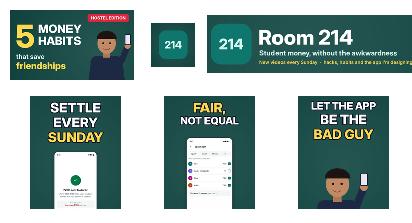

# Week 4: YouTube channel, long-form video, Shorts and showreel (major project)

This is the full content-creation project: a channel, two scripts, a 5-minute video, three Shorts, thumbnails, an
intro and outro, SEO, a showreel and a portfolio. It continues the same story as weeks 2 and 3: **Room 214**, a
student-money channel, presented around the Hisaab prototype from my UI/UX course.

The project uses free tools only: **ffmpeg, Python (Pillow, NumPy), Playwright footage, and espeak-ng with MBROLA
voices**.

## Deliverables
| Task | Deliverable |
|---|---|
| Channel with banner, logo and about section | [`channel/banner.png`](channel/banner.png) (2560×1440, plus [safe-area preview](channel/banner-preview.png)), [`profile.png`](channel/profile.png), [`watermark.png`](channel/watermark.png), [`about.md`](channel/about.md) (about text, keywords, playlists, upload schedule) |
| Scripts for 2 videos (hook, body, CTA) | [`scripts/video-a-script.md`](scripts/video-a-script.md) (produced, with real timestamps), [`scripts/video-b-script.md`](scripts/video-b-script.md) (next video) |
| Source footage | prototype screen recordings (week 2), the green-screen presenter plate (week 3), an animated chart, the café b-roll |
| **5-minute long-form video** with intro and outro | [`exports/long-form.mp4`](exports/long-form.mp4): **5:10**, 1080p30, −15.1 LUFS, 19 shots, 10 chapters, captions in [`long-form.srt`](exports/long-form.srt) |
| 3 Shorts | [`short-a-settle-sunday.mp4`](exports/short-a-settle-sunday.mp4) (18.4 s), [`short-b-fair-not-equal.mp4`](exports/short-b-fair-not-equal.mp4) (16.7 s), [`short-c-app-asks.mp4`](exports/short-c-app-asks.mp4) (19.4 s) |
| Thumbnails | [`exports/thumbnails/long-form.png`](exports/thumbnails/long-form.png), covers `cover-short-a/b/c.png`, and the whole kit at real viewing size: [`at-small-size.png`](exports/thumbnails/at-small-size.png) |
| YouTube SEO | [`exports/youtube-metadata.md`](exports/youtube-metadata.md): title, description with chapters, tags and settings, checked against YouTube's limits by `src/seo.py` |
| 2-minute showreel | [`exports/showreel.mp4`](exports/showreel.mp4): **2:00**, 27 clips from weeks 2–4, every cut on the beat |
| Portfolio | [`portfolio/index.html`](portfolio/index.html): all 13 finished edits, each with a poster, a description and the skill it shows |
| **Publish at least 1 video** | ⚠️ **Needs your YouTube login.** Everything is ready to upload; see the 5-minute checklist below |



## The long-form video (`src/script_a.py`, `src/longform.py`)
**"5 Money Habits That Keep Hostel Friendships Alive"**

* **Hook (0:00):** a specific, relatable problem ("my room almost broke up over ₹266"), then a fast text card with the
  small amounts that add up.
* **Intro (0:21):** the 5-second keyframed logo sting from week 3, with its own sound.
* **Promise (0:26):** the list of 5 habits, plus a reason to stay ("stick around for habit four").
* **Body (0:47–4:22):** each habit cuts from the presenter (*why*) to the screen recording (*how*). Cuts land on
  sentence boundaries, and on-screen call-outs and a "2 / 5" progress chip help viewers keep their place. Habit 5 uses
  an animated bar chart. A "3 mistakes" card adds a change of pace before the recap.
* **Outro (4:38):** a subscribe call-out, a pitch for the next video, and a **20-second end-screen layout**, with
  placeholders where YouTube Studio's end-screen elements go.
* **Lower third:** the presenter's name card slides in on first appearance.
* **Audio:** voice-over, a lo-fi bed ducked under the voice (sidechain compression), and the logo sting, all
  loudness-normalised.

**Chapters:**
0:00 Cold open · 0:26 What you'll learn · 0:47 Habit 1 · 1:29 Habit 2 · 2:10 Habit 3 · 2:48 Habit 4 · 3:25 Habit 5 ·
3:50 3 mistakes to avoid · 4:22 Recap · 4:38 Thanks for watching.

The first cut ran **4:06**, under the 5-minute brief. I added a mistakes section and one concrete example per habit,
not padding, which brought it to 5:10.

## The 3 Shorts (`src/shorts.py`)
Each Short takes **one habit from the long-form** and recuts it for vertical, the usual way a channel feeds its Shorts
shelf. They use the week-3 vertical compositor:

* hook title in the first 2.5 s;
* word-by-word captions;
* speed ramps through idle UI and slow motion on the payoff;
* zoom punch-ins;
* whip, punch, glitch and flash transitions with sound effects;
* a ducked original beat, at about −14 LUFS;
* all text kept inside the Shorts safe zone.

The edit decision list is in `results/shorts-edl.json`.

## SEO (`src/seo.py`)
The title puts the keyword first ("5 Money Habits…", 90 characters). The description has a 2-line summary, the
chapters, the habit list, the next video, honest credits (synthetic voice, original music, sample data) and 3
hashtags. There are 14 tags (250 of 500 characters). The other settings: Education category, English (India),
captions file, playlist, and not made for kids.

**Automated checks:**
* title ≤ 100 characters, with the keyword in the first 60;
* description ≤ 5,000 characters;
* first chapter at 0:00;
* at least 3 chapters, each at least 10 s long;
* tags ≤ 500 characters;
* at most 15 hashtags;
* video length ≥ 5:00.

All checks pass (listed at the end of [`youtube-metadata.md`](exports/youtube-metadata.md)).

## Showreel (`src/showreel.py`)
2:00, cut to an original 120 bpm track (`../week-3/src/beat.py`).

* **Structure:** an 8-second name card builds to the drop, then 27 clips of 2 or 4 seconds, each with a small label
  naming the skill, then an end card with the GitHub link.
* **Vertical clips:** shown full height over a blurred copy of themselves, so there are no black bars.
* **Edit decision list:** cut times are in `results/showreel-edl.json`.

## Publishing (needs you, free)
I can't create a YouTube channel or upload without your Google login. It costs nothing and takes about 5 minutes:

1. **Create the channel:** go to youtube.com, then *Create a channel*, and name it **Room 214** (or your own name).
2. **Customise the channel:** upload `channel/banner.png`, `profile.png` and `watermark.png`, then paste the about text
   from `channel/about.md`.
3. **Upload the video:** upload `exports/long-form.mp4`, then paste the title, description and tags from
   `exports/youtube-metadata.md`.
4. **Add the extras:** set the thumbnail `thumbnails/long-form.png`. Under *Subtitles*, upload `long-form.srt`. Under
   *End screen*, add a video element and a subscribe element over the placeholders, in the last 20 s.
5. **Upload the Shorts:** upload the 3 Shorts from the YouTube app (it detects vertical videos under 60 s as Shorts).
   Set each one's related video to the long-form.

Custom thumbnails need a verified account; phone verification is free.

## Honest limitations
* **The presenter is an illustration** keyed from my week-3 green-screen plate, not a filmed person, and the voice is
  synthetic (MBROLA). The script and edit are real, but a filmed presenter would come across better.
* **The spending chart uses sample prototype data**, and the video says so.
* **Loudness:** the long-form measures −15.1 LUFS after single-pass loudnorm, about 1 LU under the −14 target. YouTube
  only turns loud videos down, so this plays slightly quieter than ideal. A two-pass loudnorm would hit −14 exactly.

## Reproduce
```bash
cd video-editing/week-4      # needs week-2's build/ (recordings, b-roll) and week-3's exports
python src/music.py 360 && python src/longform.py
cp ../week-3/build/beat.wav ../week-3/build/beats.json build/ && python src/shorts.py
python src/channel.py && python src/seo.py
python ../week-3/src/beat.py 124 && python src/showreel.py && python src/portfolio.py
```
